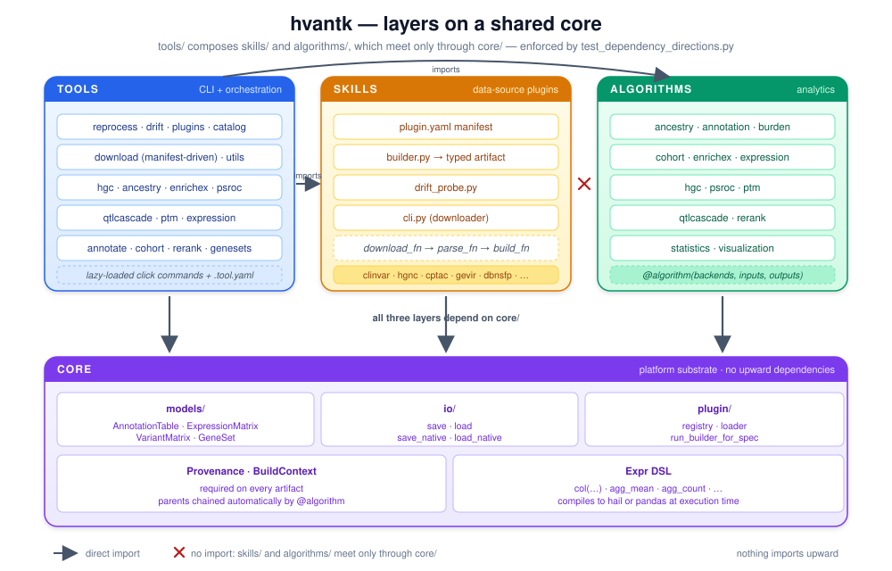

[](https://github.com/bigbio/hvantk/releases/latest)
[](https://github.com/bigbio/hvantk/actions/workflows/python-package.yml)
[](https://github.com/bigbio/hvantk/actions/workflows/python-package-conda.yml)
[](https://github.com/bigbio/hvantk/actions/workflows/drift.yml)
[](https://github.com/bigbio/hvantk/actions/workflows/python-package.yml)
[](LICENSE)
[](https://bigbio.github.io/hvantk)

# hvantk

**Hail-based toolkit for multi-omics variant annotation and analysis.**

`hvantk` turns public omics resources (variants, genes, proteins and expression) into
datasets with provenance, and integrates them in analysis tools that help
interpret genetic variants. It uses [Hail](https://hail.is/) for genome-scale tables and
[AnnData](https://anndata.readthedocs.io/) for expression matrices.

- **Data-source plugins.** More than 20 [sources](docs_site/guide/data-sources.md), among
  them ClinVar, gnomAD, GTEx, UniProt and Expression Atlas. Each one builds with one
  command, `hvantk reprocess <provider>:<dataset>`.
- **Provenance on every dataset.** A build records its source fingerprint, schema,
  builder commit and parameters, and a derived dataset keeps its parents.
- **Drift detection.** `hvantk drift` compares a source's live fingerprint with the
  committed one. A scheduled job re-checks every source twice a month and opens pull
  requests for what changed.
- **Analysis tools.** Joint genotyping, ancestry inference, QTL cascades, enrichment and
  burden tests, PTM variant classification, pathogenicity-score evaluation and multi-omic
  gene re-ranking.

## Installation

Requires Python 3.10–3.12, Java 8 or 11 (for Hail and Spark) and
[Poetry](https://python-poetry.org/) 2.x.

```bash
git clone https://github.com/bigbio/hvantk
cd hvantk
poetry install
eval "$(poetry env activate)"
hvantk utils check-install   # verify the install
```

The base install is lean. Plotting, machine-learning and a few provider-specific
dependencies are opt-in extras: `poetry install --extras "ancestry psroc"`, or
`poetry install --all-extras` for everything.
[Installation → Optional features](docs_site/getting-started/installation.md#optional-features-extras)
lists what each extra adds and which commands need it.

## Quick start

```bash
# Every data source and its datasets
hvantk plugins list

# Download, parse and build the HGNC gene table, then check its source for drift
hvantk reprocess hgnc:lookup --raw-dir data/hgnc --output hgnc.ht
```

The output is a Hail table with a `.provenance.json` sidecar. The
[Usage Guide](docs_site/guide/usage.md) covers the analysis tools.

## Toolkit

| Tool | Description | Command | Docs |
|------|-------------|---------|------|
| **Downloads** | Acquire external datasets (ClinVar, ClinGen, HGNC, etc.) | `hvantk download <source>` | [Data Sources](docs_site/guide/data-sources.md) |
| **Dataset builds** | Build any plugin dataset (download → parse → build → drift check) | `hvantk reprocess <plugin>:<dataset>` | [Usage Guide](docs_site/guide/usage.md) |
| **HGC** | Joint genotyping pipeline (GVCF combining, QC, format conversion) | `hvantk hgc` | [HGC](docs_site/tools/hgc.md) |
| **Ancestry** | Ancestry inference (PCA + Random Forest classification) | `hvantk ancestry-inference` | [Ancestry](docs_site/tools/ancestry.md) |
| **QTL Cascade** | Molecular QTL integration (eQTL + pQTL cascade, colocalization ABF) | `hvantk qtlcascade` | [QTL Cascade](docs_site/tools/qtlcascade.md) |
| **EnrichEx** | Gene set enrichment (overlap testing + rare variant burden) | `hvantk enrichex` | [EnrichEx](docs_site/tools/enrichex.md) |
| **PS-ROC** | Pathogenicity score ROC evaluation against ClinVar labels | `hvantk psroc` | [PS-ROC](docs_site/tools/psroc.md) |
| **PTM** | Post-translational modification variant classification | `hvantk ptm` | [PTM](docs_site/tools/ptm.md) |
| **Expression** | Expression analysis (summarize, marker extraction) | `hvantk expression` | [Usage Guide](docs_site/guide/usage.md) |
| **Annotate** | Build the gene spine, map sources onto it, compose a gene × feature matrix | `hvantk annotate` | [Usage Guide](docs_site/guide/usage.md#gene-level-annotation-matrices) |
| **Cohort** | Validate and attach external cohorts | `hvantk cohort` | [Usage Guide](docs_site/guide/usage.md#external-cohorts) |
| **Re-rank** | Re-rank genes by multi-omic credibility from a YAML config | `hvantk rerank` | [Re-rank](docs_site/tools/rerank.md) |
| **Gene sets** | Extract or prepare GeneSetCollection files from curated tables | `hvantk genesets` | [Usage Guide](docs_site/guide/usage.md) |

Plus the registry and operational commands: `hvantk plugins` and `hvantk tools` (inspect the
plugin and tool registries), `hvantk catalog` (search the aggregated dataset catalog),
`hvantk drift` (compare a plugin's live source fingerprint against the committed one),
and `hvantk utils` (format conversion, BGZF validation, install diagnostics).

## Architecture

`hvantk` is organized in four code layers (`core/`, `algorithms/`, `skills/`, `tools/`)
plus a substrate-level data registry (`resources/`). Imports flow one way, enforced by
[`hvantk/tests/test_dependency_directions.py`](hvantk/tests/test_dependency_directions.py):
`tools/` composes `skills/` and `algorithms/`, and those two never import each other.
They meet only through the dataset types in `core/`.

<p align="center">
  
</p>

A data-source adapter in `skills/` can break when its upstream changes without breaking
any algorithm, and `algorithms/` evolve without touching the adapters. `core/` and
`resources/` are the stable substrate; neither imports upward.

### Data model

Four dataset types live in [`hvantk/core/models/`](hvantk/core/models/), each backed by
a native engine:

| Dataset type | Backends | On-disk format | Used for |
|---|---|---|---|
| [`AnnotationTable`](hvantk/core/models/annotation_table.py) | `hail` / `pandas` | `.ht/` or `.parquet` | variants, gene-disease pairs, eQTLs, PTM sites |
| [`ExpressionMatrix`](hvantk/core/models/expression_matrix.py) | `anndata` | `.h5ad` | bulk + single-cell expression, proteomics matrices |
| [`VariantMatrix`](hvantk/core/models/variant_matrix.py) | `hail-mt` | `.mt/` | multi-sample variant cohorts (genotypes × samples × multi-field entries) |
| [`GeneSet`](hvantk/core/models/gene_set.py) | (in-memory `frozenset`) | `.geneset.json` | curated gene collections (ClinGen, GenCC, COSMIC CGC, MSigDB, …) |

Every dataset carries a [`Provenance`](hvantk/core/models/provenance.py) record: where it
came from (its dataset id, such as `clinvar:variants`, and the source fingerprint), its
schema id, the builder commit, build parameters and timestamp, and a `parents` chain. The
`@algorithm` decorator stamps input provenances onto output datasets, so the build graph
is preserved end to end.

`AnnotationTable` exposes a portable query API (`filter`, `select`, `join`,
`with_columns`, `group_by().agg()`) through the [`col(...)`](hvantk/core/models/_expr.py)
expression DSL, compiled to Hail or pandas at execution time. When an algorithm needs the
raw native object, [`core_io.load_native(path)`](hvantk/core/io/__init__.py) returns
`(native_obj, Provenance)` at no cost.

### Plugin contract

Each data source is a self-contained plugin under `hvantk/skills/<plugin>/`, declared by a
[`plugin.yaml`](hvantk/skills/clinvar/plugin.yaml) manifest that names its builder, drift
probe and, where the source allows an automated fetch, its downloader. Sources behind a
licence gate, or too large to mirror, document their acquisition instead.
[`run_builder_for_spec`](hvantk/core/plugin/run_builder.py) computes the source
fingerprint, calls the builder, validates the built dataset against the manifest's
`artifact_type` and `schema_id`, and saves it with a `.provenance.json` sidecar. The
loader discovers manifests on its own; there is no registry to edit.

The [architecture guide](docs_site/architecture.md#3-plugin-contract--adding-a-data-source)
has the build sequence, an annotated `plugin.yaml`, the two-pass loader and the
[project structure](docs_site/architecture.md#project-structure).

### How to extend

| Add | Where | Pattern |
|---|---|---|
| A new data source | `hvantk/skills/<plugin>/` | Write `plugin.yaml` + `builder.py` (returns one of the four dataset types) + `drift_probe.py`. The loader discovers it. |
| A new algorithm | `hvantk/algorithms/<domain>/` | Decorate with `@algorithm(name=…, backends=[…], inputs={…}, outputs={…})`. Operate on dataset inputs (or use `load_native` for Hail-heavy work). |
| A new CLI command | `hvantk/tools/<domain>/` | Add the click command, a `.tool.yaml` manifest and an entry in `_LAZY_COMMANDS` in `hvantk/hvantk.py`, so the command's imports load only when it runs ([details](docs_site/architecture.md#adding-a-new-cli-command)). |
| A new on-disk format | `hvantk/core/io/_formats.py` + dispatch in `__init__.py` | Add `save_<type>_<ext>` / `load_<type>_<ext>`. |

## Documentation

**Full docs site:** [https://bigbio.github.io/hvantk](https://bigbio.github.io/hvantk)

- [Data Sources](docs_site/guide/data-sources.md): available annotations and how to acquire them
- [Usage Guide](docs_site/guide/usage.md): dataset builds and the analysis tools
- [Examples](docs_site/examples/index.md): tutorials and walkthroughs for each tool
- [Architecture](docs_site/architecture.md): design patterns and extension points
- [Changelog](CHANGELOG.md): what changed in each release

## Citation

If you use hvantk in your research, please cite:

```bibtex
@software{hvantk2024,
  title = {hvantk: Hail-based toolkit for multi-omics variant annotation and analysis},
  author = {Perez-Riverol, Yasset and Audain, Enrique},
  year = {2024},
  url = {https://github.com/bigbio/hvantk}
}
```

## Contributing

See [CONTRIBUTING.md](CONTRIBUTING.md) for the development workflow, code style and tests
(`pytest -q` runs the fast suite).

## License

MIT License. See [LICENSE](LICENSE).

## Support

- [GitHub Issues](https://github.com/bigbio/hvantk/issues)
- [Documentation](https://bigbio.github.io/hvantk)
