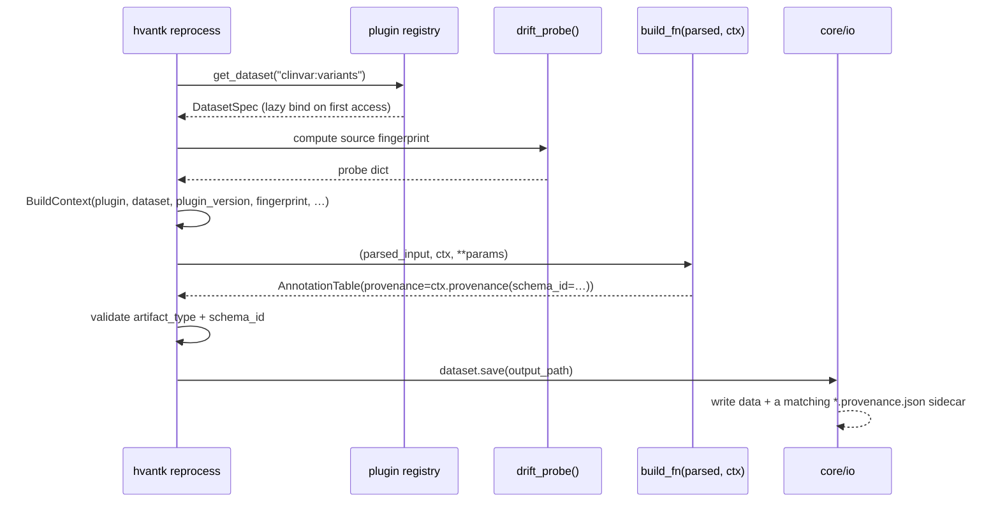

# hvantk Architecture

## Overview

`hvantk` is a multi-omics variant annotation toolkit. It is organized as a
five-package layout — four code layers (`core/`, `algorithms/`, `skills/`,
`tools/`) plus a substrate-level data registry (`resources/`) — with a
strict one-way dependency rule enforced by
[`hvantk/tests/test_dependency_directions.py`](https://github.com/bigbio/hvantk/blob/main/hvantk/tests/test_dependency_directions.py):

<p align="center">
  
</p>

`resources/` is a peer of `core/` (not a layer above it): both are
substrate that the code layers depend on, neither imports upward.
Placement rule: dataset-registry JSON, JSON schemas, and the validator /
aggregator code that operates on them go in `resources/`. Per-plugin
catalog JSON (`skills/<provider>/catalog/datasets.json`) stays with its
plugin and is aggregated by `resources/unified_registry.py`. See
[Resources](#resources-module-resources) below for the full rule.

Design priorities:

1. **Stable contracts** — algorithms consume datasets; source adapters can
   rot when upstream APIs change without breaking analysis code.
2. **Manifest-driven** — plugins declare themselves via `plugin.yaml`; the loader
   discovers descriptively first (no imports), binds executable callables lazily.
3. **Provenance everywhere** — every dataset carries a `Provenance` (plugin,
   dataset, plugin version, source fingerprint, schema id, build timestamp,
   derivation parents).
4. **Backend-portable + native escape hatch** — the dataset API works on either
   Hail or pandas; algorithms that legitimately need raw Hail use
   `core_io.load_native` / `save_native` (zero-cost passthrough with provenance).

## Project Structure

```text
hvantk/
├── hvantk.py / __main__.py   # CLI entry point (aggregates all subcommands)
│
├── core/                     # L1: shared infrastructure (no domain logic)
│   ├── config.py                 # Configuration management
│   ├── io/                       # Dataset load/save (Hail, AnnData) + load_native/save_native
│   │   ├── anndata_io.py            # AnnData on-disk I/O
│   │   └── legacy_artifacts.py      # Legacy loader for pre-plugin Hail Tables
│   ├── tool/                     # Tool-manifest system (hvantk tools list/describe; metadata only)
│   │   ├── api.py                   # Stable tool contracts
│   │   └── loader.py                # Tool manifest discovery
│   ├── models/                   # Dataset types: AnnotationTable, ExpressionMatrix,
│   │   │                         #   VariantMatrix, GeneSet, Provenance, BuildContext, col() DSL
│   │   ├── annotation_table.py      # AnnotationTable dataset type
│   │   ├── expression_matrix.py     # ExpressionMatrix dataset type (AnnData-only)
│   │   ├── variant_matrix.py        # VariantMatrix dataset type (Hail MatrixTable)
│   │   ├── gene_set.py              # GeneSet dataset type
│   │   ├── artifact.py              # Artifact union of the four dataset types above
│   │   ├── backends.py              # AlgorithmMeta, Backend, @algorithm decorator
│   │   ├── build_context.py         # BuildContext passed to plugin builders
│   │   ├── anndata_utils.py         # annotate_column_summary_ad (AnnData obs summary)
│   │   ├── provenance.py            # Provenance: source-fingerprint stamping
│   │   └── _expr.py                 # col() expression DSL, compiled to either backend
│   ├── plugin/                   # Plugin system
│   │   ├── api.py                   # Provider, DatasetSpec, PROBE_FINGERPRINT_IGNORED_KEYS
│   │   ├── loader.py                # Plugin discovery (filesystem + entry points)
│   │   ├── run_builder.py           # run_builder_for_spec() — build orchestrator
│   │   ├── drift_runner.py          # Drift probe execution
│   │   ├── drift_ledger.py          # Rebuild-ledger rows (shared by drift --regenerate and the drift bot)
│   │   └── skill_spec.py            # SKILL.md's nine-section contract, checked as code
│   ├── utils/                    # Cross-cutting utilities
│   │   ├── hail_context.py          # Idempotent Hail init
│   │   ├── hail_helpers.py          # create_table_base, cleanup_temp_file
│   │   ├── qtl_helpers.py           # GTEx variant-ID parsing (shared by eqtl/pqtl)
│   │   ├── raw_inputs.py            # Resolve a no-parse dataset's raw input file
│   │   ├── lazy_exports.py          # PEP 562 lazy package exports
│   │   ├── bgzf.py                  # BGZF utilities
│   │   ├── file_utils.py            # File I/O helpers
│   │   ├── gene_sets.py             # Gene set utilities
│   │   ├── geneset_io.py            # Gene set parsing / validation
│   │   ├── genome.py                # Genome/contig utilities (contig_recoding)
│   │   ├── table_utils.py           # Hail Table manipulation helpers
│   │   └── http.py                  # Retrying HTTP helper (drift probes, downloaders)
│   ├── streamers/                # Base streamer classes (consumed by algorithms/ + skills/)
│   │   ├── gene_disease_table.py    # GeneDiseaseTableStreamer (clingen/gencc/cosmic-cgc base)
│   │   ├── variant_table.py         # VariantTableStreamer (clinvar base)
│   │   └── gene_catalog.py          # GeneCatalogStreamer (hgnc base)
│   └── ontology/                 # OBO / MONDO ontology parsers
│       ├── obo.py                   # Generic OBO parser
│       └── mondo.py                 # MONDO disease-category map (MONDO_DISEASE_CATEGORIES)
│
├── algorithms/                # Analysis pipelines (consume datasets)
│   ├── ancestry/                  # Population ancestry inference
│   ├── annotation/                # Variant annotation pipeline
│   ├── burden/                    # Rare-variant burden testing
│   ├── cohort/                    # External cohort validation + attachment
│   ├── enrichex/                  # Gene set enrichment + burden analysis
│   ├── expression/                # Expression (AnnData) processing
│   ├── hgc/                       # Joint genotyping (HGC) pipeline
│   ├── psroc/                     # Pathogenicity score ROC evaluation
│   ├── ptm/                       # Post-translational modification analysis
│   ├── qtlcascade/                # QTL cascade analysis
│   ├── rerank/                    # Multi-omic gene re-ranking
│   ├── statistics/                # Statistical utilities
│   └── visualization/             # Shared visualization helpers
│
├── skills/                    # Per-provider data plugins (21 providers; a selection is
│   │                          #   shown -- see "Current providers" below for the full list)
│   ├── _conventions/              # Shared plugin contract (SKILL.md)
│   ├── _hooks/                    # Plugin lifecycle hooks
│   ├── clingen/                   # ClinGen gene-disease validity
│   ├── clinvar/                   # ClinVar variant annotations
│   ├── cptac/                     # CPTAC proteomics (expression/, phospho/)
│   ├── expression_atlas/          # Expression Atlas bulk RNA-seq
│   ├── gencc/                     # GenCC gene-disease assertions
│   ├── gtex_eqtl/                 # GTEx eQTL data
│   ├── gwas_catalog/              # GWAS Catalog
│   ├── hgnc/                      # HGNC gene nomenclature
│   ├── insider/                   # INSIDER protein-protein interaction sites
│   ├── msigdb/                    # MSigDB gene sets
│   ├── peptideatlas/              # PeptideAtlas proteomics
│   ├── ucsc_cellbrowser/          # UCSC Cell Browser single-cell RNA-seq
│   └── uniprot_ptm/               # UniProt PTM annotations
│
├── tools/                     # CLI command implementations
│   ├── plugins/                   # hvantk reprocess / drift / plugins / tools commands
│   ├── infra/                     # Installation check, BGZF validation, utils
│   ├── hgc/                       # HGC CLI subcommands
│   ├── genesets/                  # Gene set extraction/preparation
│   ├── training_sets/             # Training-set construction (library; no CLI command yet)
│   ├── ancestry/                  # Ancestry CLI subcommands
│   ├── annotation/                # Annotation CLI subcommands
│   ├── cohort/                    # Cohort validate / burden / attach
│   ├── enrichex/                  # EnrichEx CLI subcommands
│   ├── expression/                # Expression analysis commands
│   ├── ptm/                       # PTM CLI subcommands
│   ├── qtl/                       # QTL CLI subcommands
│   └── rerank/                    # Re-ranking CLI
│
├── resources/                  # Substrate: data catalog and schemas
│   ├── schemas/                    # JSON schema definitions
│   ├── ensembl_release.py          # Pinned Ensembl release / GTF URL
│   ├── drift_ledger.json           # Rebuild ledger: one row per accepted fingerprint bump
│   └── unified_registry.py         # Aggregates the per-plugin catalog/datasets.json files
│
└── tests/                      # Top-level test suite (see Testing Strategy below)
    ├── conftest.py                 # Pytest fixtures (hail_session, etc.)
    ├── testdata/                   # Shared test data fixtures
    └── test_*.py                   # Unit and integration tests
```

## Module Details

Purpose and key contents of each top-level package. See Project Structure
above for the full file layout.

### Core Module (`core/`)

Shared infrastructure used by every other layer: no domain logic. Holds
configuration (`config.py`), the four dataset types and their provenance /
build-context plumbing (`models/`), the plugin and tool manifest systems
(`plugin/`, `tool/`), the dataset I/O layer (`io/`), and cross-cutting
helpers (`utils/`, `streamers/`, `ontology/`).

### Skills Module (`skills/`)

Per-provider data plugins. Each provider folder contains `plugin.yaml`,
`builder.py`, `cli.py`, `drift_probe.py`, `SKILL.md`, `catalog/datasets.json`,
and `tests/`. Multi-dataset providers (e.g., `cptac/`) have one sub-folder per
dataset.

**Current providers** (21): `alphagenome`, `clingen`, `clinvar`, `cosmic_cgc`,
`cptac`, `dbnsfp`, `ensembl_gene`, `expression_atlas`, `gencc`, `gevir`,
`gnomad_metrics`, `gtex_eqtl`, `gwas_catalog`, `hgnc`, `insider`, `msigdb`,
`onek_genomes`, `peptideatlas`, `pqtl`, `ucsc_cellbrowser`, `uniprot_ptm`.

Each plugin's builder returns one of the four dataset types — see
[Dataset Contract](#2-dataset-contract) below for how each is keyed and
stored.

### Tools Module (`tools/`)

Top-level CLI command implementations.

**Key sub-packages**:
- `plugins/` - `hvantk reprocess`, `hvantk drift`, `hvantk plugins list/describe/errors/validate`,
  `hvantk tools list/describe/errors/validate`
- `hgc/` - HGC joint genotyping subcommands (combine, convert, QC, pipeline)
- `genesets/` - Gene set extraction/preparation
- `training_sets/` - Training-set construction (library only; no CLI command yet)
- `ancestry/`, `annotation/`, `cohort/`, `enrichex/`, `expression/`, `ptm/`, `qtl/`, `rerank/` -
  Per-pipeline CLI subcommands
- `infra/` - Installation check, BGZF validation, utils

### Resources Module (`resources/`)

**Purpose**: Substrate-level data registry and schema definitions.
Peer of `core/`, not a layer above it.

**Contents**:
- `unified_registry.py` - `HvantkRegistry` aggregator surfaced via `hvantk catalog {list,show,stats,search}`. Reads the per-plugin catalog JSON under `skills/<provider>/catalog/` declared via each plugin's `plugin.yaml`; there is no legacy fallback.
- `schemas/` - JSON schema definitions (`cohort_manifest.schema.json`, `feature_spec.schema.json`, `selection_policy.schema.json`), each read directly by its consumer via `jsonschema.validate()` -- e.g. `hvantk/algorithms/cohort/spec.py`, `hvantk/algorithms/annotation/spec.py`, `hvantk/algorithms/rerank/selection.py`.
- Catalog entries are validated separately: `hvantk plugins validate` (`hvantk/tools/plugins/plugins_cli.py`) checks each `catalog/datasets.json` entry against `hvantk/core/plugin/catalog_entry.schema.json`.

**Placement rule** (what goes here vs. nearby alternatives):

| Lives in | Use for |
|---|---|
| `resources/schemas/` | JSON schemas that describe catalog / dataset metadata, shared across plugins. |
| `resources/unified_registry.py` | Code that aggregates per-plugin catalog JSON declared via each plugin's `plugin.yaml`. |
| `skills/<provider>/catalog/datasets.json` | Per-plugin dataset metadata (the canonical location for new providers). |
| `core/models/` | Dataset types (`AnnotationTable`, `ExpressionMatrix`, `VariantMatrix`, `GeneSet`) — runtime data shapes, not catalog metadata. |

**Dependency direction**: `resources/` may be imported by `algorithms/`,
`skills/`, and `tools/`. It must NOT import from any of those — like
`core/`, it is substrate. This is enforced by
`test_resources_does_not_import_upward` in
[`hvantk/tests/test_dependency_directions.py`](https://github.com/bigbio/hvantk/blob/main/hvantk/tests/test_dependency_directions.py).

## Design Principles

### 1. Domain Separation

The codebase is organized by function and biological domain:

**Data Builders** (`skills/<provider>/builder.py`):
- Each plugin under `hvantk/skills/` owns its plugin builder
  (`build_<provider>_<dataset>`). Builders return `AnnotationTable`,
  `ExpressionMatrix`, `VariantMatrix`, or `GeneSet` datasets, stamped
  with `Provenance` by the platform via `run_builder_for_spec`.
- `hvantk reprocess <provider>:<dataset>` is the **only** public build
  path. There is no separate programmatic API; in-process callers that
  need to build a table inside a tool/pipeline invoke
  `hvantk.core.plugin.run_builder.run_builder_for_spec` directly.
- Generic Hail helpers live in `hvantk/core/utils/hail_helpers.py`
  (`create_table_base`, `cleanup_temp_file`); QTL-shared helpers in
  `hvantk/core/utils/qtl_helpers.py`.

**Analysis Pipelines** (separate modules under `algorithms/`, highlights):
- `hgc/` - Joint genotyping and cohort analysis
- `ancestry/` - Population ancestry inference
- `psroc/` - Pathogenicity score evaluation
- `enrichex/` - Gene set enrichment analysis
- `ptm/` - Post-translational modification variant classification. Includes
  `constraint.py` + helpers for the stratified AF-depletion analysis
  (`hvantk ptm constraint`), a tissue/cell-type-aware complement to
  `landscape` and `population`.

**Data Product Keying**:
- **Variants** - Keyed by `(locus, alleles)`
- **Genes** - Keyed by `gene_id`
- **Proteins** - Keyed by `protein_id` or `interval`
- **Expression** - AnnData matrices (`.h5ad`) with rows=samples/cells (`obs`), columns=genes (`var`)

### 2. Dataset Contract

Every data product is one of four dataset types in
[`hvantk/core/models/`](https://github.com/bigbio/hvantk/tree/main/hvantk/core/models):

| Dataset type | Backends | On-disk format | Used for |
|---|---|---|---|
| `AnnotationTable` | `hail` / `pandas` | `.ht/` or `.parquet` | variants, gene-disease pairs, eQTLs, PTM sites |
| `ExpressionMatrix` | `anndata` | `.h5ad` | bulk + single-cell expression, proteomics matrices |
| `VariantMatrix` | `hail-mt` | `.mt/` | multi-sample variant cohorts (genotypes × samples × multi-field entries) |
| `GeneSet` | (in-memory `frozenset`) | `.geneset.json` | curated gene collections |

Each dataset carries a `Provenance` record: `plugin`, `dataset`,
`plugin_version`, `source_fingerprint`, `schema_id`, `build_timestamp`,
`builder_commit`, an optional `build_parameters` dict, and `parents` (the
input datasets' provenances, for lineage). The `@algorithm` decorator chains
input provenances onto output datasets automatically, so the build graph is
preserved end-to-end.

`AnnotationTable` exposes a **portable query API** (`filter`, `select`, `join`,
`with_columns`, `group_by().agg()`) via the [`col(...)`](https://github.com/bigbio/hvantk/blob/main/hvantk/core/models/_expr.py)
expression DSL compiled to either backend at execution time. Algorithms
can be written backend-agnostically:

```python
from hvantk.core.models import AnnotationTable, col

def filter_high_impact(ann: AnnotationTable) -> AnnotationTable:
    return ann.filter((col("score") > 0.5) & (col("chrom") == "chr17"))
```

When an algorithm legitimately needs the raw native object (Hail-distributed
joins, genotype matrices), use the **native passthrough**:

```python
from hvantk.core import io as core_io

# zero-cost when backend matches file format
ht, source_prov = core_io.load_native("variants.ht")  # → hl.Table
filtered = ht.filter(ht.AC > 0)
core_io.save_native(filtered, "filtered.ht", provenance=Provenance(
    ..., parents=(source_prov,)
))
```

### 3. Plugin Contract — adding a data source

Each plugin under `hvantk/skills/<plugin>/` declares itself via `plugin.yaml`
and provides a builder that returns a dataset. The platform's
`run_builder_for_spec` orchestrates the build:



A minimal `plugin.yaml`:

```yaml
api_version: 2
name: my-source
version: 0.1.0
description: My data source — variant table

datasets:
  - name: variants
    domain: genomics
    backend: hail
    artifact_type: AnnotationTable
    schema_id: my-source-variants-v1
    builder:
      module: hvantk.skills.my_source.builder
      function: build_my_source_variants
    drift_probe:
      module: hvantk.skills.my_source.drift_probe
      function: fetch_fingerprint
    skill: SKILL.md
    tests:
      command: pytest hvantk/skills/my_source/tests -m hail
      fixture: tests/testdata/raw/my-source
      schema_snapshot: tests/snapshots/schema.json
      row_snapshot: tests/snapshots/sample_rows.json
      drift_fingerprint: tests/drift_fingerprint.json

cli:
  - command: my-source-download
    module: hvantk.skills.my_source.cli
    function: download_cmd
```

A matching builder:

```python
# hvantk/skills/my_source/builder.py
import hail as hl
from hvantk.core.models import AnnotationTable, BuildContext

def build_my_source_variants(parsed_input, ctx: BuildContext, **params) -> AnnotationTable:
    ht = hl.import_vcf(str(parsed_input), force=True).rows().key_by("locus", "alleles")
    return AnnotationTable.from_hail(
        ht, provenance=ctx.provenance(schema_id="my-source-variants-v1")
    )
```

A shipped one to copy from: `hvantk/skills/clinvar/builder.py` defines
`build_clinvar`, which `hvantk/skills/clinvar/plugin.yaml` binds to the
`clinvar:variants` dataset under schema `clinvar-variants-v1`. The builder name
is whatever `plugin.yaml`'s `builder.function` declares — plugins in the tree use
both the short form (`build_clinvar`) and the per-dataset form
(`build_clingen_gene_disease`).

The plugin loader (`hvantk/core/plugin/loader.py`) discovers manifests via a
**two-pass mechanism**:

1. **Pass 1 (descriptive, eager)** — reads YAML, populates `DatasetManifest`.
   No imports. `registry.list_manifests()` works without optional runtimes.
2. **Pass 2 (executable, lazy)** — on first `get_dataset(name)`, imports the
   builder/probe modules and caches a `DatasetSpec`. Missing optional
   runtimes only affect the *single* dataset that needs them.

Downloader CLI commands are wired automatically from the manifest's `cli:`
block — no manual edits in `hvantk/tools/plugins/download_cli.py` needed.
A `cli:` entry whose module does not import is left out of `hvantk download`
and reported by `hvantk plugins errors` as a `cli:<command>` row, whether or not
`hvantk download` has run; so is an entry that repeats a command name already
declared in the same manifest or by another provider, which is refused at load. `hvantk drift` ignores those rows: they describe a
command, and a dataset that fails along with it has a row of its own.

Of the `hvantk plugins` commands, only `errors` signals load failures through its
exit code: it exits 1 when it lists anything. `list` and `describe` are
informational and exit 0 when some units failed to load — `list` prints a one-line
summary on stderr and `describe` marks a dataset `FAILED TO LOAD` — and `describe`
exits 1 only for a provider that is unknown or failed to load as a whole.

### Streamer Placement Rule

Streamers (classes that yield batches over a built table) are split between a
**base class** that lives above the skills layer and **per-provider subclasses**
that ship with their plugin. This keeps the one-way
`skills → algorithms → tools` dependency direction clean: the sibling-skill
rule (`skills/X` cannot import from `skills/Y`) forces any base class shared by
multiple skills to live in `core/streamers/`.

| Streamer kind | Lives in | Example |
|---|---|---|
| Shared base class | `core/streamers/` | `GeneDiseaseTableStreamer` (`gene_disease_table.py`), `VariantTableStreamer` (`variant_table.py`), `GeneCatalogStreamer` (`gene_catalog.py`) |
| Per-provider subclass | `skills/<provider>/streamers.py` | `ClinGenGeneDiseaseTableStreamer` (`clingen/streamers.py`), `GenCCGeneDiseaseTableStreamer` (`gencc/streamers.py`), `ClinVarVariantTableStreamer` (`clinvar/streamers.py`) |

### 4. CLI-First Design

The primary interface is a well-structured CLI with domain-specific commands:

```bash
# Download data
hvantk download ucsc --dataset adultPancreas --output-dir data/

# Build any dataset (full pipeline: download -> parse -> build -> drift check)
hvantk reprocess clinvar:variants --raw-dir data/ --output clinvar.ht
hvantk reprocess ucsc-cellbrowser:default --raw-dir data/ --output ucsc.h5ad \
  --plugin-arg dataset=adultPancreas

# Joint genotyping (HGC)
hvantk hgc gvcf-combine -g /data/gvcfs -o cohort.vds
hvantk hgc compute-qc -i cohort.mt -o qc_results/
```

### 5. Data Flow Patterns

#### Pattern 1: Builder → Table
```
Raw File (VCF/TSV/BED) → Builder → Hail Table → Disk (.ht)
```

Example:
```bash
# The reprocess CLI runs the full build pipeline: download → parse → build → drift-check
hvantk reprocess clinvar:variants --raw-dir data/ --output clinvar.ht
```
In-process callers drive the same plugin builder via
`run_builder_for_spec(spec, *, parsed_input, output_path, plugin_version, builder_commit=None, **params)`
(in `hvantk/core/plugin/run_builder.py`), which takes a resolved `DatasetSpec`
and returns the stamped `Provenance`. Left at `None`, `builder_commit` records the
hvantk code that ran (how it is found:
[Existing output and provenance](guide/usage.md#existing-output-and-provenance)).

#### Pattern 2: Multi-Omics Integration
```
Variant Table + Gene Table + Expression Matrix → Integrated Analysis
```

Variant and gene tables are Hail; expression is AnnData (`ExpressionMatrix`
is AnnData-only — see Dataset Contract above):

```python
import hail as hl
import anndata as ad

variants = hl.read_table("data/clinvar.ht")
genes = hl.read_table("data/ensembl.ht")  # keyed by gene_id; also carries gene_name
expression = ad.read_h5ad("data/ucsc.h5ad")  # obs=cells/samples, var=genes

# ClinVar has no gene_id: take the first gene symbol from info.GENEINFO
# ("SYMBOL:GENEID|...") and join the Ensembl table on its gene_name column.
variants = variants.annotate(
    gene_symbol=hl.if_else(
        hl.is_defined(variants.info.GENEINFO) & (hl.len(variants.info.GENEINFO) > 0),
        variants.info.GENEINFO.split(":")[0],
        hl.missing(hl.tstr),
    )
)
annotated = variants.annotate(gene=genes.key_by("gene_name")[variants.gene_symbol])

# Pull expression for a gene of interest from the AnnData var/X arrays --
# a different backend, not a Hail join. See algorithms/rerank and
# algorithms/qtlcascade for real multi-backend integration pipelines.
gene_col = expression.var_names.get_loc("BRCA1")
mean_expression = expression.X[:, gene_col].mean()
```

## Testing Strategy

Tests mirror the module structure. Top-level suites run from
[`hvantk/tests/`](https://github.com/bigbio/hvantk/tree/main/hvantk/tests):
`conftest.py` provides shared fixtures (`hail_session`, etc.), `testdata/`
holds shared fixtures, per-domain subdirectories (`ancestry/`, `annotation/`,
`burden/`, `cohort/`, `enrichex/`, `hgc/`, `psroc/`, `rerank/`) hold that
domain's tests, and top-level `test_*.py` files check cross-cutting behavior
(plugin loading, dependency directions, CLI laziness, docs claims, and so on).

Every plugin additionally ships its own tests under
`hvantk/skills/<provider>/tests/` (fixtures under `testdata/raw/`, snapshots,
`test_builder.py`, `test_drift_probe.py`, …) — see
[Plugin Contract](#3-plugin-contract-adding-a-data-source) above and the
per-resource `SKILL.md` for the exact layout.

## Extension Points

### Adding a New Data Source

See the "Plugin Contract" section above for the full pattern. The minimal
checklist:

1. Create `hvantk/skills/<provider>/` with `plugin.yaml`, `builder.py` (returns
   `AnnotationTable` / `ExpressionMatrix` / `VariantMatrix` / `GeneSet` via `ctx.provenance(schema_id=…)`),
   `drift_probe.py`, `SKILL.md`, `catalog/datasets.json`, and `tests/`.
2. Loader picks it up automatically — no edits to `hvantk/hvantk.py` or
   `hvantk/tools/plugins/download_cli.py` required.
3. CLI downloader command is wired from the manifest's `cli:` block.
4. Add a conformance test using the `run_builder_for_spec` orchestrator
   (see `hvantk/tests/test_plugin_conformance.py` for the template), and a
   round-trip test tagged `@pytest.mark.round_trip("<provider>:<dataset>")`
   (one id per collected test item), with no `skip`/`skipif` marker and
   marked `hail` for a `backend: hail` dataset
   (`hvantk/tests/test_plugin_contract_artifacts.py` replays the manifest's
   `tests.command` to check this; `--require-round-trips` also fails a run
   on a real skip/xfail that collection cannot see).
5. Run `hvantk plugins list` — your plugin should appear — and
   `hvantk plugins errors`, which exits 1 if anything failed to load (`list`
   exits 0 regardless).

See `hvantk/skills/_conventions/SKILL.md` for the full contract, and
[Contributing](contributing.md#adding-a-new-data-provider-plugin) for the
full step-by-step checklist.

### Adding a New Algorithm

1. Place the algorithm body in `hvantk/algorithms/<domain>/`.
2. Decorate the entry point with `@algorithm`:
   ```python
   from hvantk.core.models.backends import Backend, algorithm

   @algorithm(
       name="my_algorithm",
       backends=[Backend.PANDAS],
       inputs={"data": "AnnotationTable", "gene_set": "GeneSet"},
       outputs={"result": "AnnotationTable"},
   )
   def my_algorithm(data, gene_set):
       ...
   ```
3. The decorator handles provenance chaining automatically. Output
   datasets inherit `parents = (data.provenance, gene_set.provenance)`.
4. For Hail-native algorithms, declare `required_backend="hail"` and use
   `core_io.load_native` to read inputs natively.

### Adding a New CLI Command

1. Place the click command in `hvantk/tools/<domain>/`.
2. Add a `<basename>.tool.yaml` manifest for discoverability via
   `hvantk tools list`. `test_lazy_commands_match_tool_manifests`
   (`hvantk/tests/test_tool_smoke.py`) requires the manifest's
   `(cli.module, cli.function, description)` to equal the `_LAZY_COMMANDS`
   entry below, so the two cannot drift apart silently.
3. Add an entry to `_LAZY_COMMANDS` in `hvantk/hvantk.py` — the command
    name mapped to `(module, attribute, short help)`:

    ```python
    "mycmd": (
       "hvantk.tools.mydomain.mycmd_cli",
       "mycmd_group",
       "One-line summary, matching the command's own short help.",
    ),
    ```

    Do **not** add a module-level `from hvantk.tools... import ...` plus
    `cli.add_command(...)`. `LazyGroup` still honours `add_command`, so that
    works — and silently costs every single invocation the import of whatever
    your command pulls in. That eager wiring is what made `hvantk --help` take
    ~10 s; going through `_LAZY_COMMANDS` keeps it at ~0.1 s because nothing is
    imported until the command is actually run. `test_every_command_is_lazy`
    (`hvantk/tests/test_import_laziness.py`) pins every top-level command to
    `_LAZY_COMMANDS`, so wiring one eagerly with `add_command` instead fails
    CI rather than silently costing startup time.

    The short help is duplicated in the registry because listing the commands
    must not import them. `test_lazy_command_registry_matches_real_commands`
    (`hvantk/tests/test_top_level_cli.py`) asserts your entry still matches the
    real command, so a later edit to the docstring fails CI rather than
    silently staling `hvantk --help`.

## Dependencies

- **Hail** - Distributed data processing framework
- **Click** - CLI framework
- **Pandas** - Data manipulation
- **PyYAML** - YAML manifest parsing (`plugin.yaml`)
- **Matplotlib/Seaborn/Plotly** - Visualization (optional)

## Performance Considerations

- **Partitioning**: Builders use appropriate partitioning for Hail operations
- **Checkpointing**: Large intermediate results are checkpointed
- **Memory**: HGC module optimized for memory-efficient large cohort processing
- **Caching**: Hail's lazy evaluation allows for optimization

## References

- [Hail Documentation](https://hail.is/docs/0.2/)
- [gnomAD Browser](https://gnomad.broadinstitute.org/)
- [UCSC Cell Browser](https://cells.ucsc.edu/)
