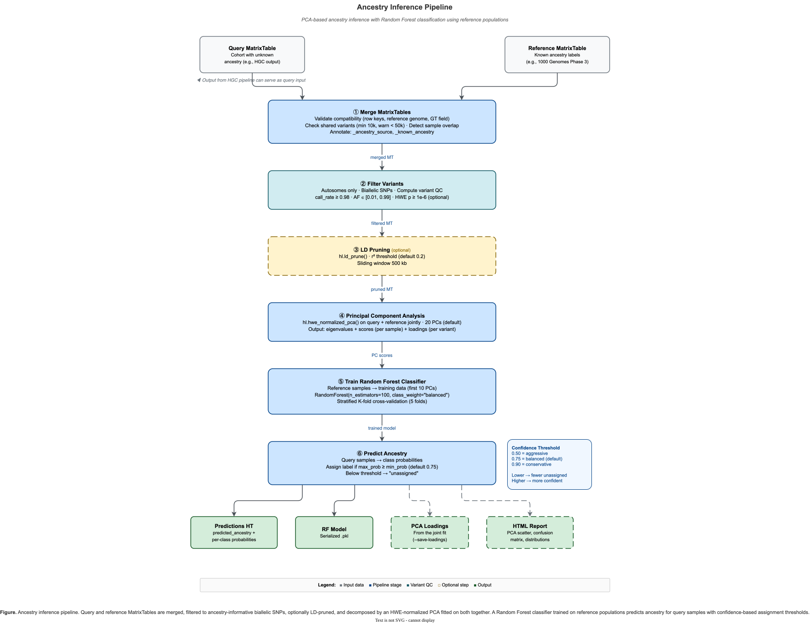

# Ancestry inference

`hvantk ancestry-inference` assigns a population label to each sample in a query cohort
by projecting it against a labeled reference panel (e.g. 1000 Genomes) with PCA, then
classifying with a Random Forest trained on the reference panel's known labels.



**Figure 1.** Ancestry inference: merge with the reference panel, variant filtering,
optional LD pruning, PCA fitted on query and reference together, Random Forest training
and prediction.

## Inputs

| | Row key | Column key | Required fields |
|---|---|---|---|
| Query MatrixTable | `(locus, alleles)` | `s` (sample ID) | `GT` genotype calls (or `LGT` + `LA`, auto-converted) |
| Reference MatrixTable | same as query | `s` | `GT`/`LGT` as above, plus a categorical ancestry-label column |

- Query and reference must use the **same reference genome** (GRCh37 or GRCh38) and the
  same row key structure; mismatches fail immediately with a descriptive error.
- The reference panel's ancestry-label column is named by `--ancestry-col`
  (`ancestry_col` in Python), default `ancestry`. It must be a column field on the
  reference MatrixTable, categorical (e.g. `"EUR"`, `"AFR"`, `"EAS"`, `"SAS"`, `"AMR"`),
  with at least 2 distinct populations and at least 10 samples per population (lower via
  `PipelineConfig(min_samples_per_pop=...)` in Python; there is no CLI flag for it).
- hvantk ships no reference panel. To build a 1000 Genomes high-coverage NYGC/CCDG
  MatrixTable and attach IGSR population labels (`super_pop`/`pop`) to use as
  `--ancestry-col`, see the
  [1000 Genomes example](https://github.com/bigbio/hvantk/tree/main/examples/1k_genome)
  and [Data sources](../guide/data-sources.md#1000-genomes-nygcccdg-high-coverage-callset).
  Other commonly used panels are 1000 Genomes Phase 3 (2,504 samples, 5
  super-populations) and HapMap Phase 3 (1,184 samples, 11 populations) — bring your own
  copy, keyed and labeled the same way.

## Quick start

```bash
hvantk ancestry-inference \
  -q cohort.mt \
  -r 1kg_reference.mt \
  --ancestry-col super_pop \
  -o ancestry_predictions.ht \
  --generate-report \
  --export-tsv
```

```python
import hail as hl
from hvantk.algorithms.ancestry import run_ancestry_inference

result = run_ancestry_inference(
    query_mt=hl.read_matrix_table("cohort.mt"),
    reference_mt=hl.read_matrix_table("1kg_reference.mt"),
    ancestry_col="super_pop",
    min_prob=0.75,
)

predictions = result.get_predictions_df()
print(predictions["predicted_ancestry"].value_counts())
result.save("results/ancestry")
```

## Method

1. **Merge.** Inner join query and reference on `(locus, alleles)`; keep only the `GT`
   entry field; column-union the samples, tagging each with its source (`query` or
   `reference`). Fails if there are 0 shared variants, or fewer than
   `--min-shared-variants` (default 10,000); warns below 50,000.
2. **Filter.** Restrict to autosomes (`locus.in_autosome()`), then biallelic SNPs, then
   apply Hail's `variant_qc`: call rate &ge; `--min-call-rate` (default 0.98) and
   *alternate*-allele frequency between `--min-af`/`--max-af` (default 0.01/0.99).
   An optional HWE filter (off by default; `--apply-hwe-filter`, p &ge; `--hwe-p`,
   default 1e-6) can additionally drop likely genotyping errors.
3. **LD prune** (skippable with `--skip-ld-pruning`). `hl.ld_prune` on `GT` with
   `r2` = `--ld-r2` (default 0.2) and `bp_window_size` = `--ld-window` (default 500,000).
4. **PCA.** `hl.hwe_normalized_pca` (Patterson et al., 2006) computes `--n-pcs`
   (default 20) principal components **jointly on the merged query+reference set** —
   this is not a projection of the query onto a reference-only PC space; query and
   reference samples share one PCA fit. Loadings are always computed in memory;
   `--save-loadings` / `result.loadings` persist them (see caveats below).
5. **Train.** A `RandomForestClassifier` (`n_estimators` = `--n-estimators`, default
   100; `random_state` = `--seed`, default 42) is fit on the **reference** rows' first
   `--n-pcs-classify` PC scores (default 10) against their known `--ancestry-col`
   labels. `max_features="sqrt"`, `min_samples_leaf=5`, `class_weight="balanced"` and
   `n_jobs=-1` are fixed and not configurable. Unless `--skip-validation`, a stratified
   `--n-cv-folds`-fold cross-validation (default 5) gives a held-out accuracy estimate;
   this raises if `n_cv_folds` exceeds the smallest population's sample count.
6. **Predict.** The fitted model scores the **query** rows' PC scores. A sample's label
   is the highest-probability class if that probability is &ge; `--min-prob` (default
   0.75), otherwise `"unassigned"`. Reference rows are also re-scored (with no
   threshold) for reporting and plotting — this is an in-sample fit, not the
   cross-validated estimate from step 5.

For a fixed reference PC space that later query batches project onto (the approach
gnomAD and similar projects use), call `compute_pca()` on the reference alone and
`project_samples()` with its loadings, instead of `run_ancestry_inference`'s joint PCA.
See [Python API](#python-api).

## Options

### Required

| Flag | Description |
|---|---|
| `-q`, `--query-mt` | Path to the query MatrixTable. |
| `-r`, `--reference-mt` | Path to the reference MatrixTable with known ancestry labels. |
| `-o`, `--output-ht` | Output path for the predictions Hail Table. |

### Reference panel and output

| Flag | Default | Description |
|---|---|---|
| `--ancestry-col` | `ancestry` | Column with ancestry labels in the reference MT. |
| `--output-dir` | `<output-ht parent>/ancestry_results` | Directory for TSV/model/report/stats outputs. |

### Variant filtering

| Flag | Default | Description |
|---|---|---|
| `--min-af` | `0.01` | Minimum alternate-allele frequency. |
| `--max-af` | `0.99` | Maximum alternate-allele frequency. |
| `--min-call-rate` | `0.98` | Minimum variant call rate. |
| `--apply-hwe-filter` | off | Apply a Hardy-Weinberg equilibrium filter. |
| `--hwe-p` | `1e-6` | HWE p-value threshold (variants below are removed). |

### LD pruning

| Flag | Default | Description |
|---|---|---|
| `--ld-r2` | `0.2` | LD pruning r² threshold. |
| `--ld-window` | `500000` | LD pruning window, in base pairs. |
| `--skip-ld-pruning` | off | Skip LD pruning (faster; may affect accuracy). |

### PCA and classification

| Flag | Default | Description |
|---|---|---|
| `--n-pcs` | `20` | Number of principal components to compute. |
| `--n-pcs-classify` | `10` | Number of PCs used as RF features (clamped to `--n-pcs` if larger). |
| `--n-estimators` | `100` | Number of trees in the Random Forest. |
| `--min-prob` | `0.75` | Minimum probability for an assignment; below this, `"unassigned"`. |
| `--seed` | `42` | Random seed. |

### Validation and merge

| Flag | Default | Description |
|---|---|---|
| `--skip-validation` | off | Skip cross-validation. |
| `--n-cv-folds` | `5` | Number of stratified CV folds. |
| `--min-shared-variants` | `10000` | Minimum shared query/reference variants required. |

### Output formats and checkpointing

| Flag | Default | Description |
|---|---|---|
| `--generate-report` | off | Write an HTML report (needs the visualization extras). |
| `--export-tsv` | off | Export predictions as TSV. |
| `--save-model` | off | Pickle the trained Random Forest. |
| `--save-loadings` | off | Write the PCA loadings Hail Table. |
| `--checkpoint-path` | none | Directory for intermediate checkpoints. |
| `--overwrite` | off | Overwrite existing outputs and checkpoints. |

There is no `--log-level` option. Verbosity is the top-level flag, which must come
before the subcommand: `hvantk -v ancestry-inference ...` (INFO) or
`hvantk -vv ancestry-inference ...` (DEBUG).

## Outputs

### Predictions Hail Table (`-o`/`--output-ht`)

Row-keyed by `s`, containing **both** query and reference samples
(`_ancestry_source` distinguishes them):

| Field | Type | Description |
|---|---|---|
| `predicted_ancestry` | `str` | Assigned population label, or `"unassigned"`. |
| `ancestry_probability` | `float` | Maximum class probability. |
| `prob_<POP>` | `float` | Per-population probability, one column per class. |
| `PC1`...`PC<n_pcs_classify>` | `float` | The PCs used for classification (not all `--n-pcs` computed — see Method). |
| `_ancestry_source` | `str` | `"query"` or `"reference"`. |
| `_known_ancestry` | `str` | Original label (reference rows only; missing for query). |

### Additional files (under `--output-dir`)

| File | Written when |
|---|---|
| `predictions.tsv` | `--export-tsv` (same columns as the predictions table). |
| `rf_model.pkl` | `--save-model`. |
| `pca_loadings.ht` | `--save-loadings` (loadings from the joint PCA — see caveats). |
| `ancestry_report.html` | `--generate-report`. |
| `pipeline_stats.json` | always. |

`result.save(output_path, save_model=True, save_loadings=True)` (Python only) writes a
related but not identical set directly under `output_path`: `predictions.ht` and
`predictions.tsv` unconditionally, `pc_scores.ht` (**all** `--n-pcs` PCs, for every
sample) unconditionally, `rf_model.pkl`/`pca_loadings.ht` unless disabled, and
`pipeline_stats.json` — the last one additionally carries an `"eigenvalues"` key that
the CLI's own `pipeline_stats.json` does not.

### HTML report (`--generate-report`)

Summary cards (query/reference sample counts, assigned/unassigned, populations, shared
variants); an ancestry distribution table and bar chart; a two-panel PCA plot (full view
+ one zoomed population) plus a variance-explained chart; cross-validation accuracy and
confusion matrix (or a notice that validation was skipped); a probability-distribution
histogram; a table of the top query predictions by probability; and the full pipeline
configuration.

## Python API

```python
from hvantk.algorithms.ancestry import run_ancestry_inference, PipelineConfig

result = run_ancestry_inference(
    query_mt: hl.MatrixTable,
    reference_mt: hl.MatrixTable,
    ancestry_col: str = "ancestry",
    config: PipelineConfig = None,
    **kwargs,  # overrides individual PipelineConfig fields, e.g. min_prob=0.80
) -> AncestryInferenceResult
```

`PipelineConfig` fields mirror the CLI options above 1:1, plus `min_samples_per_pop`
(default 10, Python-only — no CLI flag).

`AncestryInferenceResult` methods:

```python
# Data access
result.get_predictions_df() -> pd.DataFrame
result.get_scores_df() -> pd.DataFrame          # all computed PCs, every sample
result.get_query_predictions() -> pd.DataFrame
result.get_reference_predictions() -> pd.DataFrame
result.get_accuracy() -> float | None           # cross-validation accuracy
result.variance_explained() -> list[float]
result.prediction_summary() -> dict[str, int]   # query-only counts by predicted_ancestry

# Visualization (each returns a matplotlib Figure, or None if not applicable)
result.plot_pca(pc_x=1, pc_y=2, show_query_as_undefined=False, **kwargs)
result.plot_pca_panel(show_query_as_undefined=False, **kwargs)
result.plot_ancestry_proportions(**kwargs)
result.plot_probability_distribution(**kwargs)
result.plot_variance_explained(n_pcs=10, **kwargs)
result.plot_confusion_matrix(normalize=True, **kwargs) -> Figure | None

# Output
result.generate_report(output_path, title="Ancestry Inference Report", **kwargs) -> Path
result.save(output_path, save_model=True, save_loadings=True) -> dict[str, str]

# MatrixTable annotation
result.annotate_matrixtable(mt: hl.MatrixTable) -> hl.MatrixTable
```

`annotate_matrixtable` adds `predicted_ancestry`, `ancestry_probability` and
`PC1`...`PC<n_pcs_classify>` column annotations to `mt`, joined on its column key —
useful for an ancestry-stratified downstream analysis:

```python
annotated_mt = result.annotate_matrixtable(query_mt)
eur_mt = annotated_mt.filter_cols(annotated_mt.predicted_ancestry == "EUR")
```

**Advanced: projecting onto a fixed reference PC space.** `run_ancestry_inference`
always fits PCA jointly. To instead fit PCA on the reference only and project query (or
later) samples onto that fixed space without recomputing it:

```python
from hvantk.algorithms.ancestry import compute_pca, project_samples

pca_result = compute_pca(reference_mt_filtered, n_pcs=10, compute_loadings=True)
query_scores = project_samples(query_mt_filtered, loadings=pca_result.loadings, n_pcs=10)
```

`project_samples` requires the loadings table to carry an `af` field (present when
`compute_pca` ran with `variant_qc` annotated, which it is here); it is not called by
`run_ancestry_inference` itself.

## Interpretation and caveats

- **Joint PCA, not reference-fixed projection.** The default pipeline's PCA axes are
  influenced by the query cohort, not just the reference. A query batch run twice
  (alone, and alongside a different second batch) can land at slightly different PC
  coordinates. If you need a stable, reusable PC space across runs, use the
  `compute_pca()` + `project_samples()` path above instead.
- **`--save-loadings` saves the joint run's loadings**, not a reference-only fit. Using
  them later with `project_samples()` projects onto *this run's* combined PC space, not
  a clean reference-only one.
- **The variant-frequency filter is on alternate-allele frequency**, not minor allele
  frequency — a variant with alt AF 0.95 passes the default `--max-af 0.99` filter even
  though its *minor* allele frequency is 0.05.
- **Random Forest hyperparameters are mostly fixed.** Only tree count (`--n-estimators`)
  and the random seed are configurable; `max_features`, `min_samples_leaf` and
  `class_weight="balanced"` are not exposed.
- **`--min-prob` is inclusive**: a probability exactly equal to the threshold is
  assigned, not marked unassigned.

  | Threshold | Behavior |
  |---|---|
  | 0.50 | Aggressive; may misclassify admixed individuals. |
  | 0.75 | Balanced (default). |
  | 0.90 | Conservative; more `"unassigned"` but higher confidence. |

- **Reference rows' `predicted_ancestry` in the output table is an in-sample
  prediction** from the model trained on all reference data, not a held-out estimate.
  For an honest accuracy figure, use `result.get_accuracy()` or the report's confusion
  matrix, both from cross-validation.

## Troubleshooting

**No shared variants, or too few.** `merge_matrixtables` raises if query and reference
share 0 variants (check both use the same reference genome and that variants are
normalized the same way) or fewer than `--min-shared-variants` (default 10,000) — the
error names the actual count. Lowering the threshold is possible but not recommended;
a genotyping-platform mismatch is a more likely root cause than a bad threshold.

**A population has too few samples.** Training requires at least 2 populations and
`min_samples_per_pop` (default 10, Python-only) samples in each; the error names the
underprovisioned population(s). Merge rare populations into a broader label, or exclude
them from the reference panel.

**`KeyError: 's'` while merging or predicting.** Both MatrixTables must have their
column key named literally `s` (Hail's `import_vcf` default). Re-key with
`mt.key_cols_by("s")` (renaming the existing key field first if needed) before calling
`run_ancestry_inference`.

**Many samples `"unassigned"`.** Likely admixed individuals, or a query cohort that
does not match the reference panel's populations well. Try a lower `--min-prob`, or
check that the panel actually covers your cohort's ancestries.

**Cross-validation accuracy is low.** Reference populations may overlap in PC space.
Try more PCs (`--n-pcs-classify 15` or higher, up to `--n-pcs`) or a panel with better
population separation; some populations (e.g. closely related regional groups) are
inherently hard to separate from PCA alone.

**Large datasets.** Use `--checkpoint-path` so a failed run can resume past the
expensive merge/filter/LD-prune/PCA steps; `--skip-ld-pruning` if variants are already
LD-pruned; and fewer `--n-pcs` if memory-constrained.

## References

1. Patterson N, Price AL, Reich D. (2006). Population structure and eigenanalysis. *PLoS Genet.* 2(12):e190.
2. Price AL, et al. (2006). Principal components analysis corrects for stratification in genome-wide association studies. *Nat Genet.* 38(8):904-9.
3. 1000 Genomes Project Consortium. (2015). A global reference for human genetic variation. *Nature.* 526(7571):68-74.

## See also

- [Ancestry examples](../examples/ancestry.md) - runnable CLI and Python scripts, including synthetic test data.
- [1000 Genomes example](https://github.com/bigbio/hvantk/tree/main/examples/1k_genome) - build a reference panel MatrixTable and attach population labels.
- [HGC joint genotyping](hgc.md) - build a cohort MatrixTable to use as the query input.
- [Architecture](../architecture.md) - project architecture.
