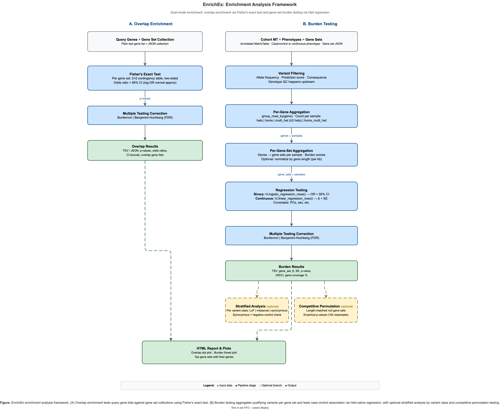

# EnrichEx: gene-set enrichment and burden testing

EnrichEx tests a collection of gene sets (cell-type markers, pathways, disease panels)
in two ways:

- **Overlap** (`hvantk enrichex overlap`): is a gene list, such as GWAS hits or
  differentially expressed genes, over- or under-represented in each gene set relative to
  a background universe? One Fisher's exact test per gene set. No Hail needed.
- **Burden** (`hvantk enrichex burden`): in a cohort MatrixTable, is a sample's count of
  genes in the set that carry a qualifying variant associated with a binary or continuous
  phenotype? One Hail logistic or linear regression per gene set, with optional
  variant-class strata and a competitive permutation test.
  `hvantk enrichex burden-pipeline` runs the same test over several gene-set collections
  and variant classes in one pass.



**Figure 1.** (A) Overlap enrichment with Fisher's exact test. (B) Burden testing with
Hail regression, with optional variant-class strata and a competitive permutation test.

## Inputs

### Query gene list

Used by `overlap`. Plain text, one gene per line. Blank lines and lines starting with `#`
are skipped, surrounding whitespace is stripped and duplicates collapse. Matching against
the gene sets and the background is exact and case-sensitive, so use one identifier type
(symbols or Ensembl IDs) everywhere.

### Gene-set collection (JSON)

Used by all three commands:

```json
{
  "gene_sets": {
    "Microglia": {
      "name": "Microglia",
      "genes": ["TREM2", "CD33", "MS4A6A", "TYROBP"],
      "source": "Lake et al. 2018",
      "metadata": {"tissue": "brain"}
    },
    "Astrocytes": {"name": "Astrocytes", "genes": ["GFAP", "AQP4", "S100B"]}
  },
  "background_genes": ["TREM2", "CD33", "MS4A6A", "TYROBP", "GFAP", "AQP4", "S100B", "..."],
  "source_description": "Brain cell-type markers",
  "metadata": {}
}
```

- Each set needs `name` and `genes`; `source` and `metadata` are optional. Results are
  labelled with each set's `name` field.
- `background_genes` is the universe for `overlap`, and `overlap` needs it: without it
  (or with an empty list) the command logs "No query genes found in background universe!"
  and writes no output. `burden` ignores the background.
- The counts that `GeneSetCollection.save()` adds (`n_genes`, `n_gene_sets`,
  `n_background`) are ignored when the file is read.

Build the file with the `hvantk genesets` commands (ClinGen, GenCC, COSMIC, or your own
two-column TSV through `hvantk genesets prepare`; see [Gene sets](genesets.md)) or from
Python (see [Python API](#python-api)). The CLI reads JSON only: convert a GMT file with
`GeneSetCollection.load_gmt("sets.gmt").save("sets.json")`.

!!! warning "Choose the overlap background deliberately"
    `hvantk genesets clingen`, `gencc`, `cosmic` and `prepare` (without `--background`),
    and the Python helpers `load_gene_sets_from_dict()`, `load_marker_genes()` and
    `GeneSetCollection.load_gmt()`, set the background to the union of the genes in the
    sets. With that background, query genes outside every set drop out of the test, and
    the test asks how the query is distributed among the sets rather than whether it is
    enriched genome-wide. For the genome-wide question, use the universe the query was
    drawn from (for example all protein-coding genes, or every gene tested in the GWAS):
    pass it to `hvantk genesets prepare` with `--background`.

### Cohort MatrixTable

Used by `burden` and `burden-pipeline`: one row per variant, one column per sample.

| Field | Where | Default name (option) | Requirement |
| --- | --- | --- | --- |
| Gene | row | `SYMBOL` (`--gene-field`) | Top-level string field, one gene per row, same identifiers as the gene-set JSON. Rows with a missing gene are dropped. |
| Allele frequency | row | `gnomad_af` (`--af-field`) | Numeric. Read only when an AF threshold is set. |
| Prediction score | row | `cadd_phred` (`--score-field`) | Numeric, such as CADD PHRED or REVEL. Read only when `--min-score` is set. |
| Consequence | row | `consequence` (`--consequence-field`) | One string per row (for example the most severe consequence), matched exactly. Read only when consequences or variant classes are set. |
| `filters` | row | | Set of strings. Read only by `burden-pipeline --pass-only`, which skips the check when the field is absent. |
| `GT` | entry | | Genotype call. |

The AF, score and consequence options accept dot paths into structs (`vep.CADD_PHRED`);
the gene field does not.

EnrichEx assumes a QC'd MatrixTable. It applies no genotype (GQ, DP), sample or variant
QC of its own. Do that upstream: `hvantk hgc filter-qc` covers sample and variant QC
(see [HGC](hgc.md)), and genotype filters are one Hail call:

```python
mt = mt.filter_entries((mt.GQ >= 20) & (mt.DP >= 10))
```

Filtered genotypes and no-calls count as non-carriers.

### Phenotype table

- A Hail Table (a path ending in `.ht`) keyed by sample ID, or a TSV (any other path),
  read with type imputation and keyed by `--sample-id-field` (default `sample_id`).
- The key must match the MatrixTable column key in value and type. In a TSV,
  numeric-looking IDs are imputed as integers; if the MatrixTable keys samples by string,
  write the phenotypes to a Hail Table with a string key first.
- Binary phenotype: boolean, or 0/1. Continuous phenotype: numeric. Covariates: numeric or
  boolean, so code a categorical covariate such as sex as 0/1.
- MatrixTable samples without a phenotype value are dropped. Hail's regression also
  excludes samples with any missing covariate.

`burden-pipeline` can read the phenotype and covariates from MatrixTable column fields
instead (omit `-p`).

## Overlap enrichment

### How the overlap test works

For each gene set S, with query list Q and background U:

1. Q and S are intersected with U. `n_query` = |Q ∩ U|, `n_gene_set` = |S ∩ U|,
   `n_background` = |U|. A set with no genes in U is skipped; if no query gene is in U,
   nothing is tested.
2. The 2×2 table is

    | | In the set | Not in the set |
    | --- | --- | --- |
    | In the query | a = `n_overlap` | b = `n_query` − a |
    | Not in the query | c = `n_gene_set` − a | d = `n_background` − `n_query` − `n_gene_set` + a |

3. A two-sided Fisher's exact test (`scipy.stats.fisher_exact`) gives `p_value`. A small
   p-value means over- or under-representation; read the direction from the odds ratio.
4. `odds_ratio` is the sample odds ratio ad/(bc): 0 when a = 0, infinite when b or c is 0.
5. The 95% confidence interval uses Woolf's log method,
   exp(ln OR ± 1.96 √(1/a + 1/b + 1/c + 1/d)), when all four cells are above zero, and is
   reported as [0, inf] otherwise.
6. `p_adjusted` applies Benjamini-Hochberg (default), Bonferroni or no correction across
   the gene sets actually tested.
7. `significant` is `p_adjusted < --alpha`.

### Run overlap

```bash
mkdir -p results
hvantk enrichex overlap \
  -g gwas_genes.txt \
  -s brain_cell_types.json \
  -o results/overlap.tsv \
  --generate-report
```

| Option | Default | Description |
| --- | --- | --- |
| `-g`, `--gene-list` | required | Query gene list file. |
| `-s`, `--gene-sets` | required | Gene-set collection JSON with `background_genes`. |
| `-o`, `--output` | required | Output path (see below). |
| `--correction` | `benjamini-hochberg` | `bonferroni`, `benjamini-hochberg` or `none`. |
| `--alpha` | `0.05` | Threshold for `significant` and the console summary. |
| `--output-format` | `tsv` | `tsv`, `json` or `both`. |
| `--generate-report` | off | Write a dot plot and an HTML report (see [Reports and plots](#reports-and-plots)). |

### Overlap output

- `tsv` writes the table to `-o`, adding `.tsv` if missing; `json` writes to `-o`, adding
  `.json` if missing. For `both`, give `-o` without an extension: `-o results/overlap`
  writes `results/overlap.tsv` and `results/overlap.json`. The directory that holds these
  files (`-o`'s parent) is created if it does not exist yet.
- With `--generate-report`, the report and its plot are written next to `-o`, in that
  same directory. The report always reads a TSV: when `--output-format` wrote one this
  run, it is reused; otherwise (`json` only) a copy named `overlap_results.tsv` is
  written there for the report to read. Both are refreshed on every run, so rerunning
  into the same `-o` never reports a previous run's results.
- When nothing can be tested, the command prints "No results generated" and writes no
  file.

One row per tested gene set, sorted by `p_value`:

| Column | Meaning |
| --- | --- |
| `gene_set_name` | The set's `name`. |
| `n_query` | Query genes in the background (the same on every row). |
| `n_gene_set` | Set genes in the background. |
| `n_overlap` | Genes in both (a). |
| `n_background` | Background size. |
| `p_value` | Two-sided Fisher's exact p-value. |
| `odds_ratio` | ad/(bc). |
| `ci_lower`, `ci_upper` | 95% CI (Woolf); 0 and `inf` when a cell is zero. |
| `overlap_genes` | Overlapping genes, sorted, comma-separated. |
| `p_adjusted` | Corrected p-value. |
| `significant` | `p_adjusted < --alpha`. |

The JSON output is an array of the same records; `overlap_genes` stays a comma-separated
string and an infinite `ci_upper` becomes `null`.

## Burden testing

### How the burden test works

1. **Select qualifying variants.** With no filter option, every variant in the
   MatrixTable counts. Each filter you set keeps a row only when its condition holds:
    - allele frequency ≤ `--max-af` (no AF filter when unset or 1.0 or more);
    - score ≥ `--min-score` (no score filter when unset, or 0 or less);
    - consequence in `--consequences`.

    A row with a missing value for an active filter is dropped. With `--max-af`, for
    example, variants that have no gnomAD AF are excluded; fill the field with 0 upstream
    to keep them. If a filter's field does not exist, that filter is skipped and only a log
    warning says so.

2. **Decide, per gene and sample, whether the sample qualifies**
   (`--genotype-aggregation`):

    | Model | The sample qualifies for a gene when it has |
    | --- | --- |
    | `hets` (default) | ≥ 1 heterozygous qualifying genotype. Homozygous-alternate genotypes do not count. |
    | `homs` | ≥ 1 homozygous-alternate qualifying genotype. |
    | `multi_het` | ≥ 2 heterozygous qualifying genotypes. Genotypes are unphased, so two variants in cis also count; this approximates compound heterozygosity. |
    | `homs_multi_het` | Either of the two above (a recessive model). |

3. **Sum per gene set.** A sample's burden for a set is the number of genes in the set for
   which it qualifies. With `--normalize-by-length`, each qualifying gene adds 1/L instead
   of 1, where L is the gene length in kb from `--gene-lengths` (genes missing from that
   file use L = 1) or, without the file, the number of qualifying variant sites in the
   gene.
4. **Regress the phenotype on burden**, one model per gene set, over the samples with a
   phenotype:
    - binary (`--phenotype-type binary`): logistic regression with a Wald test
      (`hl.logistic_regression_rows`, at most 25 iterations),
      logit P(case) = β₀ + β·burden + Σ γₖ·covariateₖ.
      `odds_ratio` = exp(β), with 95% CI exp(β ± 1.96 SE);
    - continuous: linear regression with a t-test (`hl.linear_regression_rows`),
      y = β₀ + β·burden + Σ γₖ·covariateₖ + ε.

    This is a self-contained test: the null hypothesis is that burden in the set is not
    associated with the phenotype.

Before the regression, gene sets that list fewer genes than `--min-gene-set-size` are
dropped, and so are sets with fewer carriers (samples with burden above zero) than
`--min-carriers`. A set in which no gene has a qualifying variant never reaches the
regression and is absent from the output.

`p_adjusted` applies `--correction` with m equal to the number of gene sets in the JSON,
including the sets dropped above (like R's `p.adjust(p, n = m)`), so pre-filtering does
not lower the penalty. `significant` is `p_adjusted < --alpha`. A gene set whose
regression does not converge keeps a missing `p_value`, is left out of the correction,
and gets `p_adjusted` = NaN and `significant` = false.

### Variant classes

`--variant-classes` repeats the whole test once per class, each with its own consequence
filter. `--consequences` is then ignored; `--max-af`, `--min-score` and the field options
apply to every class. The presets use VEP Sequence Ontology terms:

| Class | Qualifying consequences | Score filter |
| --- | --- | --- |
| `lof` | `stop_gained`, `frameshift_variant`, `splice_donor_variant`, `splice_acceptor_variant` | `--min-score` when set |
| `missense_constrained` | `missense_variant` | Always score ≥ 25, whatever `--min-score` says |
| `synonymous` | `synonymous_variant` | `--min-score` when set |

Any other name is a custom class whose only qualifying consequence is the name itself,
for a precomputed grouping field: `--variant-classes hcLOF,missC,syn --consequence-field csq_group`.

Each class is corrected on its own (m = gene sets in the JSON), not across classes. The
synonymous class is a negative control: when any gene set reaches nominal p < 0.05 for
synonymous variants, a warning is logged, because that points to confounding (gene
length, batch, ancestry) rather than biology.

### Competitive permutation test

A self-contained test can flag many sets at once when cases carry more rare variants
overall, for example after a batch or ancestry difference. `--permutation`
(`--competitive` in `burden-pipeline`) adds a test whose null hypothesis is that the set
is no more associated than a random set of the same size:

1. Per-gene qualifying indicators, with the same filter and model as the main test, are
   computed in Hail for every gene in the MatrixTable and collected to the driver.
2. The observed statistic is the Wald z (binary, refitted in NumPy with the same
   covariates) or the t statistic (continuous) of the set's burden.
3. Each permutation draws a random set with as many genes as the set has in the
   MatrixTable. Draws are length-matched: genes are binned into up to 10 quantile bins of
   their carrier count, and each set gene is replaced by a random gene from its bin
   (with replacement). With fewer than 10 genes in the MatrixTable, draws are uniform.
4. The empirical p-value is (1 + the number of permutations whose absolute statistic is
   at least the observed one) / (N + 1), a two-sided test. With `--variant-classes` the
   test runs once per class.

The smallest attainable p-value is 1/(N + 1), so choose `--n-permutations` large enough
to pass your multiple-testing threshold. Empirical p-values are not corrected for
multiple testing, `--min-carriers` and `--min-gene-set-size` do not apply, and run time
grows with gene sets × permutations.

### Run burden

```bash
hvantk enrichex burden \
  -m cohort.mt \
  -p phenotypes.ht \
  -s gene_sets.json \
  --covariates PC1,PC2,PC3,PC4,PC5,age,sex \
  --max-af 0.001 \
  --consequences stop_gained,frameshift_variant,splice_donor_variant,splice_acceptor_variant \
  --min-carriers 5 \
  -o results/burden/
```

Stratified by variant class, with the competitive test and a report, and phenotypes from
a TSV:

```bash
hvantk enrichex burden \
  -m cohort.mt \
  -p phenotypes.tsv \
  --sample-id-field sample_id \
  -s gene_sets.json \
  --covariates PC1,PC2,PC3,sex \
  --max-af 0.001 \
  --variant-classes lof,missense_constrained,synonymous \
  --permutation \
  --permutation-seed 42 \
  --generate-report \
  -o results/burden_by_class/
```

A quantitative trait uses linear regression:

```bash
hvantk enrichex burden \
  -m cohort.mt \
  -p phenotypes.ht \
  -s gene_sets.json \
  --phenotype-type continuous \
  --phenotype-field ldl \
  --covariates PC1,PC2,PC3,age,sex \
  --max-af 0.001 \
  -o results/burden_ldl/
```

| Option | Default | Description |
| --- | --- | --- |
| `-m`, `--cohort-mt` | required | Cohort MatrixTable. |
| `-p`, `--phenotypes` | required | Phenotype `.ht`, or a TSV. |
| `-s`, `--gene-sets` | required | Gene-set collection JSON. |
| `-o`, `--output` | required | A directory, created if needed, that receives `burden_results.tsv`; or a results `.tsv` path, whose directory is created if needed. |
| `--phenotype-field` | `is_case` | Phenotype field. |
| `--phenotype-type` | `binary` | `binary` (logistic) or `continuous` (linear). |
| `--covariates` | none | Comma-separated covariate fields, no spaces. |
| `--genotype-aggregation` | `hets` | `hets`, `homs`, `multi_het` or `homs_multi_het`. |
| `--max-af` | none | Keep variants with AF ≤ this value. |
| `--min-score` | none | Keep variants with score ≥ this value; 0 or less disables it. |
| `--consequences` | none | Comma-separated qualifying consequences, no spaces. Ignored with `--variant-classes`. |
| `--gene-field` | `SYMBOL` | Row field holding the gene. |
| `--af-field` | `gnomad_af` | Row field holding the allele frequency. |
| `--score-field` | `cadd_phred` | Row field holding the prediction score. |
| `--consequence-field` | `consequence` | Row field holding the consequence. |
| `--correction` | `benjamini-hochberg` | `bonferroni`, `benjamini-hochberg` or `none`. |
| `--alpha` | `0.05` | Threshold for `significant`. |
| `--sample-id-field` | `sample_id` | Sample ID column of a TSV phenotype file. |
| `--variant-classes` | none | Comma-separated variant classes (see above). |
| `--permutation` | off | Add the competitive permutation test. |
| `--n-permutations` | `10000` | Permutations per gene set. |
| `--permutation-seed` | none | Random seed for the permutations. |
| `--normalize-by-length` | off | Length-normalised burden (see step 3). |
| `--gene-lengths` | none | TSV with a header row: gene in the first column, length in bp in the second. |
| `--min-carriers` | `0` | Drop gene sets with fewer carriers. |
| `--min-gene-set-size` | `0` | Drop gene sets that list fewer genes. |
| `--dry-run` | off | Print the inputs and settings, then exit without reading the data. |
| `--generate-report` | off | Write a forest plot and an HTML report. |

### Burden output

Files go to the directory of `-o` when it ends in `.tsv`, otherwise to `-o` itself:

| File | Written |
| --- | --- |
| The `-o` file, or `burden_results.tsv` | Always; all classes together with `--variant-classes`. |
| `burden_<class>.tsv` | Per class, with `--variant-classes`. |
| `permutation_results.tsv`, or `permutation_<class>.tsv` per class | With `--permutation`. |
| `enrichex_burden.png`, `enrichex_burden_report.html` | With `--generate-report`. |

When no gene set is testable, the command writes an empty results file and stops there:
no permutation test, no report.

The results table has one row per tested gene set, sorted by `p_value`:

| Column | Phenotype | Meaning |
| --- | --- | --- |
| `gene_set_name` | both | The set's `name`. |
| `gene_set_size` | both | Genes listed in the set. |
| `n_genes_found` | both | Set genes with at least one qualifying variant in the MatrixTable. |
| `gene_coverage_pct` | both | `n_genes_found / gene_set_size × 100`, one decimal. A warning is logged for sets below 50%. |
| `beta`, `standard_error`, `p_value` | both | Effect of one unit of burden, its SE and p-value. |
| `z_stat` | binary | Wald z statistic. |
| `fit.n_iterations`, `fit.converged`, `fit.exploded` | binary | Logistic fit diagnostics. When the fit does not converge, the statistics are missing. |
| `odds_ratio`, `ci_lower`, `ci_upper` | binary | exp(β) and its 95% CI. |
| `n`, `sum_x`, `y_transpose_x` | continuous | Samples used, sum of burden, and Σ y·burden. |
| `t_stat` | continuous | t statistic. |
| `p_adjusted`, `significant` | both | Corrected p-value, and `p_adjusted < --alpha`. |
| `variant_class` | both | With `--variant-classes`. |

The permutation tables have `gene_set_name`, `n_genes_tested` (set genes present in the
MatrixTable), `observed_statistic`, `empirical_p_value`, `n_permutations` and
`n_exceeded`, plus `variant_class` per class.

## Burden pipeline

`hvantk enrichex burden-pipeline` loads the cohort once and runs the burden test for every
pair of gene-set collection and variant class. The statistics are those of `burden`;
inputs, defaults and outputs differ.

```bash
hvantk enrichex burden-pipeline \
  -m cohort.mt \
  -p phenotypes.ht \
  --gene-sets heart:gene_sets/heart.json \
  --gene-sets brain:gene_sets/brain.json \
  --variant-classes lof,missense_constrained,synonymous \
  --max-af 0.001 \
  --covariates PC1,PC2,PC3,sex \
  --competitive \
  --generate-report \
  -o results/celltype_burden/
```

With the phenotype and covariates stored as MatrixTable column fields, omit `-p` and use
dot paths; the leaf names (`is_case`, `PC1`, ...) are used for the regression:

```bash
hvantk enrichex burden-pipeline \
  -m cohort.mt \
  --gene-sets heart:gene_sets/heart.json \
  --phenotype-field phe.is_case \
  --covariates phe.PC1,phe.PC2,phe.sex \
  --variant-classes lof,synonymous \
  -o results/burden/
```

`--max-af`, `--min-score`, `--pass-only` and the three field options always apply, with
or without `--variant-classes`: without it, the pipeline still makes one unstratified
run per collection, named `all`, using those filters.

Where it differs from `burden`:

| Option | `burden-pipeline` | `burden` |
| --- | --- | --- |
| Gene sets | `--gene-sets NAME:PATH`, repeatable, required, no short flag | `-s PATH`, one file |
| `-p`, `--phenotypes` | Optional; when omitted, read from MatrixTable column fields | Required |
| `-o` | `--output-dir`, a directory | `--output`, a file or a directory |
| `--min-carriers` | `5` | `0` |
| `--max-af` | `0.01` | none |
| `--min-score` | Applied as given; leave it unset to disable | 0 or less disables it |
| `--pass-only` / `--no-pass-only` | `--no-pass-only`; `--pass-only` keeps rows whose `filters` set is empty | Not available |
| Permutation test | `--competitive` | `--permutation` |
| `--consequences` | Not available; use `--variant-classes` | Available |

The remaining options (`--phenotype-field`, `--phenotype-type`, `--covariates`,
`--gene-field`, `--genotype-aggregation`, `--correction`, `--alpha`,
`--min-gene-set-size`, `--n-permutations`, `--permutation-seed`, `--normalize-by-length`,
`--gene-lengths`, `--af-field`, `--score-field`, `--consequence-field`,
`--sample-id-field`, `--dry-run`, `--generate-report`) behave as in `burden`, except that
`--covariates` tolerates spaces after commas. `--dry-run` prints the run plan without
starting Hail or writing anything to disk, in both commands (it still checks that the
input paths exist).

Each run (one collection, one class) is corrected on its own, with m = gene sets in that
collection. A gene set whose regression fails keeps a missing `p_adjusted`.

```text
results/celltype_burden/
├── burden_combined.tsv                      # every run, with variant_class and collection columns
├── per_run/
│   ├── burden_<collection>_<class>.tsv      # class "all" when unstratified
│   └── permutation_<collection>_<class>.tsv # with --competitive
├── plots/                                   # created empty
├── enrichex_burden.png                      # with --generate-report
└── enrichex_burden_report.html              # with --generate-report
```

## Reports and plots

`--generate-report` needs matplotlib, from the `enrichex` extra
(`pip install 'hvantk[enrichex]'`). The report is one HTML file with the plot embedded;
the PNG is also written next to it.

- `overlap` writes `enrichex_overlap_report.html` and `enrichex_overlap.png`: a table of
  the 20 sets with the smallest `p_adjusted`, the overlapping genes of each, and a dot
  plot of those among them with at least one overlapping gene (height −log10
  `p_adjusted`, colour odds ratio, size `n_overlap`).
- `burden` and `burden-pipeline` write `enrichex_burden_report.html` and
  `enrichex_burden.png`: a forest plot of the 25 sets with the smallest `p_adjusted`
  (odds ratio or β with 95% CI) and a table.

Each report opens with an overview that counts the rows whose `significant` column is
true, and ends with a short methods note. The `overlap` and `burden` reports also
summarise the gene-set collection.

The same output from Python:

```python
import pandas as pd

from hvantk.algorithms.enrichex import (
    generate_report,
    plot_burden_forest,
    plot_enrichment_dotplot,
)

overlap = pd.read_csv("results/overlap.tsv", sep="\t")
plot_enrichment_dotplot(overlap, output_path="plots/overlap_dotplot.png", top_n=25)

burden = pd.read_csv("results/burden/burden_results.tsv", sep="\t")
plot_burden_forest(
    burden, output_path="plots/burden_forest.pdf", format="pdf", phenotype_type="binary"
)

generate_report(
    output_path="report/enrichex_report.html",
    overlap_results="results/overlap.tsv",
    burden_results="results/burden/burden_results.tsv",
    gene_sets_path="gene_sets.json",
    title="EnrichEx report",
)
```

Each plot function saves to `output_path` with the extension replaced by `format`
(default `png`) and returns the matplotlib figure. `plot_burden_forest` needs `ci_lower`
and `ci_upper`, which binary results have; for continuous results add
`beta ± 1.96 × standard_error` yourself and pass `sort_by="p_value"`. The other plots are
`plot_enrichment_barplot`, `plot_burden_volcano`, `plot_celltype_burden_heatmap` (one cell
per gene set and variant class, from `burden_combined.tsv`) and `plot_celltype_forest`
(one gene set across variant classes).

## Python API

Everything below is importable from `hvantk.algorithms.enrichex`.

### Overlap and gene sets

Overlap runs on plain Python, without Hail:

```python
from hvantk.algorithms.enrichex import (
    GeneSetCollection,
    compute_overlap_enrichment_pandas,
)

gene_sets = GeneSetCollection.load("brain_cell_types.json")
query = ["APOE", "CLU", "CR1", "PICALM", "BIN1", "TREM2", "CD33", "MS4A6A"]

df = compute_overlap_enrichment_pandas(
    query, gene_sets, correction_method="benjamini-hochberg"
)
print(df.loc[df["significant"], ["gene_set_name", "n_overlap", "odds_ratio", "p_adjusted"]])
```

`compute_overlap_enrichment()` takes the same arguments and returns a list of
`OverlapResult` objects sorted by `p_value`. Their attributes are the table columns,
with `overlap_genes` as a list and no `significant` attribute.

To build a collection:

```python
from hvantk.algorithms.enrichex import load_gene_sets_from_dict

with open("protein_coding_genes.txt") as fh:
    background = {line.strip() for line in fh if line.strip()}

collection = load_gene_sets_from_dict(
    {"Microglia": ["TREM2", "CD33", "MS4A6A"], "Astrocytes": ["GFAP", "AQP4", "S100B"]},
    background_genes=background,
)
collection.save("brain_cell_types.json")
```

`load_marker_genes(path, cluster_column="cluster", gene_column="gene")` makes one set per
cluster from a marker TSV, such as Seurat `FindAllMarkers` output.
`GeneSetCollection.load_gmt(path, background_genes=None)` reads GMT.
`GeneSet(name, genes, source="", metadata={})` and
`GeneSetCollection(gene_sets, background_genes, source_description="", metadata={})`
build collections by hand; a collection supports `len()`, iteration over its `GeneSet`
objects, `get(name)`, `names()`, `save()`, `save_gmt()` and `to_dict()`.

### Burden

```python
import hail as hl

from hvantk.algorithms.enrichex import (
    GeneSetCollection,
    VariantFilter,
    apply_correction,
    run_burden_analysis,
)
from hvantk.core.utils.hail_context import init_hail

init_hail()
mt = hl.read_matrix_table("cohort.mt")
pheno = hl.read_table("phenotypes.ht")
gene_sets = {
    gs.name: sorted(gs.genes) for gs in GeneSetCollection.load("gene_sets.json")
}

lof = VariantFilter(
    max_af=0.001,
    min_score=None,
    consequences=["stop_gained", "frameshift_variant"],
    pass_only=False,
)
result = run_burden_analysis(
    cohort_mt=mt,
    gene_sets=gene_sets,
    phenotype_ht=pheno,
    phenotype_field="is_case",
    phenotype_type="binary",
    covariate_fields=["PC1", "PC2", "PC3", "age", "sex"],
    variant_filter=lof,
    genotype_aggregation="hets",
    min_carriers=5,
)
if result is not None:
    df = result.to_pandas()
    df["p_adjusted"] = apply_correction(
        df["p_value"].astype(float).tolist(),
        method="benjamini-hochberg",
        n_total=len(gene_sets),
    )
```

- `run_burden_analysis()` returns the regression table without `p_adjusted` and
  `significant` (the CLI adds those), or `None` when nothing is testable.
- `VariantFilter()` defaults are stricter than the CLI's: `max_af=0.01`, `min_score=20.0`
  on `cadd_phred`, and `pass_only=True`. Pass `min_score=None` and `pass_only=False` to
  select by consequence and AF only. Its `min_gq` and `min_dp` fields are accepted but the
  burden functions never apply them.
- `apply_correction(p_values, method, n_total=None)` takes a list, not a NumPy array.

| Function or class | What it does |
| --- | --- |
| `compute_geneset_burden_mt(mt, gene_sets, ...)` | Steps 1 to 3: a MatrixTable with one row per gene set (`gene_set_size`, `n_genes_found`, `gene_coverage_pct`), one column per sample and a `burden` entry; `None` when no set gene has a qualifying variant. |
| `logistic_burden_test(mt_burden, phenotype_field, covariates, pass_through)`, `linear_burden_test(...)` | Step 4 on such a MatrixTable; the phenotype and covariates must already be column fields of `mt_burden`. |
| `compute_per_gene_burden_mt(mt, gene_field, variant_filter)` | Per-gene MatrixTable with `hets`, `homs` and `multi_het` entries. |
| `run_stratified_burden_analysis(..., variant_classes)` | `run_burden_analysis` per class; returns a dict of class name to table (with `variant_class`). |
| `build_variant_classes_from_presets(names, base_filter=None)` | Dict of class name to `VariantFilter`. Without `base_filter`: no AF, PASS or score filter, except the fixed score ≥ 25 of `missense_constrained`. |
| `permutation_burden_test(..., n_permutations=10000, length_matched=True, seed=None)` | The competitive test; returns a pandas DataFrame. |
| `BurdenConfig`, `BurdenPipeline` | The `burden-pipeline` engine: `BurdenPipeline(config).show_plan()` and `.run()`, which returns the combined DataFrame. `BurdenConfig.generate_report` defaults to `True`, unlike the CLI flag. |
| `generate_synthetic_burden_cohort(...)` | A synthetic cohort with planted signal: returns the MatrixTable, a phenotype table with `is_case`, and the signal gene sets. |
| `check_type_i_error(p_values, alpha=0.05, tolerance=2.0)` | Calibration check under the null: `calibrated` is true when the rejection rate lies within [alpha/tolerance, alpha × tolerance] and a Kolmogorov-Smirnov test of uniformity gives p > 0.001. |

## Interpreting results

- **Overlap is two-sided.** An odds ratio below 1 with a small p-value is depletion.
- **Overlap depends on the background** (see the warning under
  [Gene-set collection](#gene-set-collection-json)). Fisher's test also treats genes as
  exchangeable: it ignores gene length and the genes that sets share. The Woolf interval
  is approximate and can disagree with the exact p-value at small counts.
- **The burden effect is per qualifying gene.** `odds_ratio` (or β) is the effect of one
  more gene in the set in which a sample qualifies, or of one unit of the length-normalised
  rate with `--normalize-by-length`. An odds ratio of 1.5 means each additional qualifying
  gene multiplies the odds of being a case by 1.5; it does not mean that cases carry 50%
  more variants.
- **Sparse sets.** With few carriers or complete separation the logistic fit fails
  (`fit.converged` false, missing statistics) or gives unstable, wide intervals. Raise
  `--min-carriers`, merge small sets or use broader variant classes.
- **Self-contained and competitive tests answer different questions.** A significant
  self-contained result says the set's burden tracks the phenotype; only the competitive
  test says the set stands out from random sets. Check the synonymous class: signal there
  points to confounding.
- **Gene length.** Long genes collect more qualifying variants, so sets of long genes look
  burdened. Use `--normalize-by-length`, or rely on the length-matched permutation null.
- **Missing annotations.** Active filters drop variants with a missing value. Check
  `n_genes_found` and `gene_coverage_pct` to see how much of each set was testable.
- **Differential QC.** No-calls count as non-carriers, so a call-rate difference between
  cases and controls biases burden. Joint-call and QC cases and controls together, and
  include ancestry principal components among the covariates.
- **Many strata.** Variant classes and collections are corrected separately. When you
  test several, account for the total number of tests when you report.

## See also

- [Gene sets](genesets.md): build the gene-set JSON (`hvantk genesets prepare`, ClinGen,
  GenCC and COSMIC sets).
- [HGC](hgc.md): joint calling and sample and variant QC before burden testing.
- [Ancestry inference](ancestry.md): principal components to use as covariates.
- [External cohorts](cohort.md): a per-gene Fisher's exact burden test on a case-control
  MatrixTable (`hvantk cohort burden`).
- [EnrichEx examples](../examples/enrichex.md) and the scripts in
  [`examples/enrichex/`](https://github.com/bigbio/hvantk/tree/main/examples/enrichex).
- [Running on HPC](../guide/hpc-migration.md): Spark settings for large cohorts.
