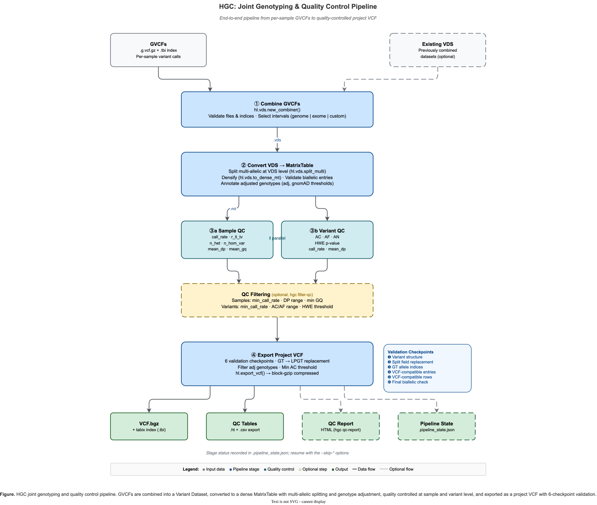

# HGC: joint genotyping

HGC (Hail-based Genotype Combiner) joint-genotypes a cohort of per-sample gVCFs: it
combines them into a Variant DataSet (VDS), converts that to a MatrixTable (MT), runs
quality control, and exports a cohort VCF. It is built on [Hail](https://hail.is/).



**Figure 1.** HGC: gVCF combining, VDS to MatrixTable conversion, sample and variant QC,
optional filtering, and cohort VCF export.

## Entry points

| Entry point | Use it when |
|---|---|
| `hvantk hgc pipeline` | You have a directory of gVCFs and want VDS → MT → cohort VCF with QC tables in one command; you can resume it by hand from the stage outputs. |
| Individual commands (`gvcf-combine`, `vds-combine`, `vds2mt`, `mt2vcf`, `compute-qc`, `filter-qc`, `qc-report`, `qc-summary`) | You already have a VDS or MT, want QC filter thresholds the pipeline doesn't expose (see [Filter by QC metrics](#filter-by-qc-metrics)), or want to rerun a single stage without re-running the rest. |

Every command also takes `-h`/`--help`, and a `--dry-run` flag that prints what it
would do without running Hail.

## Quick start

```bash
# 1. gVCFs -> VDS -> MatrixTable -> cohort VCF
hvantk hgc pipeline -i /path/to/gvcfs -o /path/to/output

# 2. QC the MatrixTable the pipeline produced, and build an HTML report.
#    compute-qc's -o is an output DIRECTORY (see "Compute QC metrics" below).
hvantk hgc compute-qc -i /path/to/output/cohort.mt -o /path/to/output/qc
hvantk hgc qc-report -i /path/to/output/qc/qc_metrics_with_qc.mt \
    -o /path/to/output/qc/report.html
```

Preview either command's plan first with `--dry-run`. For a region-restricted run
(a single chromosome, an exome, a gene panel), see
[Performance and sizing](#performance-and-sizing) before running the combine step —
the default partitioning is sized for whole genomes and can leave most of your cores
idle on a smaller region.

## Step-by-step commands

### Combine gVCFs into a VDS

```bash
hvantk hgc gvcf-combine -g /data/gvcfs -o cohort.vds
```

| Option | Meaning | Default |
|---|---|---|
| `-g, --gvcf-dir TEXT` | Directory of `.g.vcf.gz` files, each with a `.tbi` index | none (need this or `-v`) |
| `-v, --vds-paths TEXT` | Existing VDS to combine with the gVCFs (repeatable) | none |
| `-o, --output TEXT` | Output VDS path | required |
| `--temp-dir, --tmp TEXT` | Temporary directory for intermediate files | `$HGC_TEMP_DIR`, else the system temp dir |
| `-s, --save-path TEXT` | Where to save the combiner's execution plan (JSON) | `<output>.plan` |
| `--import-interval-size INT` | Interval size in bp; Hail derives **one partition per interval** | Hail's genome default, 1.2 Mb |
| `--use-genome-default-intervals` | Explicit genome interval size (1.2 Mb) | already the default |
| `--use-exome-default-intervals` | Hail's exome interval size (60 Mb) | off |
| `--gvcf-batch-size INT` | gVCFs merged per tree-merge batch | Hail default, 50 |
| `--branch-factor INT` | Branch factor of the hierarchical merge | Hail default, 100 |
| `--dry-run` | Preview without executing | off |

`--import-interval-size`, `--use-genome-default-intervals` and
`--use-exome-default-intervals` are mutually exclusive. See
[Performance and sizing](#performance-and-sizing) for when to change the interval size.

### Combine VDS datasets

Merge several VDS directories (for example, per-batch VDSes from incremental cohort
building — see [Worked examples](#worked-examples)):

```bash
hvantk hgc vds-combine -i /data/vds_datasets -o merged.vds
```

| Option | Meaning | Default |
|---|---|---|
| `-i, --input-dir TEXT` | Directory containing VDS subdirectories (each ending in `.vds`) | required |
| `-o, --output TEXT` | Output path for the merged VDS | required |
| `--validate / --no-validate` | Validate the merged VDS with Hail's validator | validate |
| `--overwrite / --no-overwrite` | Overwrite existing output | no-overwrite |
| `--dry-run` | Preview without executing | off |

### Convert a VDS to a MatrixTable

```bash
hvantk hgc vds2mt -i cohort.vds -o cohort.mt --adjust-genotypes
```

| Option | Meaning | Default |
|---|---|---|
| `-i, --input TEXT` | Input VDS | required |
| `-o, --output TEXT` | Output MatrixTable path | required |
| `--adjust-genotypes / --no-adjust-genotypes` | Annotate the `adj` entry field (see [adjusted-genotype thresholds](#adjusted-genotype-adj-thresholds)) | adjust |
| `--skip-split-multi` | Skip the VDS-level multi-allelic split | off (split runs) |
| `--skip-validation` | Skip the biallelic audit and genotype repair (see below) | off |
| `--skip-keying-by-cols` | Keep the VDS's own column order instead of keying and sorting columns by sample ID | off |
| `--overwrite / --no-overwrite` | Overwrite existing output | no-overwrite |
| `--n-partitions INT` | Coalesce the dense MatrixTable to this many partitions before writing (reduces only) | keep the VDS's own layout |
| `--dry-run` | Preview without executing | off |

Two things worth knowing before you reach for `--skip-validation` or `--n-partitions`:

- **The densify runs exactly once.** Hail is lazy and does not cache, so any eager
  action on the dense MatrixTable (a `count`, an `aggregate`) re-executes the whole
  densify. `vds2mt` is written so that only the final write touches the dense matrix:
  the biallelic audit (out-of-bounds `GT` indices, `AD` length mismatches) runs on the
  *sparse* variant data before densification, and the repair is a lazy expression that
  fuses into the write. The audit is cheap (it scans only the sparse records), so there
  is rarely a reason to skip it.
- **`--n-partitions` matters more as your cohort grows.** A VDS's on-disk layout is
  derived from its reference-block count, which saturates as sample count grows, while
  the dense matrix keeps growing. Past that point the VDS's partition count stops
  tracking the size of what it partitions, and tasks get too thin to amortise overhead.
  Size `--n-partitions` from the dense matrix you're producing, not the VDS.

Also: VDS-level splitting already produces biallelic `GT`/`AD`, so there is no manual
LGT→GT downcoding step to worry about. Adjusted-genotype annotation needs no extra
dependency — `annotate_adj` is ported from gnomAD's `gnomad_methods` (MIT) into
`hvantk/algorithms/hgc/adj.py`, with gnomAD's published thresholds kept verbatim.

### Export a MatrixTable to VCF

```bash
hvantk hgc mt2vcf -i cohort.mt -o cohort.vcf.bgz --min-ac 1
```

| Option | Meaning | Default |
|---|---|---|
| `-i, --input TEXT` | Input MatrixTable | required |
| `-o, --output TEXT` | Output VCF path — use `.vcf.bgz` (block gzip), not `.vcf.gz` | required |
| `--filter-adj / --no-filter-adj` | Keep only `adj` genotypes (recommended) | filter |
| `--min-ac INT` | Minimum alternate allele count | 1 |
| `--split-multi / --no-split-multi` | Split multi-allelic variants if not already split | split |
| `--check-adj / --no-check-adj` | Verify `adj` is not systematically MISSING before filtering | check |
| `--dry-run` | Preview without executing | off |

Use `.vcf.bgz`: block gzip is what bcftools, tabix and GATK expect, and `mt2vcf` warns
if you give it a plain `.vcf.gz` path. Keep `--check-adj` on: Hail's `filter_entries`
treats a MISSING `adj` as not-passing, so if `adj` were ever systematically missing
(for example, from a MatrixTable built before a dependent field like `DP` was
reliably populated), `--filter-adj` would silently delete genotypes instead of
failing loudly. `--check-adj` catches that before it happens.

The exported VCF carries standard INFO fields: `AF`, `AC`, `AN`, and `call_rate`
(fraction of samples with a called genotype).

### Run the full pipeline

```bash
hvantk hgc pipeline -i /data/gvcfs -o /data/output --output-prefix cohort
```

Stages (each can be skipped independently):

1. Combine gVCFs → VDS
2. Convert VDS → MatrixTable
3. Compute sample QC metrics
4. Compute variant QC metrics
5. Export → cohort VCF

**Required**

| Option | Meaning |
|---|---|
| `-i, --input-dir PATH` | Directory of gVCF files (must exist) |
| `-o, --output-dir PATH` | Output directory |

**Stage control and combiner/conversion tuning** (same meaning as the matching
`gvcf-combine`/`vds2mt` options above)

| Option | Meaning | Default |
|---|---|---|
| `--skip-combine-gvcfs` | Skip stage 1 (needs `--vds-path`) | off |
| `--skip-vds-to-mt` | Skip stage 2 (needs `--mt-path`) | off |
| `--skip-compute-sample-qc` | Skip stage 3 | off |
| `--skip-compute-variant-qc` | Skip stage 4 | off |
| `--skip-export-pvcf` | Skip stage 5 | off |
| `--skip-validation` | Skip `vds2mt`'s biallelic audit and repair | off |
| `--vds-path PATH` | Existing VDS to resume from | - |
| `--mt-path PATH` | Existing MatrixTable to resume from | - |
| `--import-interval-size` / `--use-exome-default-intervals` / `--gvcf-batch-size` / `--branch-factor` | Stage-1 combiner tuning | see `gvcf-combine` |
| `--n-partitions INT` | Stage-2 MatrixTable partition count | keep the VDS's layout |

**Processing and output**

| Option | Meaning | Default |
|---|---|---|
| `--reference-genome [GRCh37\|GRCh38]` | Reference build | GRCh38 |
| `--tmp-dir PATH` | Temporary directory | system default |
| `--overwrite` | Overwrite existing output files | off |
| `--output-prefix TEXT` | Prefix for every output file | `cohort` |
| `--apply-qc-filters` | Apply QC filters before exporting the cohort VCF | off |
| `--min-sample-call-rate FLOAT` | Sample call-rate threshold (used only with `--apply-qc-filters`) | 0.85 |
| `--min-variant-call-rate FLOAT` | Variant call-rate threshold (used only with `--apply-qc-filters`) | 0.85 |
| `--generate-qc-report` | Generate an HTML QC report after computing QC | off |
| `--dry-run` | Show the execution plan without running | off |

`--apply-qc-filters` and `--generate-qc-report` both read the small
`qc/<prefix>_sample_qc.ht`/`qc/<prefix>_variant_qc.ht` Tables stages 3/4 write and
annotate the plain MT with them on the fly — see [Outputs](#outputs). Neither flag
makes the pipeline write a QC-annotated copy of the whole MatrixTable: on a real
cohort that would be a multi-TB write and hours of cluster time, paid on every run
since the QC stages run by default. If both QC stages are skipped, those `.ht`
tables don't exist: `--apply-qc-filters` then exports unfiltered (there is nothing
to filter by), and `--generate-qc-report` logs a warning and writes no report.

**Resuming.** The pipeline does not auto-resume: it always runs every stage you
haven't explicitly `--skip-*`'d. `.pipeline_state.json` in the output directory
records what completed and the error, if any, purely for you to inspect — to resume,
read it, then re-run with the matching `--skip-*` flags and `--vds-path`/`--mt-path`
pointing at the stage outputs that already succeeded:

```bash
cat /data/output/.pipeline_state.json

hvantk hgc pipeline -i /data/gvcfs -o /data/output \
    --skip-combine-gvcfs --vds-path /data/output/cohort.vds \
    --overwrite
```

`--overwrite` is usually needed on a resumed run, since the stage you're re-entering
at will try to write a path that already exists.

`--generate-qc-report` is resume-aware: it looks for `qc/<prefix>_sample_qc.ht`/
`qc/<prefix>_variant_qc.ht` on disk even if this invocation's own (fresh,
not-auto-loaded) state has no record of computing them, so
`--skip-compute-sample-qc --skip-compute-variant-qc --generate-qc-report` on its own
picks up an earlier run's tables. `--apply-qc-filters` does not: it filters by
whichever of sample/variant QC is *not* `--skip-*`'d in this same invocation, same as
every other stage skip.

## QC metrics and filters

### Compute QC metrics

```bash
hvantk hgc compute-qc -i cohort.mt -o qc_results/
```

`-o`/`--output-dir` is an **output directory**, not a file path — `compute-qc` writes
`<prefix>_sample_qc.csv`, `<prefix>_variant_qc.tsv` and (unless `--no-save-mt`)
`<prefix>_with_qc.mt` into it (`<prefix>` from `--prefix`, default `qc_metrics`). Feed
that `_with_qc.mt` to `filter-qc` or `qc-report` — a plain `.mt` without QC
annotations fails qc-report's "No QC annotations found" check immediately.

| Option | Meaning | Default |
|---|---|---|
| `-i, --input TEXT` | Input MatrixTable | required |
| `-o, --output-dir TEXT` | Output directory (see above) | required |
| `--sample-qc / --no-sample-qc` | Compute sample-level metrics | on |
| `--variant-qc / --no-variant-qc` | Compute variant-level metrics | on |
| `--call-field TEXT` | Entry field to call genotypes from | `GT` |
| `--prefix TEXT` | Output file prefix | `qc_metrics` |
| `--save-mt / --no-save-mt` | Also write the QC-annotated MatrixTable | save |
| `--adj-filter / --no-adj-filter` | Filter to `adj` genotypes before computing QC, so the metrics describe the filtered callset rather than the densified matrix | off |
| `--remove-star-alleles / --keep-star-alleles` | Drop rows whose alt allele is the gVCF placeholder `<*>`/`<NON_REF>` or the spanning-deletion `*` — not real variants, and on a densified gVCF callset they can be around half of all rows | remove |
| `--dry-run` | Preview without executing | off |

At least one of `--sample-qc`/`--variant-qc` must stay enabled. `--adj-filter`
requires an `adj` entry field (from `vds2mt --adjust-genotypes`); if the MatrixTable
has `adj` but you don't pass `--adj-filter`, `compute-qc` warns that the reported call
rate describes the unfiltered matrix, not what you'd actually export.

### Filter by QC metrics

```bash
hvantk hgc filter-qc -i qc_results/qc_metrics_with_qc.mt -o cohort_filtered.mt \
    --min-sample-call-rate 0.9 --min-ac 5
```

| Option | Meaning | Default |
|---|---|---|
| `-i, --input TEXT` | MatrixTable with QC annotations (e.g. `<prefix>_with_qc.mt`) | required |
| `-o, --output TEXT` | Output filtered MatrixTable path | required |
| `--min-sample-call-rate FLOAT` | | 0.85 |
| `--min-variant-call-rate FLOAT` | | 0.85 |
| `--min-ac INT` | Minimum alt allele count | 1 |
| `--max-ac INT` | | none |
| `--min-af FLOAT` | | none |
| `--max-af FLOAT` | | none |
| `--hwe-threshold FLOAT` | Minimum `p_value_hwe` | 1e-6 |
| `--min-mean-dp FLOAT` | | none |
| `--max-mean-dp FLOAT` | | none |
| `--min-mean-gq FLOAT` | | none |
| `--sample-qc-name TEXT` | Name of the sample QC annotation to read | `sample_qc` |
| `--variant-qc-name TEXT` | Name of the variant QC annotation to read | `variant_qc` |
| `--overwrite / --no-overwrite` | | no-overwrite |
| `--dry-run` | Preview without executing | off |

### Generate an HTML QC report

```bash
hvantk hgc qc-report -i qc_results/qc_metrics_with_qc.mt -o report.html
```

| Option | Meaning | Default |
|---|---|---|
| `-i, --input TEXT` | MatrixTable with QC annotations | required |
| `-o, --output TEXT` | Output HTML path | required |
| `--title TEXT` | Report title | `Quality Control Report` |
| `--include-plots CHOICE` (repeatable) | `sample_overview`, `variant_overview`, `sample_call_rates`, `variant_call_rates`, `allele_frequencies`, `hwe`, `titv` | all seven |
| `--dry-run` | Preview without executing | off |

The report is self-contained (plots embedded as base64 PNGs). There is no standalone
plotting/dashboard CLI; for ad hoc or custom plots, export the QC metrics as pandas
DataFrames and plot them directly (see [Worked examples](#worked-examples)).

### Summarize QC metrics

```bash
hvantk hgc qc-summary -d qc_results/ -o summary.md --format markdown
```

| Option | Meaning | Default |
|---|---|---|
| `-d, --qc-dir TEXT` | Directory containing QC metric files | required |
| `--sample-file TEXT` | Specific sample QC file | auto-detected: the first `*sample_qc*.csv` in `--qc-dir` |
| `--variant-file TEXT` | Specific variant QC file | auto-detected: `*variant_qc*.tsv`, falling back to `*variant_qc*.csv` |
| `-o, --output TEXT` | Write the summary here | print to the console |
| `--format [csv\|json\|markdown]` | Output format | markdown |

No `--dry-run` on this command. It reports `describe()`-style statistics
(count/mean/std/min/25%/50%/75%/max) per numeric metric column, not a QC pass/fail.

### Metric names

#### Sample metrics

Field names in `sample_qc`, from Hail's `hl.sample_qc`: `call_rate`, `n_called`,
`n_not_called`, `n_filtered`, `n_hom_ref`, `n_het`, `n_hom_var`, `n_non_ref`, `n_snp`,
`n_insertion`, `n_deletion`, `n_singleton`, `n_transition`, `n_transversion`, `n_star`,
`r_ti_tv`, `r_het_hom_var`, `r_insertion_deletion`, plus nested `dp_stats`/`gq_stats`
(`mean`/`stdev`/`min`/`max`) when `DP`/`GQ` are present. hvantk additionally adds flat
sibling columns `sample_qc_mean_dp` / `sample_qc_mean_gq` (not nested under
`sample_qc`) — these are what `filter-qc`'s `--min-mean-dp`/`--max-mean-dp`/
`--min-mean-gq` filter on.

#### Variant metrics

Field names in `variant_qc`, from Hail's `hl.variant_qc`: `AF`, `AC`,
`homozygote_count` (arrays, one element per allele including the reference), `AN`,
`call_rate`, `n_called`, `n_not_called`, `n_filtered`, `n_het`, `n_non_ref`,
`het_freq_hwe`, `p_value_hwe`, `p_value_excess_het`, plus `dp_stats`/`gq_stats` and the
same flat `variant_qc_mean_dp` / `variant_qc_mean_gq` siblings. `filter-qc` reads the
alt-allele element of the arrays (`AC[1]`, `AF[1]`), so it assumes biallelic data —
run after `vds2mt`'s split, not before.

#### Adjusted-genotype (`adj`) thresholds

From `vds2mt --adjust-genotypes`
(`hvantk/algorithms/hgc/adj.py`, ported from gnomAD's `annotate_adj`, thresholds kept
verbatim): `GQ >= 20`, `DP >= 10` (`DP >= 5` for a haploid call), and allele balance
`>= 0.2` for each called allele on a heterozygous call (homozygous calls skip the
allele-balance test).

## Outputs

**Data formats**

| Format | What it is | On disk |
|---|---|---|
| gVCF | Single-sample calls plus reference blocks | `.g.vcf.gz` + `.tbi` |
| VDS | Hail's storage-optimized format; separates reference data from variant data | directory ending `.vds` |
| MatrixTable (MT) | Hail's dense analysis format; rows = variants, columns = samples | directory ending `.mt` |
| VCF | Standard variant format, exported by `mt2vcf` | `.vcf.bgz` (block gzip) |

**`compute-qc` output directory** (filenames use `--prefix`, default `qc_metrics`):

```text
qc_results/
├── qc_metrics_sample_qc.csv     # comma-separated, every sample
├── qc_metrics_variant_qc.tsv    # TAB-separated (alleles/struct fields contain
│                                 # commas Hail doesn't quote); every variant,
│                                 # exported directly by Hail, not collected
└── qc_metrics_with_qc.mt         # QC-annotated MatrixTable (unless --no-save-mt)
```

**`pipeline` output directory** (filenames use `--output-prefix`, default `cohort`):

```text
output_directory/
├── cohort.vds/                  # Stage 1
├── cohort.mt/                   # Stage 2
├── cohort_filtered.mt/          # Stage 5, only with --apply-qc-filters
├── cohort.vcf.bgz               # Stage 5
├── qc/
│   ├── cohort_sample_qc.ht      # Stage 3, Hail Table, every sample
│   ├── cohort_sample_qc.csv     # same data, comma-separated
│   ├── cohort_variant_qc.ht     # Stage 4, Hail Table, every variant
│   ├── cohort_variant_qc.tsv    # first 10,000 variants, TAB-separated
│   └── cohort_qc_report.html    # only with --generate-qc-report
├── logs/
│   └── pipeline_<timestamp>.log
└── .pipeline_state.json         # inspect this to resume manually, see above
```

`cohort_sample_qc.csv` (every sample, comma-separated) and `cohort_variant_qc.tsv` use
the same names, delimiters and columns as `compute-qc`'s files. The variant TSV is a
preview of the first 10,000 variants; the full per-variant table is
`cohort_variant_qc.ht`, and `compute-qc` exports every variant when you need the text.
There is no `_with_qc.mt` here: unlike `compute-qc`, the pipeline
never writes a QC-annotated copy of the MatrixTable, since the QC stages run by
default and that write would cost a full extra MatrixTable write of the whole cohort
on every run. `--apply-qc-filters` and `--generate-qc-report` instead annotate
`cohort.mt` with `cohort_sample_qc.ht`/`cohort_variant_qc.ht` on the fly.

## Performance and sizing

**Combiner parallelism (stage 1).** Hail's gVCF combiner creates **one partition per
genomic interval**, so the interval size caps how many cores can do useful work. The
default — Hail's whole-genome default, 1.2 Mb — is sized for whole-genome gVCFs. For a
region-restricted run it produces far fewer partitions than you likely have cores:

| Input region | Partitions at the 1.2 Mb default |
|---|---|
| chr20 (64.4 Mb) | 54 |
| chr1 (249.0 Mb) | 208 |
| whole genome (3.1 Gb) | ~2,584 |

Keep partitions at roughly 2-4x your core count. On a 128-core run of chr1, lower the
interval size so partitions clear that target (600 kb -> ~415 partitions on chr1,
~3x 128 cores):

```bash
hvantk hgc gvcf-combine -g /data/chr1_gvcfs -o chr1.vds \
    --import-interval-size 600000
```

**MatrixTable partitioning (stage 2).** A VDS's on-disk partition count is derived
from its reference blocks, which is a property of the genome and saturates as sample
count grows — while the dense matrix you're producing keeps growing. Past that point
the VDS's layout stops tracking the data it partitions, and `vds2mt`/the pipeline's
stage 2 keeps using it unless you override it with `--n-partitions`, sized from the
dense matrix you expect, not the VDS.

**Memory.** Set Hail's driver memory for larger cohorts:
`export PYSPARK_SUBMIT_ARGS="--driver-memory 32g pyspark-shell"`.

**Storage, as rough ratios of the input gVCF size** (not a measured benchmark — actual
ratios depend on cohort size, ploidy and compression): VDS ~50-70%; MatrixTable
~100-150% of the VDS; temporary space during combine, 2-3x the input gVCFs.

**Actual runtimes vary too much by hardware, storage and gVCF size to state here.**
`examples/hgc/scalability/` and `examples/hgc/cpu_scaling/` include benchmark scripts
if you want numbers for your own setup.

## Python API

### Core functions

```python
from hvantk.algorithms.hgc import (
    combine_gvcfs,
    combine_vdses,
    convert_vds_to_mt,
    convert_mt_to_multi_sample_vcf,
)
```

| Function | Returns |
|---|---|
| `combine_gvcfs(gvcf_dir, vds_output_path, tmp_path, save_path, vdses, kwargs, reference_genome="GRCh38")` | `None` |
| `combine_vdses(vdses_dir, output_path, validate=True, overwrite=False)` | `None` |
| `convert_vds_to_mt(vds_path, output_path, adjust_genotypes=True, skip_split_multi=False, skip_validation=False, skip_keying_by_cols=False, overwrite=False, n_partitions=None)` | `None` |
| `convert_mt_to_multi_sample_vcf(mt_path, vcf_path, filter_adj_genotypes=True, min_ac=1, split_multi=True, check_adj=True)` | `None` |

`combine_gvcfs`'s `kwargs` forwards to Hail's `hl.vds.new_combiner()`; its interval
keys (`import_interval_size`, `use_genome_default_intervals`,
`use_exome_default_intervals`, `intervals`) are mutually exclusive, same as the CLI.

### QC functions

```python
from hvantk.algorithms.hgc import (
    QCMetrics,
    compute_sample_qc,
    compute_variant_qc,
    compute_full_qc,
    extract_qc_metrics,
    filter_samples_by_qc,
    filter_variants_by_qc,
    get_qc_summary_stats,
    prepare_qc_for_visualization,
    save_qc_metrics,
)
```

| Function | Returns |
|---|---|
| `compute_sample_qc(mt, name="sample_qc", call_field="GT")` | `MatrixTable` |
| `compute_variant_qc(mt, name="variant_qc", call_field="GT")` | `MatrixTable` |
| `compute_full_qc(mt, sample_qc_name="sample_qc", variant_qc_name="variant_qc", call_field="GT")` | `QCMetrics` |
| `extract_qc_metrics(mt, sample_qc_name="sample_qc", variant_qc_name="variant_qc", max_variant_rows=500_000)` | `(DataFrame, DataFrame)` |
| `filter_samples_by_qc(mt, min_call_rate=0.85, min_mean_dp=None, max_mean_dp=None, min_mean_gq=None, sample_qc_name="sample_qc")` | `MatrixTable` |
| `filter_variants_by_qc(mt, min_call_rate=0.85, min_ac=1, max_ac=None, min_af=None, max_af=None, hwe_threshold=1e-6, variant_qc_name="variant_qc")` | `MatrixTable` |
| `get_qc_summary_stats(qc_df, metrics=None)` | `DataFrame` |
| `prepare_qc_for_visualization(qc_metrics, sample_metrics=None, variant_metrics=None)` | `Dict[str, DataFrame]` |
| `save_qc_metrics(qc_metrics, output_dir, prefix="qc_metrics", save_mt=True)` | `Dict[str, str]` |

`QCMetrics` (returned by `compute_full_qc`) holds `.mt`, `.sample_qc`, `.variant_qc`
(`Optional[hl.Table]`), `.has_sample_qc`/`.has_variant_qc`, `.count_samples()`/
`.count_variants()`, `.get_sample_metrics_df()`, `.get_variant_metrics_df(max_rows=500_000)`
(subsamples above the row budget — a real dense chromosome can be ~10-11M variants,
and collecting every row to the driver has killed real runs; the full table is always
on disk via `save_qc_metrics`/`compute-qc`), and `.generate_html_report(output_path, **kwargs)`.

```python
qc_results = compute_full_qc(mt)
report_path = qc_results.generate_html_report("qc_report.html")

sample_df = qc_results.get_sample_metrics_df()
import matplotlib.pyplot as plt
fig, ax = plt.subplots()
ax.hist(sample_df["sample_qc.call_rate"], bins=30)
ax.axvline(0.85, color="red", ls="--", label="min call rate")
ax.set_xlabel("Sample call rate")
ax.legend()
fig.savefig("call_rate.png", dpi=300, bbox_inches="tight")
```

### Pipeline API

```python
from hvantk.algorithms.hgc.pipeline import PipelineConfig, PipelineRunner
```

```python
config = PipelineConfig(
    input_dir="/data/gvcfs",
    output_dir="/data/output",
    output_prefix="cohort",
    reference_genome="GRCh38",
)

errors = config.validate()
if errors:
    raise SystemExit(errors)

runner = PipelineRunner(config)
runner.show_plan()       # optional preview
state = runner.run()

print(state.outputs)      # {"vds": ..., "mt": ..., "compute_sample_qc": ..., ...}
print(state.errors)
```

Constructing `PipelineRunner(config)` has side effects: it creates the output,
`qc/` and `logs/` directories immediately, and initializes Hail (through the same
idempotent `init_hail` the rest of hvantk uses, so constructing more than one runner
in a process is safe) before you call `.show_plan()` or `.run()`.

`PipelineConfig` is a dataclass with every option the CLI exposes (see
[Run the full pipeline](#run-the-full-pipeline)); `PipelineRunner.run()` returns a
`PipelineState` with `.completed_stages`, `.outputs` and `.errors`, and persists itself
to `<output_dir>/.pipeline_state.json`. `PipelineState.load(path)` can read that file
back, though nothing in the CLI calls it automatically — see
[Resuming](#run-the-full-pipeline) above. `PipelineStage` is the stage-name enum
(`COMBINE_GVCFS`, `VDS_TO_MT`, `COMPUTE_SAMPLE_QC`, `COMPUTE_VARIANT_QC`,
`EXPORT_PVCF`).

### Utility functions

Imported from `hvantk.algorithms.hgc`: `validate_vcfs_paths(directory, pattern=None)`
and `validate_vds_paths(vdses)` (both `-> List[str]`),
`check_path_exists_and_readable(path) -> str`, and
`sort_mts_cols(mts, ref_index=0) -> List[MatrixTable]`.

Two advanced functions need a direct import from `hvantk.algorithms.hgc.combiners`
rather than the package root: `combine_matrix_table_rows(mt_paths, output_path,
n_partitions, force_sort_cols=False, overwrite=False, kwargs=None)` and
`combine_matrix_table_cols(mt_paths, output_path, n_partitions, overwrite=False,
kwargs=None)` (both `-> None`), for combining already-built MatrixTables by variant or
by sample.

### Worked examples

**Incremental cohort building** — combine in batches, then merge:

```python
from hvantk.algorithms.hgc import combine_gvcfs, combine_vdses

for batch in ("batch1", "batch2"):
    combine_gvcfs(
        gvcf_dir=f"data/{batch}",
        vds_output_path=f"output/{batch}.vds",
        tmp_path="tmp",
        save_path=f"output/{batch}_plan.json",
        vdses=[],
        kwargs={},
    )

combine_vdses(
    vdses_dir="output",  # contains batch1.vds and batch2.vds
    output_path="output/merged.vds",
    validate=True,
)
```

**Custom filtering with Hail expressions** — when `filter_samples_by_qc`/
`filter_variants_by_qc`'s fixed set of thresholds isn't enough, filter the
QC-annotated MatrixTable directly:

```python
import hail as hl

mt = hl.read_matrix_table("qc_metrics_with_qc.mt")
mt = mt.filter_rows(
    (mt.variant_qc.AC[1] > 2) & (mt.variant_qc.call_rate > 0.95)
)
mt = mt.filter_cols(mt.sample_qc.call_rate > 0.90)
mt.write("cohort_filtered.mt")
```

## Troubleshooting

**`ValueError: Call field 'GT' not found in MatrixTable entries`** — raised by
`compute_sample_qc`/`compute_variant_qc` (and so by `compute-qc`) when the MatrixTable
has no plain `GT` entry field and no split-dataset `LPGT` fallback either. This
happens if `vds2mt --skip-split-multi` was used on data that still carries only local
allele fields (`LGT`/`LA`). Re-run `vds2mt` without `--skip-split-multi`, or pass
`--call-field LPGT` if the MatrixTable does carry per-split local genotypes.

**Out of memory during gVCF combination or densify** — raise the driver memory before
running: `export PYSPARK_SUBMIT_ARGS="--driver-memory 64g pyspark-shell"`.

**A gVCF's `.tbi` index is missing** — `gvcf-combine`/`pipeline` validate every gVCF's
companion index and raise `FileNotFoundError` for the missing one. Create it with
`tabix -p vcf <file>.g.vcf.gz`.

**`qc-report` says "No QC annotations found in MatrixTable. Run compute-qc first."**
— the input MatrixTable lacks `sample_qc`/`variant_qc` columns. This is expected for
a plain `vds2mt` output (feed it `compute-qc`'s `<prefix>_with_qc.mt` instead) and
for the `pipeline`'s own `<prefix>.mt`, which never carries them either: the
pipeline keeps QC separate (`qc/<prefix>_sample_qc.ht`/`variant_qc.ht`) rather than
writing a QC-annotated copy of the whole MatrixTable. Pass `--generate-qc-report` to
the pipeline itself instead of running `qc-report` against `<prefix>.mt` directly.

**An exported `_variant_qc.tsv` doesn't parse downstream (numeric columns come back as
strings or empty)** — Hail's `Table.export` formats floats using the JVM's default
locale. On a machine whose locale uses a comma decimal separator, `call_rate` is
written `1,0000e+00` instead of `1.0000e+00`, and every numeric column reads as text.
`compute-qc` and the pipeline's QC stages both detect this and raise instead of writing
a silently broken file; fix it by starting the JVM with
`-Duser.language=en -Duser.country=US` (for example via
`PYSPARK_SUBMIT_ARGS="--driver-java-options='-Duser.language=en -Duser.country=US'"`).

## See also

- [Installation](../getting-started/installation.md) — Hail/Spark setup, the memory
  and locale environment variables used above.
- [Running on HPC](../guide/hpc-migration.md) — running HGC under Slurm/Apptainer at
  cohort scale.
- [HGC examples](../examples/hgc.md) — a runnable QC workflow and the scalability /
  CPU-scaling benchmark scripts.
- [Contributing](../contributing.md) — development workflow.
