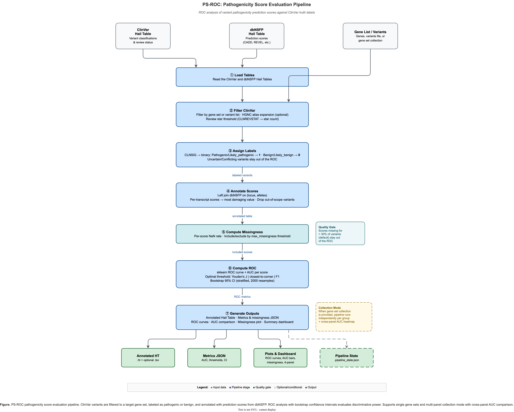

# PS-ROC: pathogenicity score evaluation

PS-ROC measures how well each pathogenicity predictor in dbNSFP separates ClinVar
pathogenic variants from benign ones, within a gene list, an explicit variant list, or each
gene set of a collection. `hvantk psroc` joins a ClinVar table with a dbNSFP table, labels
the variants from ClinVar and reports, for every score, the ROC AUC with a bootstrap 95%
confidence interval, an optimal threshold with its sensitivity and specificity, and how
often the score is missing.



**Figure 1.** PS-ROC stages, from loading the ClinVar and dbNSFP tables to the output
files.

## Inputs

| Input | How to get it | What PS-ROC reads |
| --- | --- | --- |
| ClinVar table | `hvantk reprocess clinvar:variants` (downloads the VCF) | `info.CLNSIG`, `info.CLNREVSTAT`, `info.GENEINFO` |
| dbNSFP table | `hvantk reprocess dbnsfp:variants`, from a file you download yourself | the fields named in `--scores` |
| Variant scope | exactly one of `--genes`, `--genes-file`, `--variants`, `--gene-sets` | see below |

```bash
hvantk reprocess clinvar:variants --raw-dir data/clinvar/ --output data/clinvar.ht
# dbNSFP is bring-your-own: put the combined .bgz file in data/dbnsfp/ first
hvantk reprocess dbnsfp:variants --raw-dir data/dbnsfp/ --output data/dbnsfp.ht
```

[Data sources](../guide/data-sources.md) covers the dbNSFP download and the step that
combines its per-chromosome files. PS-ROC joins the two tables on `(locus, alleles)` and
does no liftover, so build both on the same reference genome.

Choose the variants with one of:

- `--genes BRCA1,BRCA2,TP53` or `--genes-file genes.txt` (one symbol per line; blank
  lines and lines starting with `#` are skipped): one run over all the genes.
- `--variants variants.txt`: one `chr:pos:ref:alt` per line. A missing `chr` prefix is
  added, lines starting with `#` are skipped and lines without four `:`-separated fields
  are ignored. `hvantk ptm export-strata` writes lists in this format.
- `--gene-sets collection.json` (or `.gmt`): one independent run per named gene set.
  [Gene sets](genesets.md) shows how to build a collection from ClinGen, GenCC, COSMIC or
  your own panels, for example:

```bash
hvantk genesets clingen --ht data/clingen.ht --group-by gcep --min-genes 20 \
  -o gene_sets/clingen_gcep.json
```

Gene symbols are matched exactly (case-sensitive) to ClinVar's. Pass `--hgnc data/hgnc.ht`
(the table from `hvantk reprocess hgnc:lookup`) to add each symbol's HGNC aliases and
previous symbols, and the approved symbol of any alias you list, before filtering.

PS-ROC needs the `psroc` extra (scikit-learn, matplotlib); see
[Installation](../getting-started/installation.md).

## How variants are labelled and scored

The stages run in this order: select variants → review-status filter → labels → join scores
→ missingness → ROC → outputs.

### Selecting variants

The gene of a ClinVar variant is the first symbol in `GENEINFO` (`BRCA1:672|NBR2:10230`
gives `BRCA1`), so a variant whose `GENEINFO` lists your gene second is not selected. With
`--variants`, a variant is kept when its `contig:position:ref:alt` equals a line of the
file.

### Review status and labels

With `--min-stars` above 0 (the default is 1), `CLNREVSTAT` is converted to review stars
and variants below the minimum or without a review status are dropped. `--min-stars 0`
turns the filter off. `hvantk reprocess clinvar:variants` stores `CLNREVSTAT` as Hail reads
it from the VCF: an array split at commas, so `criteria_provided,_single_submitter` becomes
`["criteria_provided", "_single_submitter"]`; PS-ROC joins it back into one string with `,`
before the lookup below, so array- and string-typed tables are scored the same way.

| `CLNREVSTAT` | Stars |
| --- | --- |
| `practice_guideline` | 4 |
| `reviewed_by_expert_panel` | 3 |
| `criteria_provided,_multiple_submitters,_no_conflicts` | 2 |
| `criteria_provided,_single_submitter`; `criteria_provided,_conflicting_classifications` (or `_interpretations`) | 1 |
| any other value | 0 |

The label comes from `CLNSIG` (its first element when the field is an array),
matched exactly:

- pathogenic: `Pathogenic`, `Likely_pathogenic`, `Pathogenic/Likely_pathogenic`
- benign: `Benign`, `Likely_benign`, `Benign/Likely_benign`

Every other value (`Uncertain_significance`, `Conflicting_classifications_of_pathogenicity`,
`not_provided`, `risk_factor` and so on), or no value, gets the label
`Uncertain/Conflicting`. Whatever `--min-stars` is, these variants stay in the annotated
table and are counted as excluded, but they enter neither the missingness check nor the
ROC.

### Scores and missingness

Each variant gets its dbNSFP row by `(locus, alleles)`. Every name in `--scores` must be a
field of the dbNSFP table (names are case-sensitive), or the run stops and lists the
fields it found. Any numeric field works, including the `*_rankscore` columns; common
choices are `REVEL_score`, `MetaRNN_score`, `ClinPred_score`, `BayesDel_addAF_score`,
`AlphaMissense_score`, `VEST4_score`, `PrimateAI_score` and `CADD_phred`.

The dbNSFP plugin stores every `*_score` field and `CADD_phred` per transcript. PS-ROC
reduces such a score to its most damaging transcript value: the maximum, or the minimum for
a score where lower is more damaging (see [Score direction](#score-direction)).

Variants with none of the requested scores (indels, and any variant dbNSFP does not
cover) are dropped and counted as out of scope (`n_out_of_scope` in the Python result).
For each score, the missing rate over the remaining pathogenic and benign variants, the
ones the ROC uses, then decides inclusion: a score missing for more than
`--max-missingness` of them (default 0.3; a rate equal to the threshold passes) is left out
of the ROC but still reported. `Uncertain/Conflicting` variants do not count, so a score
missing only for them still passes.

### ROC, confidence interval and threshold

Only pathogenic (1) and benign (0) variants enter the ROC. If fewer than `--min-variants`
of them remain (default 10), PS-ROC logs a warning and writes its outputs without AUCs.
Otherwise each included score is evaluated on the variants where it is present, with
scikit-learn's `roc_curve` and `roc_auc_score`:

- If the variants where a score is present are all pathogenic or all benign, the run
  stops with an error.
- The AUC 95% confidence interval is a stratified percentile bootstrap: pathogenic and
  benign variants are resampled separately, with replacement, `--n-bootstrap` times
  (default 2000) from a fixed seed, so a rerun on the same data gives the same interval.
- The optimal threshold is a point on the ROC curve chosen by `--threshold-method`:

| `--threshold-method` | Picks the ROC point that |
| --- | --- |
| `youden` (default) | maximises Youden's J = TPR − FPR |
| `closest_to_corner` | minimises the distance to the perfect classifier (FPR 0, TPR 1) |
| `f1` | maximises F1 with precision approximated as TPR / (TPR + FPR), which equals the real precision only when both classes are the same size |

The threshold is a value on the score's own scale: variants scoring at or above it are
called pathogenic, or at or below it for a score where lower is more damaging.
Sensitivity and specificity are read at that point, on the same variants that chose it.
PS-ROC computes no p-values: there is no DeLong or permutation test for the difference
between two AUCs, and no precision-recall curve.

### Score direction

PS-ROC knows six raw scores where lower means more damaging: `SIFT_score`,
`SIFT4G_score`, `PROVEAN_score`, `FATHMM_score`, `LRT_score` and `ESM1b_score`. It evaluates such a score
on its negated values, so the ROC, the AUC and its confidence interval are on the usual
scale (above 0.5 for a useful predictor), and reports the thresholds on the score's own
scale. Each result records the direction in `higher_is_pathogenic`: variants are called
pathogenic at or above the threshold when it is `true`, at or below it when it is `false`.
The console summary and the dashboard write a lower-is-damaging threshold with `<=`, for
example `threshold<=0.050`.

Every other score is treated as higher = more damaging. Check the direction of any other
raw score you request: one that runs the other way comes out with 1 minus its real AUC
unless you set it in `score_directions` (Python API, see below). The dbNSFP rank scores
need no setting: in every `*_rankscore`, such as `SIFT_converted_rankscore`, a higher
value is more damaging, and the plugin stores it as one value per variant. Their threshold
is a rank between 0 and 1, not a cut-off on the predictor's own scale.

## Run PS-ROC

```bash
# One gene list
hvantk psroc \
  --genes BRCA1,BRCA2,TP53 \
  --clinvar-ht data/clinvar.ht \
  --dbnsfp-ht data/dbnsfp.ht \
  --scores "REVEL_score,AlphaMissense_score,MetaRNN_score,SIFT_converted_rankscore" \
  --output-dir results/psroc_brca

# Every gene set of a collection, with HGNC alias expansion
hvantk psroc \
  --gene-sets gene_sets/clingen_gcep.json \
  --hgnc data/hgnc.ht \
  --clinvar-ht data/clinvar.ht \
  --dbnsfp-ht data/dbnsfp.ht \
  --scores "REVEL_score,AlphaMissense_score,MetaRNN_score,SIFT_converted_rankscore" \
  --output-dir results/psroc_gcep
```

Add `--dry-run` to validate the inputs and print the plan without running the stages: it
does not start Hail, create the output directory, or read the `--hgnc` table. Stage
progress is logged at INFO level, which the CLI hides by default: add the global `-v`
option before `psroc` (`hvantk -v psroc ...`) to see it, and `--log-file FILE` next to it
to also write the log to a file.

| Option | Default | Description |
| --- | --- | --- |
| `--genes TEXT` | | Comma-separated gene symbols |
| `--genes-file PATH` | | File with one gene symbol per line |
| `--variants PATH` | | File with one `chr:pos:ref:alt` per line |
| `--gene-sets PATH` | | Gene set collection (`.json` or `.gmt`); one run per set |
| `--hgnc PATH` | | HGNC table (`.ht`) for alias expansion of gene symbols |
| `--clinvar-ht PATH` | required | ClinVar Hail table |
| `--dbnsfp-ht PATH` | required | dbNSFP Hail table |
| `--scores TEXT` | required | Comma-separated dbNSFP field names |
| `-o`, `--output-dir PATH` | required | Output directory |
| `--min-stars INTEGER` | `1` | Minimum ClinVar review stars; `0` turns the filter off |
| `--max-missingness FLOAT` | `0.3` | Leave out scores missing for more than this fraction of the pathogenic and benign variants (0 to 1) |
| `--threshold-method` | `youden` | `youden`, `closest_to_corner` or `f1` |
| `--min-variants INTEGER` | `10` | Minimum pathogenic + benign variants for the ROC step |
| `--n-bootstrap INTEGER` | `2000` | Bootstrap resamples for the AUC 95% CI; `0` disables the CI |
| `--output-prefix TEXT` | `psroc` | Prefix of every output file name |
| `--export-tsv` | off | Also write the annotated variants as TSV |
| `--no-plots` | off | Skip the plots |
| `--dry-run` | off | Print the execution plan and stop |

## Outputs

```text
results/psroc_brca/
├── psroc_metrics.json        # ROC metrics per score
├── psroc_missingness.json    # missingness per requested score
├── psroc_annotated.ht/       # one row per variant: label and scores
├── psroc_annotated.tsv       # the same rows as TSV (--export-tsv)
├── plots/
│   ├── psroc_roc_curves.png
│   ├── psroc_auc_comparison.png
│   ├── psroc_missingness.png
│   └── psroc_dashboard.png
├── logs/                     # psroc_<timestamp>.log: the run's log, at the console's level (INFO with -v)
└── .pipeline_state.json      # configuration, completed stages, errors and timings
```

A rerun into the same directory with the same prefix replaces these files.

With `--gene-sets`, each set gets a subdirectory named after it (characters other than
letters, digits, `_` and `-` become `_`), and its files carry the prefix
`<prefix>_<set>`:

```text
results/psroc_gcep/
├── Hereditary_Cancer/
│   ├── psroc_Hereditary_Cancer_metrics.json
│   ├── plots/psroc_Hereditary_Cancer_dashboard.png
│   └── ...
├── Hearing_Loss/
│   └── ...
└── plots/
    └── psroc_collection_heatmap.png   # AUC per score (rows) and gene set (columns)
```

The heatmap is drawn when plots are on and at least two sets produced AUCs. A set whose
run fails, for example because a score is present in only one class, is skipped with a
warning; the command fails only when every set fails. A set with fewer than
`--min-variants` labelled variants is kept, without AUCs.

`{prefix}_metrics.json` maps each score that reached the ROC to its result (values
illustrative):

```json
{
  "REVEL_score": {
    "score_name": "REVEL_score",
    "auc": 0.998,
    "optimal_threshold": 0.454,
    "higher_is_pathogenic": true,
    "sensitivity_at_optimal": 0.98,
    "specificity_at_optimal": 1.0,
    "n_variants_used": 87,
    "missingness": {
      "n_total": 90,
      "n_present": 87,
      "n_missing": 3,
      "missingness_rate": 0.0333,
      "included_in_analysis": true,
      "exclusion_reason": null
    },
    "auc_ci_lower": 0.994,
    "auc_ci_upper": 1.0
  }
}
```

- `higher_is_pathogenic`: the score's direction (see [Score direction](#score-direction)).
  `true`: pathogenic at or above `optimal_threshold`; `false`: at or below it.
- `n_variants_used`: pathogenic and benign variants where this score is present.
- `missingness`: over the pathogenic and benign variants, as in `{prefix}_missingness.json`.
- `auc_ci_lower`, `auc_ci_upper`: present only when `--n-bootstrap` is above 0.

`{prefix}_missingness.json` covers every requested score, computed over the pathogenic
and benign variants in the annotated table (values from the
[PS-ROC example](../examples/psroc.md), with 90 of them):

```json
{
  "CADD_phred": {
    "n_total": 90, "n_present": 83, "n_missing": 7, "missingness_rate": 0.0778,
    "included_in_analysis": true, "exclusion_reason": null
  },
  "VEST4_score": {
    "n_total": 90, "n_present": 52, "n_missing": 38, "missingness_rate": 0.4222,
    "included_in_analysis": false,
    "exclusion_reason": "missingness_rate (0.42) exceeds max_missingness (0.30)"
  }
}
```

The annotated table (and TSV) is keyed by `locus` and `alleles` and holds `label`
(`Pathogenic`, `Benign` or `Uncertain/Conflicting`) and one column per requested score,
with per-transcript scores already reduced to one value. The plots are 300-dpi PNGs: ROC
curves with the optimal points marked and AUC [CI] in the legend, AUCs with CI bars,
missingness against the threshold, and a dashboard combining the three with the gene,
pathogenic and benign counts. The ROC, AUC and dashboard plots need at least one AUC. A
plot that fails is logged as a warning and does not stop the run.

When reading the results:

- Compare AUCs together with their CIs and `n_variants_used`. Each score is evaluated on
  the variants where it is present, so two scores can be measured on different variants
  (see [Caveats](#caveats)).
- The console summary of a single run prints the variant counts, each score's AUC [CI] and
  threshold (`threshold<=` for a lower-is-damaging score), and the scores left out for
  missingness. "Excluded" counts the `Uncertain/Conflicting` variants kept in the table.

## Python API

```python
from hvantk.algorithms.psroc import PSROCConfig, PSROCPipeline
from hvantk.skills.clinvar.streamers import ClinVarVariantTableStreamer

config = PSROCConfig(
    genes=["BRCA1", "BRCA2", "TP53"],
    clinvar_ht="data/clinvar.ht",
    dbnsfp_ht="data/dbnsfp.ht",
    scores=["REVEL_score", "AlphaMissense_score", "MetaRNN_score"],
    output_dir="results/psroc_brca",
    # Required: the ClinVar label vocabulary (the CLI passes the same lists).
    pathogenic_labels=ClinVarVariantTableStreamer.PATHOGENIC_LABELS,
    benign_labels=ClinVarVariantTableStreamer.BENIGN_LABELS,
)
pipeline = PSROCPipeline(config)  # validates, creates the output dirs, starts Hail
result = pipeline.run()
print(result.summary())
for name, roc in result.metrics.items():
    print(name, round(roc.auc, 3), roc.auc_ci_lower, roc.auc_ci_upper)
```

`PSROCConfig` takes the CLI options as fields (`genes`, `genes_file`, `variants_path`,
`gene_set_collection`, `clinvar_ht`, `dbnsfp_ht`, `scores`, `output_dir`, `output_prefix`,
`min_stars`, `max_missingness`, `threshold_method`, `hgnc_path`, `export_tsv`,
`generate_plots`, `min_variants`, `n_bootstrap`), with the same defaults, plus:

- `pathogenic_labels`, `benign_labels`: required; without them `PSROCPipeline` raises
  `Configuration validation failed`.
- `score_directions`: `{score: bool}` setting a score's direction (`True` = higher is more
  damaging, `False` = lower is), on top of the six lower-is-damaging scores PS-ROC knows.
  The direction picks the per-transcript value and orients the ROC (see
  [Score direction](#score-direction)). `run_collection()` passes it on to every per-set
  run.

For a gene set collection, pass a dict of sets and call `run_collection()`. Alias expansion
needs a gene catalog passed to the pipeline; `hgnc_path` alone only records the path:

```python
from hvantk.algorithms.psroc import PSROCConfig, PSROCPipeline
from hvantk.skills.clinvar.streamers import ClinVarVariantTableStreamer
from hvantk.skills.hgnc.streamers import HGNCGeneCatalogStreamer

config = PSROCConfig(
    gene_set_collection={
        "cardiac": {"MYH7", "TNNT2", "LMNA"},
        "epilepsy": {"SCN1A", "SCN2A", "KCNQ2"},
    },
    clinvar_ht="data/clinvar.ht",
    dbnsfp_ht="data/dbnsfp.ht",
    scores=["REVEL_score", "AlphaMissense_score"],
    output_dir="results/psroc_panels",
    pathogenic_labels=ClinVarVariantTableStreamer.PATHOGENIC_LABELS,
    benign_labels=ClinVarVariantTableStreamer.BENIGN_LABELS,
)
catalog = HGNCGeneCatalogStreamer.from_path("data/hgnc.ht")
results = PSROCPipeline(config, gene_catalog=catalog).run_collection()  # {set: PSROCResult}
```

A `PSROCResult` holds `metrics` (score → `ROCResult`), `missingness` (score →
`ScoreMissingness`), `n_pathogenic`, `n_benign`, `n_excluded`, `n_total`, `n_out_of_scope`,
`n_genes`, `scores_included`, `scores_excluded`, `max_missingness_threshold`, `output_dir`
and `annotated_ht_path`, plus `summary()` and `to_dict()`. A `ROCResult` holds `fpr`,
`tpr`, `thresholds`, `auc`, `auc_ci_lower`, `auc_ci_upper`, `optimal_threshold`,
`higher_is_pathogenic`, `sensitivity_at_optimal`, `specificity_at_optimal`,
`n_variants_used` and `missingness`; `thresholds` and `optimal_threshold` are on the
score's own scale. `scores_included` lists the scores that passed the missingness check,
which still get no AUC when the ROC step is skipped for too few labelled variants, so
iterate over `metrics` for the scores that have one.

The ROC functions also work on plain arrays, without Hail tables:

```python
import numpy as np
from hvantk.algorithms.psroc import compute_roc_metrics, plot_roc_curves

labels = np.array([0, 0, 0, 1, 1, 1])  # 1 = pathogenic, 0 = benign
scores = {
    "score_a": np.array([0.1, 0.4, 0.35, 0.8, 0.3, np.nan]),  # NaN = missing
    "score_b": np.array([2.0, 1.0, 3.0, 4.0, 5.0, 2.5]),
    "score_c": np.array([0.9, 0.6, 0.7, 0.02, 0.1, 0.3]),  # lower = more damaging
}
results = compute_roc_metrics(
    labels,
    scores,
    threshold_method="youden",
    n_bootstrap=1000,
    score_directions={"score_c": False},
)
for name, roc in results.items():
    print(name, roc.auc, roc.optimal_threshold, roc.auc_ci_lower, roc.auc_ci_upper)
plot_roc_curves(results, output_path="roc_curves.png")
```

`compute_roc_metrics` defaults to `n_bootstrap=0` (no CI), unlike the CLI. It treats a
score as higher = more damaging unless `score_directions` maps it to `False`: unlike the
pipeline, it does not know the six lower-is-damaging dbNSFP scores. The package also
exports `compute_all_missingness`, `compute_score_missingness`,
`filter_scores_by_missingness`, `find_optimal_threshold`, `plot_roc_curve_single`,
`plot_auc_comparison`, `plot_missingness_summary` and `plot_psroc_summary_dashboard`; the
collection heatmap is `plot_collection_heatmap` in `hvantk.algorithms.psroc.plots`. Each
plot function returns the matplotlib figure and, given `output_path`, saves it as a PNG
(the `.png` suffix is optional).

## Caveats

- **Circularity.** Many predictors were trained on ClinVar or HGMD variants (REVEL,
  MetaRNN and ClinPred among them), so their AUC against ClinVar labels is optimistic and
  favours them over predictors trained without disease labels. PS-ROC does not correct for
  this. The `scores:` block of the
  [dbNSFP plugin manifest](https://github.com/bigbio/hvantk/blob/main/hvantk/skills/dbnsfp/plugin.yaml)
  records the training data of most rank scores.
- **Different variants per score.** A score that is also defined for nonsense and
  splice-site SNVs (such as `CADD_phred`) is evaluated on a different, often easier, set
  than a missense-only predictor. Because a variant stays when any requested score is
  present, adding such a score also raises the other scores' missingness. For a
  like-for-like comparison, request scores with similar coverage and check
  `n_variants_used`.
- **Score direction.** Only six raw scores are known to run lower = more damaging (see
  [Score direction](#score-direction)). Any other raw score that runs that way gets 1 minus
  its real AUC, below 0.5, unless you set its direction in `score_directions` or request
  its `*_rankscore` instead.
- **Coverage of uncertain variants.** Missingness is measured on the pathogenic and benign
  variants only, so a score that is often missing for the `Uncertain/Conflicting` variants,
  the ones you may want it to classify, still passes. Check their scores in the annotated
  table.
- **Label imbalance.** AUC does not depend on the ratio of pathogenic to benign variants,
  but thresholds do: the `f1` method assumes equal class sizes, and a threshold chosen in a
  gene set dominated by one class may not transfer to another.
- **Small gene sets.** `--min-variants` is the floor for running the ROC, not a sample size
  that makes an AUC reliable. With few variants per class the bootstrap interval is wide
  and unstable; check the class counts and the CI before ranking predictors.
- **In-sample thresholds.** The optimal threshold and its sensitivity and specificity are
  chosen and measured on the same variants; validate them on independent data before using
  them as a cut-off.

## Troubleshooting

| Message | Meaning and fix |
| --- | --- |
| `Requested scores not found in dbNSFP table` | A `--scores` name is not a field of the table. Names are case-sensitive; the message lists the fields found. |
| `Score '<name>' has only one class after filtering missing values` | Where this score is present, every variant is pathogenic (or every one benign). Widen the gene set, lower `--min-stars`, or drop the score. With `--gene-sets`, only that set is skipped. |
| `Too few labeled variants (N) for ROC analysis` | Fewer than `--min-variants` pathogenic and benign variants remain; the outputs are written without AUCs. |
| `No scores passed the missingness threshold` | Every score is missing for more than `--max-missingness` of the pathogenic and benign variants. Check `{prefix}_missingness.json`, raise the threshold or choose scores with better coverage. |
| `No valid variants found in <file>` | The `--variants` file has no `chr:pos:ref:alt` lines. |

## See also

- [Gene sets](genesets.md): build the collections that `--gene-sets` takes.
- [Data sources](../guide/data-sources.md): the ClinVar download and dbNSFP acquisition.
- [Building datasets](../guide/usage.md#build-a-dataset): `hvantk reprocess`.
- [PTM](ptm.md): run PS-ROC on PTM and non-PTM variant strata.
- [PS-ROC example](../examples/psroc.md): a complete run on synthetic data.
- ClinVar [review status](https://www.ncbi.nlm.nih.gov/clinvar/docs/review_status/) and
  [dbNSFP](https://www.dbnsfp.org/).
