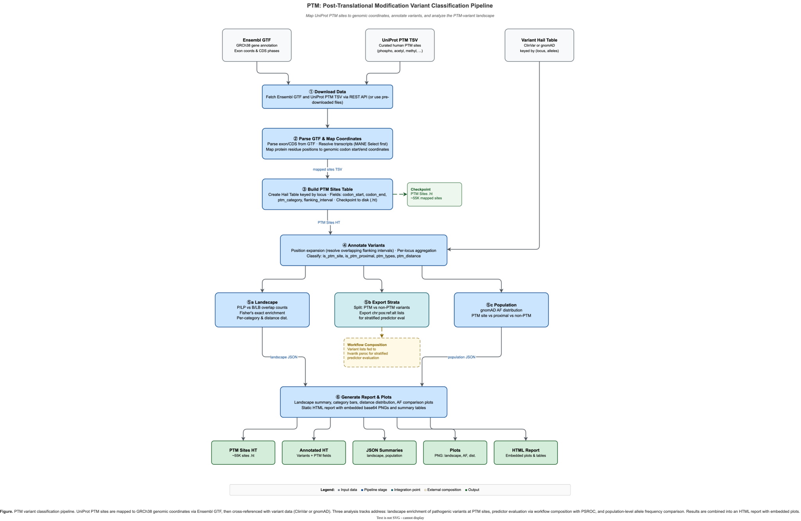

# PTM variant classification

`hvantk ptm` places post-translational modification (PTM) sites on their GRCh38 codons,
classifies variants by where they fall relative to those codons, and analyzes the
classes. This page covers the sites table, the classification and every subcommand
except `constraint`, which has its own page: [PTM constraint](ptm-constraint.md). For a
run from start to finish, see the [PTM example](../examples/ptm.md).



**Figure 1.** From UniProt sites and the Ensembl GTF to the sites table, the variant
annotation, the landscape, strata and population analyses, and the report. `test` and
`constraint` are not drawn.

| Command | What it does | Writes |
| --- | --- | --- |
| [`build`](#build-the-sites-table) | Maps UniProt PTM sites, plus optional PeptideAtlas and CPTAC phosphosites, to GRCh38 codons | Sites Hail Table, mapped TSVs |
| [`annotate`](#annotate-a-variant-table) | Adds the PTM fields to a variant table | Hail Table |
| [`landscape`](#landscape) | Compares ClinVar P/LP and B/LB variants at and near PTM sites | JSON, PNGs |
| [`population`](#population) | Summarizes allele frequency by PTM class | JSON, PNG |
| [`export-strata`](#export-strata-for-psroc) | Writes PTM and non-PTM variant lists for `hvantk psroc` | Two text files |
| [`report`](#report) | Renders the landscape and population results as one HTML page | HTML, PNGs |
| [`test`](#per-stratum-mixed-models) | Fits a mixed model of allele frequency on PTM status in each stratum | TSV |
| `constraint` | Allele-frequency depletion by tissue or cell type, see [PTM constraint](ptm-constraint.md) | TSVs, PNGs, HTML |

## Requirements

- `build`, `annotate`, `landscape`, `population` and `export-strata` need only the base
  install; they run on Hail. `build` downloads from UniProt and Ensembl unless you pass
  local files.
- `report`, and `--save-plots` on `landscape` and `population`, need matplotlib, which the
  `viz` extra installs.
- `test` and `constraint` need the `constraint` extra. Without statsmodels, `test` stops
  with a message that names it.
- CPTAC sites come from `hvantk download cptac-phospho`, which needs the `ptm` extra.

[Installation](../getting-started/installation.md) lists the extras.

## How variants are classified

`annotate` compares each variant's position with every codon in the sites table.
`landscape` and `population` run the same step on their input table.

- A site occupies its codon: the three bases from `codon_start`. A codon split by an
  intron is treated as the three contiguous bases from `codon_start`.
- The site's window extends `--flanking-codons` × 3 bp (default 5 codons, 15 bp) beyond
  each end of the codon. It is counted in genomic bases, so it can reach into an intron,
  and it is clipped at the contig ends.
- A variant inside any site's codon is a **site** variant. Otherwise, a variant inside
  any site's window is **proximal**. Every other variant is **non-PTM**. Site takes
  precedence, so the two flags are never both true.
- Only the position counts: every allele at a position gets the same class.

The variant table needs a GRCh38 `locus` field (the sites table is GRCh38). `annotate`
keeps all its fields and adds:

| Field | Type | Value |
| --- | --- | --- |
| `is_ptm_site` | bool | The variant lies in a PTM codon |
| `is_ptm_proximal` | bool | The variant lies in a window but in no codon |
| `ptm_distance` | int32 | Distance to the nearest codon in codons, `ceil(bp / 3)`: 0 in a codon, at most `--flanking-codons` in a window. Counted in genomic bases, so it is not the residue distance when an intron lies between |
| `ptm_types` | set\<str\> | The `ptm_category` of every site whose codon or window covers the position, not only the nearest |
| `ptm_evidence` | array\<struct\> | One struct per row of the nearest site or sites, with `source_db`, `evidence_type`, `n_observations`, `uniprot_id`, `gene_symbol`, `residue_pos`, `amino_acid` and `ptm_type`. Added only when the sites table has at least one of these fields; a table from `build` has all of them |

For a non-PTM variant both flags are `False` and the other three fields are missing.
`landscape`, `export-strata` and `constraint` treat site and proximal variants together
as PTM variants; `population` reports the three classes separately.

## Build the sites table

```bash
hvantk ptm build --output-dir data/ptm/ --output-ht data/ptm/ptm_sites.ht
```

`build` downloads the UniProt sites and the Ensembl GTF into `--output-dir` (or reuses
them), maps every site to its codon, and writes the Hail Table with the
`uniprot-ptm:sites` plugin builder. `hvantk reprocess uniprot-ptm:sites` builds the same
table from UniProt alone (see [Data sources](../guide/data-sources.md)); `build` is the
command that also adds PeptideAtlas and CPTAC sites.

### Sources

| Source | How `build` gets it | Sites | `n_observations` |
| --- | --- | --- | --- |
| UniProt (always) | Downloads `uniprot-ptm-human-<date>.tsv`, or takes `--ptm-tsv` (written by `hvantk download uniprot-ptm`) | `Modified residue` (MOD_RES) features of reviewed (Swiss-Prot) human proteins, on the canonical sequence | 0 |
| PeptideAtlas | `--peptideatlas-tsv`, written by `hvantk download peptideatlas-phospho` | Phosphorylated S, T and Y observed on canonical proteins in one PeptideAtlas build | Observations summed over the phosphopeptide forms that carry the site |
| CPTAC | `--cptac-tsv`, written by `hvantk download cptac-phospho` | Phosphorylated S, T and Y quantified in CPTAC tumor and normal samples; `tissue_type` is `tumor` or `normal` | Samples with a measured intensity |

The UniProt search endpoint has no versioned archive, so a later download can give a
different table. Keep the downloaded TSV and pass it with `--ptm-tsv` to rebuild the same
table. A file downloaded the same day is reused.

PeptideAtlas: `hvantk download peptideatlas-phospho -o data/ptm/` writes
`peptideatlas-phospho-<build_date>-<build_id>.tsv` and prints its path. A TSV written by
hvantk before 0.4.0 over-counts `n_observations`, and the download reuses an existing
TSV, so delete the old file (or pass `--overwrite`) and download again.

CPTAC: `hvantk download cptac-phospho` needs `--cancer-type` or `--all`. Pass
`cptac-phospho-<cancer_type>.tsv` (tumor and normal rows) or, after `--all`,
`cptac-phospho-pancancer.tsv`. The `-tumor.tsv` and `-normal.tsv` files have the same
layout and hold one tissue type each. The `-matrix.csv` and `-metadata.csv` files are
for the `cptac:phospho` dataset, not for `build`.

### Mapping sites to codons

Each protein maps through one Ensembl transcript from the pinned GTF
(`Homo_sapiens.GRCh38.113.gtf.gz`), chosen in this order:

1. `xref_mane`: a transcript in the protein's UniProt Ensembl cross-references that is
   MANE Select.
2. `xref_any`: the first cross-referenced transcript with a CDS.
3. `gene_mane`: the MANE Select transcript of the protein's gene symbol.

A protein with no match is `unresolved`, and its sites fail. PeptideAtlas and CPTAC
rows carry no cross-references, so they map only through `gene_mane`.

Residue *p* maps to bases 3*p* - 2 to 3*p* of the transcript's CDS, on either strand.
`codon_start` and `codon_end` are the lowest and highest genomic positions of those
bases, so a codon split by an intron spans the intron. A residue beyond the end of the
CDS fails. The mapper does not check that the codon encodes the source's amino acid: a
site lands on the right codon only when the source protein sequence matches the
transcript.

### Categories

`ptm_category` comes from the start of the site's description (`ptm_type`):

| Category | Description starts with |
| --- | --- |
| `phosphorylation` | `Phosphoserine`, `Phosphothreonine`, `Phosphotyrosine` |
| `acetylation` | `N6-acetyllysine` |
| `methylation` | `N6-methyllysine`, `N6,N6-dimethyllysine`, `N6,N6,N6-trimethyllysine`, `Asymmetric dimethylarginine`, `Symmetric dimethylarginine`, `Omega-N-methylarginine` |
| `other` | Anything else |

PeptideAtlas and CPTAC sites are all `phosphorylation`. The prefix list in the code also
maps glycosylation, SUMOylation and ubiquitination, but UniProt records those as
`Glycosylation` and `Cross-link` features, which the download does not fetch, so a table
from `build` has none of them.

### Combining sources

Each source is mapped on its own, to `ptm_sites_mapped.tsv.bgz` (UniProt),
`peptideatlas_sites_mapped.tsv.bgz` and `cptac_sites_mapped.tsv.bgz` in `--output-dir`.
With more than one source, `build` concatenates them into `ptm_sites_combined.tsv.bgz`
and builds the table from that file. Rows are not merged: a residue reported by two
sources, or by CPTAC in both tumor and normal tissue, keeps one row per report, each
with its own `source_db`, `evidence_type` (`curated` for UniProt, `mass_spectrometry`
otherwise), `n_observations` and `tissue_type`. The classification pools all rows at a
position, so these duplicates change only `ptm_evidence`.

### The sites table

The table is keyed by `locus`, the position of `codon_start`. Contigs get a `chr` prefix
(`MT` becomes `chrM`), rows on contigs outside GRCh38 are dropped, and several rows can
share a locus. Its fields are `chrom`, `codon_start`, `codon_end`, `strand`,
`uniprot_id` (the source's protein accession), `gene_symbol`, `residue_pos`,
`amino_acid`, `ptm_type`, `ptm_category`, `source_db`, `evidence_type`,
`n_observations`, `tissue_type` and `flanking_interval` (the codon extended by
`--flanking-codons` × 3 bp). No command reads `flanking_interval`: `annotate`,
`landscape` and `population` apply their own `--flanking-codons`.

`build` prints a summary like this one (`Resolution` counts proteins, not sites):

```text
Sources: UniProt (<n> mapped), PeptideAtlas (<n> mapped)
Mapping complete: <mapped>/<total> mapped (<percent>%), <failed> failed
Resolution: {'xref_mane': <n>, 'xref_any': <n>, 'gene_mane': <n>, 'unresolved': <n>}
Mapped TSV: data/ptm/ptm_sites_combined.tsv.bgz
Hail Table: data/ptm/ptm_sites.ht
```

A source that maps no site is logged as a warning; it usually means the wrong file. If
no site maps at all, `build` exits with an error and writes no table. Without
`--overwrite`, an existing `--output-ht` stops the run before anything is downloaded.

| Option | Default | Description |
| --- | --- | --- |
| `-o`, `--output-dir` | required | Directory for the downloads and the mapped TSVs |
| `--output-ht` | required | Sites table to write |
| `--gtf-path` | download | Ensembl GRCh38 GTF to use instead of downloading `Homo_sapiens.GRCh38.113.gtf.gz` |
| `--ptm-tsv` | download | UniProt TSV to use instead of downloading one |
| `--peptideatlas-tsv` | none | PeptideAtlas site TSV to add |
| `--cptac-tsv` | none | CPTAC site TSV to add |
| `--flanking-codons` | 5 | Width of the stored `flanking_interval`, in codons |
| `--overwrite` | off | Download the GTF and UniProt TSV again instead of reusing them, and replace an existing `--output-ht` |

## Annotate a variant table

```bash
hvantk ptm annotate \
  --variants-ht data/clinvar.ht \
  --ptm-ht data/ptm/ptm_sites.ht \
  -o data/clinvar_ptm.ht
```

`annotate` writes the fields described in
[How variants are classified](#how-variants-are-classified) and prints how many variants
are site and proximal variants.

| Option | Default | Description |
| --- | --- | --- |
| `--variants-ht` | required | Variant Hail Table with a GRCh38 `locus` field |
| `--ptm-ht` | required | Sites table from `build` |
| `-o`, `--output-ht` | required | Annotated table to write |
| `--flanking-codons` | 5 | Window beyond each end of a codon, in codons |
| `--overwrite` | off | Replace an existing output table |

## Landscape

```bash
hvantk ptm landscape \
  --clinvar-ht data/clinvar.ht \
  --ptm-ht data/ptm/ptm_sites.ht \
  -o results/landscape/ \
  --save-plots
```

`landscape` classifies a ClinVar table (built with `hvantk reprocess clinvar:variants`,
or any table with `info.CLNSIG`) and labels each variant by its `CLNSIG`, taking the
first value when the field is an array:

- P/LP: `Pathogenic`, `Likely_pathogenic` or `Pathogenic/Likely_pathogenic`.
- B/LB: `Benign`, `Likely_benign` or `Benign/Likely_benign`.
- Any other value counts only in the total, `n_variants`.

It then computes:

- Enrichment: the 2×2 table of P/LP against B/LB variants by PTM (site or proximal)
  against non-PTM. The odds ratio is scipy's conditional maximum-likelihood estimate
  with its 95% confidence interval; the p-value is from a two-sided Fisher's exact test.
- Per-category enrichment: for each category in `ptm_types`, the same test among PTM
  variants only, comparing the variants with that category against those without it. A
  variant with several categories counts in each.
- The P/LP count per category and per `ptm_distance` (0 means in a codon).

| File in `-o` | Contents |
| --- | --- |
| `landscape_summary.json` | `n_variants`, `n_pathogenic`, `n_benign`; `ptm_site` and `ptm_proximal` (P/LP and B/LB counts); `enrichment` (`odds_ratio`, `ci_low`, `ci_high`, `p_value`); `overlap_by_category`; `category_enrichment` (counts, odds ratio, interval and p-value per category); `distance_distribution` |
| `landscape_summary.png` | P/LP and B/LB counts per class with the odds ratio, and the P/LP share per class against the overall rate (`--save-plots`) |
| `overlap_by_category.png` | P/LP count per category (`--save-plots`) |
| `distance_distribution.png` | P/LP count per distance (`--save-plots`) |

| Option | Default | Description |
| --- | --- | --- |
| `--clinvar-ht` | required | ClinVar Hail Table |
| `--ptm-ht` | required | Sites table from `build` |
| `-o`, `--output` | required | Output directory |
| `--flanking-codons` | 5 | Window beyond each end of a codon, in codons |
| `--save-plots` | off | Also write the PNG plots |

## Population

```bash
hvantk ptm population \
  --gnomad-ht data/gnomad_sites.ht \
  --ptm-ht data/ptm/ptm_sites.ht \
  --af-field AF \
  -o results/population/ \
  --save-plots
```

`population` classifies a variant table with an allele-frequency (AF) field and
summarizes each class. The option is named `--gnomad-ht`, but any variant table works.

- `--af-field` must name a top-level numeric field with a value on every row. gnomAD
  release tables keep frequencies in the `freq` array; copy the entry you want into a
  top-level field first.
- Non-PTM means every other variant in the table. Nothing restricts it to coding
  positions, so filter the table first if that is the comparison you want.
- For each class it reports the variant count and mean AF, and for site variants the
  number with an AF of exactly 0. It runs no statistical test.
- It keeps up to 5,000 AF values per class for the plot. These are an arbitrary subset,
  not a random sample.

| File in `-o` | Contents |
| --- | --- |
| `population_summary.json` | `n_variants`, `n_ptm_site`, `n_ptm_proximal`, `n_non_ptm`, `mean_af` per class, `n_zero_af_ptm`, and the kept values (`ptm_site_afs`, `proximal_afs`, `non_ptm_afs`) |
| `population_af.png` | The kept AF values per class on a log scale with their medians, and the share below 1e-4 per class (`--save-plots`) |

| Option | Default | Description |
| --- | --- | --- |
| `--gnomad-ht` | required | Variant Hail Table with an AF field |
| `--ptm-ht` | required | Sites table from `build` |
| `--af-field` | `AF` | AF field name |
| `-o`, `--output` | required | Output directory |
| `--flanking-codons` | 5 | Window beyond each end of a codon, in codons |
| `--save-plots` | off | Also write the PNG plot |

## Export strata for psroc

```bash
hvantk ptm export-strata --annotated-ht data/clinvar_ptm.ht -o strata/
```

`export-strata` reads a table from `annotate` and writes `ptm_variants.txt` (site and
proximal variants) and `non_ptm_variants.txt` (all others) to `-o`. Each line is one
`contig:pos:ref:alt` with the contig as stored (for example `chr1`) and the first
alternate allele; there is no header. Pass each list to `hvantk psroc` with `--variants`
to compare predictor performance between the strata ([PS-ROC](psroc.md)); the
[PTM example](../examples/ptm.md) runs both.

| Option | Default | Description |
| --- | --- | --- |
| `--annotated-ht` | required | Table from `annotate` |
| `-o`, `--output` | required | Output directory |

## Report

```bash
hvantk ptm report \
  -o results/ptm_report.html \
  --landscape-json results/landscape/landscape_summary.json \
  --population-json results/population/population_summary.json
```

`report` needs at least one of the two JSON files. The page holds summary cards, a short
"Key findings" list generated from the numbers, the landscape plots and per-category
enrichment table, the population plot, and a methods paragraph. The plots are redrawn
from the JSON, embedded in the page and also written next to it as
`ptm_landscape_summary.png`, `ptm_overlap_by_category.png`,
`ptm_distance_distribution.png` and `ptm_population_af.png`. The methods paragraph is
fixed text that does not reflect the options you ran; for example, it always states the
tool's default flanking width, not the `--flanking-codons` value a `landscape` or
`population` run actually used.

| Option | Default | Description |
| --- | --- | --- |
| `-o`, `--output` | required | HTML file to write |
| `--landscape-json` | none | `landscape_summary.json` from `landscape` |
| `--population-json` | none | `population_summary.json` from `population` |
| `--title` | `PTM-Variant Analysis Report` | Page title |
| `--description` | none | Paragraph shown under the title |

## Per-stratum mixed models

```bash
hvantk ptm test --test lmm \
  --input variants.tsv \
  --stratum-col tissue \
  -o results/tissue_lmm.tsv
```

`test` fits one linear mixed model for each value of `--stratum-col`, typically a tissue
or cell type you assigned to each variant. It reads a CSV or TSV, plain, `.gz` or `.bgz`
(a `.csv` name is read as CSV, any other as TSV), with one row per variant: the gene
(`--gene-col`), the AF (`--af-col`), the PTM status as a boolean or 0/1
(`--is-ptm-col`) and the stratum. No `ptm` command writes this table. Export it yourself,
for example from an `annotate` output with `is_ptm` true for site and proximal variants.

Rows missing the gene, AF or PTM status, and rows with an AF of 0 or less, are dropped.
The response is `log_af` = log10(AF + 1e-8), each gene gets a random intercept, and the
fit uses statsmodels `mixedlm` with REML.

- `--test lmm` fits `log_af ~ is_ptm + (1|gene)`. A stratum is fitted only with at least
  30 PTM variants, 30 non-PTM variants and 10 genes that have both; otherwise its row has
  empty estimates and a `note`. `beta_ptm` is the PTM effect on log10 AF (negative means
  lower AF at PTM variants), with its standard error `se_ptm` and Wald p-value `p_ptm`.
- `--test lmm-binned` fits `log_af ~ is_ptm * expr_bin + (1|gene)` and needs a gene ×
  stratum expression matrix: `--expression-pkl`, a pickled pandas DataFrame (load only
  pickles you trust), or `--expression-tsv`, with genes in the first column and one
  column per stratum. The pickle wins if you pass both. In each stratum a variant takes
  its gene's expression there (0 when the gene is absent). Zero-expression variants form
  the reference bin `b0_none`; the rest are split into up to four quantile bins of
  log2(expression + 1), `b1_Q1` to `b4_Q4`, and tied quantiles merge. A stratum is
  fitted only with at least 100 variants of positive expression and 5 variants in every
  bin and PTM-status cell, `b0_none` included. For each bin, `beta_<bin>` is the PTM
  effect in that bin (the main effect plus the bin's interaction) and `se_<bin>` its
  standard error. `p_<bin>` is the p-value of the main `is_ptm` term for `b0_none`, and
  of the interaction term, the difference from `b0_none`, for every other bin. A stratum
  missing from the matrix gets a row with a `note`.

The output TSV has one row per stratum:

- `lmm`: `stratum`, `n_variants`, `n_ptm`, `n_nonptm`, `n_genes`, `n_mixed_genes`,
  `beta_ptm`, `se_ptm`, `p_ptm`, `converged`, `note`.
- `lmm-binned`: `stratum`, `n_variants`, `n_genes`, `bin_levels`, `converged`, `note`,
  then `beta_<bin>`, `se_<bin>` and `p_<bin>` for each bin fitted.

The p-values are not adjusted for the number of strata. For the rank-based stratified
analysis with plots and a report, see [PTM constraint](ptm-constraint.md).

| Option | Default | Description |
| --- | --- | --- |
| `--test` | required | `lmm` or `lmm-binned` |
| `--input` | required | Variant table (CSV or TSV) |
| `--stratum-col` | required | Column with each variant's stratum |
| `-o`, `--output` | required | TSV to write |
| `--gene-col` | `gene` | Gene column |
| `--af-col` | `af_filled` | AF column |
| `--is-ptm-col` | `is_ptm` | PTM-status column |
| `--expression-pkl` | none | `lmm-binned`: pickled gene × stratum DataFrame |
| `--expression-tsv` | none | `lmm-binned`: gene × stratum TSV |

## Python API

```python
import hail as hl

from hvantk.algorithms.ptm import (
    PTMBuildConfig,
    annotate_variants_with_ptm,
    export_ptm_strata,
    generate_report,
    ptm_landscape,
    ptm_population,
)
from hvantk.skills.clinvar.shared.constants import (
    CLINVAR_BENIGN_LABELS,
    CLINVAR_PATHOGENIC_LABELS,
)
from hvantk.tools.ptm.pipeline import ptm_build_pipeline

# What `hvantk ptm build` runs. hvantk.algorithms.ptm.ptm_build_pipeline_core is the
# mapping step alone: it needs config.ptm_tsv and writes no Hail Table.
build = ptm_build_pipeline(
    PTMBuildConfig(output_dir="data/ptm/", output_ht="data/ptm/ptm_sites.ht")
)
print(build.source_counts, f"{build.n_mapped}/{build.n_total} sites mapped")

ptm = hl.read_table(build.output_ht)
clinvar = hl.read_table("data/clinvar.ht")

annotated = annotate_variants_with_ptm(clinvar, ptm, flanking_codons=5)
annotated = annotated.checkpoint("data/clinvar_ptm.ht")
strata = export_ptm_strata(annotated, "strata/")  # {"ptm": path, "non_ptm": path}

# landscape and population classify their input table themselves.
landscape = ptm_landscape(
    clinvar,
    ptm,
    "results/landscape/",
    pathogenic_labels=CLINVAR_PATHOGENIC_LABELS,  # both label sets are required
    benign_labels=CLINVAR_BENIGN_LABELS,
)
population = ptm_population(
    hl.read_table("data/gnomad_sites.ht"), ptm, "results/population/", af_field="AF"
)
print(landscape.summary())
print(population.summary())

generate_report(
    "results/ptm_report.html",
    landscape_result=landscape,
    population_result=population,
)
```

For variant tables in pandas, `annotate_variants_by_symbol(variants_df, ptm_df)` adds
`is_ptm_site` and `is_ptm_proximal` by matching gene symbol and chromosome against a
mapped TSV from `build` read into pandas (`SYMBOL`, `chrom` and `pos` columns by
default). Its rules differ from `annotate`: a site variant lies anywhere from
`codon_start` to `codon_end`, a proximal variant lies within `proximal_bp` (default 21)
bases of that interval, and `is_ptm_proximal` is also true for site variants.

## See also

- [PTM constraint](ptm-constraint.md): allele-frequency depletion by tissue or cell type
- [PTM example](../examples/ptm.md): a run from the sites table to the report
- [PS-ROC](psroc.md): predictor evaluation on the exported strata
- [Data sources](../guide/data-sources.md): the UniProt, PeptideAtlas and CPTAC
  downloads, and `hvantk reprocess uniprot-ptm:sites`
- Source code: [`hvantk/algorithms/ptm/`](https://github.com/bigbio/hvantk/tree/main/hvantk/algorithms/ptm)
  and [`hvantk/tools/ptm/ptm_cli.py`](https://github.com/bigbio/hvantk/blob/main/hvantk/tools/ptm/ptm_cli.py)
