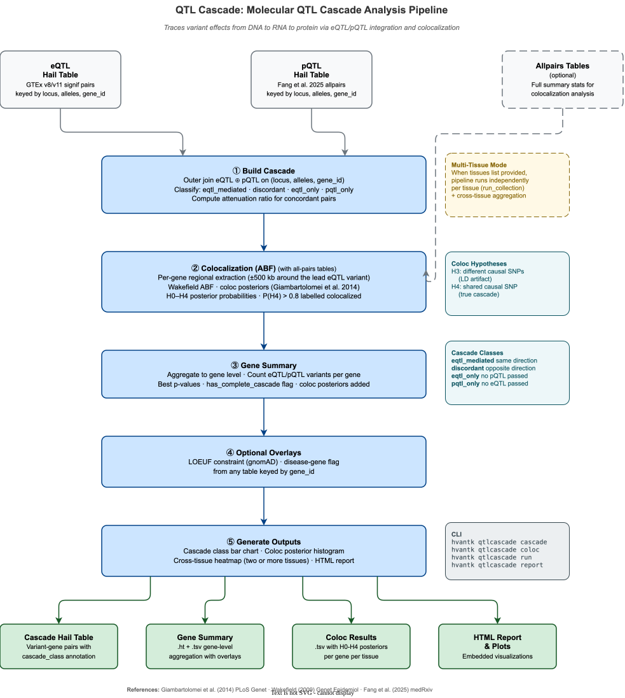

# QTL cascade

`hvantk qtlcascade` asks whether a variant that changes a gene's mRNA level (an eQTL)
also changes the level of its protein (a pQTL), in the same direction, and whether the
two signals share one causal variant. It joins eQTL and pQTL summary statistics by
variant and gene, classifies each variant-gene pair, colocalises the two signals gene by
gene with approximate Bayes factors (ABF), and summarises the evidence per gene,
optionally with gnomAD constraint and a disease-gene list. A separate command,
`gwas-coloc`, colocalises one GWAS locus with cis-eQTLs to rank candidate effector genes
and checks the top gene with SuSiE fine-mapping.

For a run on one tissue from raw files to report, see the
[walkthrough](../examples/qtlcascade.md).



**Figure 1.** The eQTL × pQTL pipeline run by `hvantk qtlcascade run`. `gwas-coloc`
is a separate command.

## Commands

| Command | What it does | Needs |
| --- | --- | --- |
| `run` | Full pipeline: cascade join, colocalisation (optional), gene summary, plots, HTML report; one or several tissues | Hail |
| `cascade` | Join and classify only; writes the cascade table | Hail |
| `coloc` | ABF colocalisation for a list of genes; writes a TSV | Hail |
| `report` | Rebuilds the HTML report from existing TSVs and PNGs | No Hail |
| `gwas-coloc` | Colocalises a FinnGen GWAS locus with eQTL Catalogue cis-eQTLs, then confirms with SuSiE | Network access, no Hail |

There is no gene-summary command: `run` writes the summary, or call
`build_cascade_gene_summary` from Python.

## Inputs

### eQTL and pQTL tables

The cascade reads two Hail Tables keyed by `(locus, alleles, gene_id)` with the fields
`beta`, `se` and `p_value`, plus `tissue` when you filter by tissue. Two plugins build
them with `hvantk reprocess` ([Building datasets](../guide/usage.md#build-a-dataset);
where to get the files: [Data sources](../guide/data-sources.md#qtl-data)):

| Dataset | Raw files | Plugin arguments that matter here |
| --- | --- | --- |
| `gtex-eqtl:eqtls` | GTEx v11 parquet (`source=gtex_v11`, the default) or v8 TSV (`source=gtex_v8`) | `tissue=<name>`; `p_threshold`, default `5e-8`, `0` keeps every pair |
| `pqtl:metrics` | Fang et al. (2025) cis-pQTL all-pairs files, `<Tissue>.allpairs_nobsGE72.txt.gz` | `tissue=<name>`; `hgnc_ht=<hgnc.ht>` (required); `p_threshold`, default none, so every pair is kept |

Both datasets are bring-your-own: put the files in `--raw-dir` and `reprocess` skips the
download stage. The walkthrough shows the
[build commands](../examples/qtlcascade.md#build-the-tables).

For the join to work:

- Gene IDs: both sides need unversioned Ensembl IDs. The eQTL builder strips the
  version. The pQTL builder maps the Fang gene symbols to Ensembl IDs through an
  `hgnc:lookup` table given as `--plugin-arg hgnc_ht=...`; a symbol it cannot map keeps
  the symbol as `gene_id` and never joins (the build log counts them).
- Alleles: both builders read `alleles` as `[ref, alt]` from GTEx-style variant IDs
  (`chr1_1000050_C_T_b38`), and both effect sizes are per ALT allele, so an exact
  `(locus, alleles)` match keeps effect directions comparable. Nothing flips alleles or
  strands: a variant coded the other way round in one table does not join.
- Genome build: both tables must be GRCh38. The `eqtlgen` source of `gtex-eqtl:eqtls`
  is GRCh37 and has no `beta` or `se`, so it cannot be used here.
- Tissue names: the tissue filter is an exact string match on both tables, and the
  builders take the tissue from the raw file name before the first dot. GTEx names
  sub-tissues (`Heart_Left_Ventricle`, `Colon_Transverse`, ...) while Fang uses `Colon`,
  `Heart`, `Liver`, `Lung` and `Thyroid`; only `Liver`, `Lung` and `Thyroid` match as
  they are. For the others, build one table per tissue and run without a tissue filter,
  or give the GTEx file (or a symlink to it) the Fang name.

### All-pairs tables for colocalisation

Colocalisation needs every tested variant-gene pair in the window, not only the
significant ones. Build the eQTL table with `--plugin-arg p_threshold=0` from GTEx
all-pairs files (GTEx distributes them separately from the significant pairs) and the
pQTL table without `p_threshold` (the Fang files already hold every pair). Because
`cascade` applies `--eqtl-p` and `--pqtl-p` itself, the same two tables can also be the
cascade inputs. A significant-pairs table does not fail, but coloc then sees only the
variants that passed the threshold, which hides evidence for distinct causal variants
(H3) and overstates H4.

### Overlays

- `--constraint-ht`: a table keyed by `gene_id` (Ensembl) with an `oe_lof_upper`
  (LOEUF) field, such as the default `gnomad-metrics:metrics` build (gnomAD v2.1.1, by
  gene). The v4.0 build is keyed by transcript and has no `oe_lof_upper`, so it does not
  work here.
- `--disease-genes-ht`: any table keyed by one `gene_id` field of Ensembl IDs; a gene
  gets `is_disease_gene = true` when its ID is a key of that table. The ClinGen and
  GenCC tables that hvantk builds have compound keys that start with `hgnc_id` and
  `mondo_id`, and stop the run with a key type mismatch. Re-key one through the HGNC
  table first (ClinGen shown):

```python
import hail as hl

clingen = hl.read_table("data/clingen.ht")  # keyed by (hgnc_id, mondo_id); hgnc_id like "1100"
hgnc = hl.read_table("data/hgnc.ht")  # keyed by hgnc_id like "HGNC:1100"

genes = clingen.key_by()
genes = genes.select(gene_id=hgnc["HGNC:" + genes.hgnc_id].ensembl_gene_id)
genes = genes.filter(hl.is_defined(genes.gene_id)).key_by("gene_id").distinct()
genes.write("data/clingen_genes.ht")
```

### GWAS statistics

`gwas-coloc` does not read a local GWAS table: it streams FinnGen R10 summary statistics
for one endpoint ([below](#gwas-colocalisation-gwas-coloc)). The
`gwas-catalog:associations` dataset lists published lead associations without standard
errors, so it cannot feed coloc; use it to pick a lead variant.

## Quick start

With an all-pairs eQTL table and a pQTL table for liver, built as in the walkthrough:

```bash
hvantk qtlcascade run \
  --eqtl-ht data/eqtl_liver_allpairs.ht \
  --pqtl-ht data/pqtl_liver.ht \
  --eqtl-allpairs data/eqtl_liver_allpairs.ht \
  --pqtl-allpairs data/pqtl_liver.ht \
  --constraint-ht data/gnomad_metrics.ht \
  --tissues Liver \
  -o results/qtl_liver
```

This keeps the pairs with p ≤ 5e-8 on each side, classifies them, colocalises every
gene that has an eQTL and a pQTL at the same variant, and writes:

```text
results/qtl_liver/
├── per_tissue/
│   └── Liver/                     # "all" when --tissues is not given
│       ├── cascade.ht/            # variant-gene pairs with their class
│       ├── gene_summary.ht/       # one row per gene
│       ├── gene_summary.tsv       # the same table as TSV
│       └── coloc_results.tsv      # H0-H4 per gene, when coloc ran
├── plots/
│   ├── Liver_cascade_classes.png
│   ├── Liver_coloc_posteriors.png
│   └── cross_tissue_heatmap.png   # with two or more tissues
└── qtlcascade_report.html
```

Tissue names keep their case in paths; characters other than letters, digits, `_` and
`-` become `_`.

## Cascade join (`cascade`)

1. If `--tissue` is given, keep only the rows of that tissue in each table (a table
   without a `tissue` field is not filtered).
2. Keep eQTL rows with `p_value <= --eqtl-p` and pQTL rows with `p_value <= --pqtl-p`.
   A threshold of `0` keeps every row.
3. Outer-join the two tables on `(locus, alleles, gene_id)`.
4. Classify each pair:

    | `cascade_class` | Rule |
    | --- | --- |
    | `eqtl_mediated` | eQTL and pQTL, `eqtl_beta * pqtl_beta > 0` (same direction) |
    | `discordant` | eQTL and pQTL, `eqtl_beta * pqtl_beta <= 0` |
    | `eqtl_only` | eQTL, and no pQTL row for this variant and gene after filtering |
    | `pqtl_only` | pQTL, and no eQTL row for this variant and gene after filtering |

5. For `eqtl_mediated` pairs, compute
   `attenuation_ratio = 1 - |pqtl_beta| / |eqtl_beta|` (missing for the other classes):
   0 when both effects have the same size, towards 1 when the protein effect is smaller,
   negative when it is larger.

Joining on `gene_id` as well as the variant stops an eQTL for one gene and a pQTL for
another gene at the same variant from being paired. It does not show that the eQTL and
the pQTL share a causal variant; `coloc` tests that. Without a tissue filter, input
tables that hold several tissues pair rows across tissues (a warning is logged).

| Option | Default | Description |
| --- | --- | --- |
| `--eqtl-ht` | required | eQTL Hail Table |
| `--pqtl-ht` | required | pQTL Hail Table |
| `-o`, `--output` | required | Output cascade table (`.ht`) |
| `--tissue` | none | Keep only this tissue in both tables |
| `--eqtl-p` | `5e-8` | eQTL p-value threshold (`0` keeps every row) |
| `--pqtl-p` | `5e-8` | pQTL p-value threshold (`0` keeps every row) |
| `--overwrite` | off | Replace an existing output table |

```bash
hvantk qtlcascade cascade \
  --eqtl-ht data/eqtl_liver_allpairs.ht \
  --pqtl-ht data/pqtl_liver.ht \
  --tissue Liver \
  -o results/cascade_liver.ht
```

The cascade table is keyed by `(locus, alleles, gene_id)`:

| Field | Type | Description |
| --- | --- | --- |
| `eqtl_beta`, `eqtl_se`, `eqtl_pvalue` | float64 | eQTL statistics (missing for `pqtl_only`) |
| `pqtl_beta`, `pqtl_se`, `pqtl_pvalue` | float64 | pQTL statistics (missing for `eqtl_only`) |
| `cascade_class` | str | Class, as above |
| `attenuation_ratio` | float64 | `eqtl_mediated` pairs only |
| `tissue` | str | The `--tissue` value; missing without it |

## Colocalisation (`coloc`)

For each requested gene, `coloc` tests whether the eQTL and the pQTL share one causal
variant:

1. Read both all-pairs tables, keep the requested genes (and `--tissue`), and inner-join
   them on `(locus, alleles, gene_id)`: only variants present in both tables are used.
2. Take the lead eQTL variant, the shared variant with the smallest eQTL p-value, and
   keep the shared variants within `--window-kb` of it (default ±500 kb).
3. Skip the gene, leaving it out of the output, if fewer than 2 variants remain.
4. Compute a log ABF per variant and trait from `beta` and `se` (Wakefield 2009), then
   the posterior of each hypothesis (Giambartolomei et al. 2014, the algebra of the R
   coloc package's `coloc.abf`). Sums run over the variants in the window; the code
   works in log space.

```text
per variant:  z = beta / se,   r = W / (W + se^2),   log ABF = 0.5 * (log(1 - r) + r * z^2)

H0  no association                     L0 = 1
H1  eQTL only                          L1 = p1  * sum(ABF_eqtl)
H2  pQTL only                          L2 = p2  * sum(ABF_pqtl)
H3  both, distinct causal variants     L3 = p1 * p2 * (sum(ABF_eqtl) * sum(ABF_pqtl) - sum(ABF_eqtl * ABF_pqtl))
H4  both, one shared causal variant    L4 = p12 * sum(ABF_eqtl * ABF_pqtl)

PP.Hk = Lk / (L0 + L1 + L2 + L3 + L4)
```

| Parameter | Default | Meaning |
| --- | --- | --- |
| `p1` | `1e-4` | Prior that a variant is causal for the eQTL only |
| `p2` | `1e-4` | Prior that a variant is causal for the pQTL only |
| `p12` | `1e-5` | Prior that a variant is causal for both |
| `W` | `0.04` | Prior variance of the true effect (prior SD 0.2), the same for both traits |
| Window | ±500 kb | Around the lead eQTL variant |
| Colocalised | H4 > 0.8 | Label used by the gene summary, the `run` printout, the report and the plots |

The CLI sets only the window and the tissue. Change the priors and `W` through
`CascadeConfig` (`coloc_p1`, `coloc_p2`, `coloc_p12`, `coloc_W`) or
`run_coloc_per_gene`. The 0.8 cut-off is fixed and only labels results: every tested
gene is written.

Compared with the R coloc package, this implementation:

- uses `beta` and `se` only: there is no p-value and MAF route, no sample size, no
  `sdY` estimate and no case fraction. R coloc's default prior for a quantitative trait
  with unit SD is W = 0.0225 (SD 0.15), which `gwas-coloc` uses for its eQTL side; the
  cascade uses 0.04 for both traits.
- assumes at most one causal variant per trait in the window. With several independent
  signals, a shared one can be missed or reported as H3; only `gwas-coloc` adds SuSiE
  fine-mapping.
- needs no allele alignment for the posteriors, which depend on z² only; variants coded
  differently in the two tables are not joined and drop out.

H4 ignores the direction of effect, so a `discordant` gene can colocalise. Coloc collects
every shared variant of every requested gene to the driver before applying the window,
so memory follows the size of the all-pairs tables, not `--window-kb`.

`run` tests every gene with at least one `eqtl_mediated` or `discordant` pair. For the
CLI, list the genes in a text file, one `gene_id` per line.

| Option | Default | Description |
| --- | --- | --- |
| `--eqtl-allpairs` | required | All-pairs eQTL table |
| `--pqtl-allpairs` | required | All-pairs pQTL table |
| `--cascade-genes` | required | Text file, one `gene_id` per line |
| `--tissue` | none | Keep only this tissue; also the output `tissue` value (`unknown` without it) |
| `--window-kb` | `500` | Half-width of the window around the lead eQTL variant, in kb |
| `-o`, `--output` | required | Output TSV |

The TSV has one row per tested gene: `gene_id`, `tissue`, `H0` to `H4`, and
`n_variants` (shared variants in the window). It is written even when no gene could be
tested (header only).

## Gene summary

`run` aggregates the cascade table per gene into `gene_summary.ht` and
`gene_summary.tsv`:

| Column | Description |
| --- | --- |
| `gene_id` | Ensembl gene ID (key) |
| `n_eqtl_variants`, `n_pqtl_variants` | Variants with an eQTL, and with a pQTL, for the gene |
| `n_concordant`, `n_discordant` | `eqtl_mediated` and `discordant` pairs |
| `best_eqtl_pvalue`, `best_pqtl_pvalue` | Smallest p-value on each side |
| `tissues` | Tissue labels of the gene's pairs |
| `has_complete_cascade` | `n_concordant > 0` |
| `oe_lof_upper` | LOEUF, with `--constraint-ht` |
| `is_disease_gene` | With `--disease-genes-ht` |
| `coloc_max_h4` | Highest H4 among the gene's coloc rows, when coloc ran |
| `coloc_n_tissues` | Number of those rows with H4 > 0.8 |

`run` passes one tissue's coloc results at a time, so there `coloc_max_h4` is that
tissue's H4 and `coloc_n_tissues` is 0 or 1; pass results for several tissues to
`build_cascade_gene_summary` to count across tissues. Genes that coloc did not test have
missing coloc columns.

## Full pipeline (`run`)

`run` executes the stages in order: build the cascade, colocalise (only when both
all-pairs tables are given), build the gene summary, then write the plots and the
report.

| Option | Default | Description |
| --- | --- | --- |
| `--eqtl-ht`, `--pqtl-ht` | required | Cascade inputs |
| `--eqtl-allpairs`, `--pqtl-allpairs` | none | All-pairs tables: give both to run coloc, or neither |
| `--constraint-ht` | none | LOEUF overlay |
| `--disease-genes-ht` | none | Disease-gene overlay |
| `--tissues` | none | Comma-separated tissues, one pass each |
| `-o`, `--output-dir` | required | Output directory |
| `--eqtl-p`, `--pqtl-p` | `5e-8` | Thresholds, as in `cascade` |
| `--window-kb` | `500` | Coloc window, as in `coloc` |
| `--no-plots` | off | Skip the PNGs |
| `--no-report` | off | Skip the HTML report |
| `--overwrite` | off | Replace existing Hail tables |
| `--dry-run` | off | Print the plan and exit |

- Without `--tissues`, `run` makes one pass with no tissue filter, writes under
  `per_tissue/all/`, and prints the number of genes in the summary and the class counts.
- With `--tissues A,B`, it runs the tissues one at a time in alphabetical order and
  prints `<tissue>: <n> genes, <m> colocalised` for each, where `m` counts H4 > 0.8. A
  tissue that fails is skipped (the command fails only if all do). It draws
  `cross_tissue_heatmap.png` (class counts per tissue) when at least two tissues finish,
  and writes one combined report.
- `--dry-run` prints the tissues, the inputs, whether coloc will run and the stages,
  without reading any table or writing anything to `-o`.
- Plots need matplotlib (`pip install 'hvantk[viz]'`); without it, `run` logs a warning
  for each plot and carries on.
- `--overwrite` replaces the Hail tables. A rerun in which no gene has both an eQTL and
  a pQTL still writes an empty (header-only) `coloc_results.tsv`, replacing any file
  from an earlier run at that path.

## Report (`report`)

`report` rebuilds the self-contained HTML report from files that `run` wrote: an
overview, the top 50 genes by `n_concordant`, a coloc summary (genes tested, number and
share with H4 > 0.8, median H4), every PNG in `--plots-dir`, and a fixed methods
paragraph. It reads no Hail tables, so its overview has no class counts; the report that
`run` writes has them. The footer carries a timestamp, so compare the TSVs, not report
files, when checking a rerun.

| Option | Default | Description |
| --- | --- | --- |
| `--gene-summary` | none | `gene_summary.tsv` |
| `--coloc-results` | none | `coloc_results.tsv` |
| `--plots-dir` | none | Directory whose `*.png` files are embedded |
| `-o`, `--output` | required | Output HTML file |
| `--title` | `QTL Cascade Analysis Report` | Page title |

```bash
hvantk qtlcascade report \
  --gene-summary results/qtl_liver/per_tissue/Liver/gene_summary.tsv \
  --coloc-results results/qtl_liver/per_tissue/Liver/coloc_results.tsv \
  --plots-dir results/qtl_liver/plots \
  -o results/liver_report.html
```

## GWAS colocalisation (`gwas-coloc`)

`gwas-coloc` asks which cis gene at a GWAS locus is the likely effector. It colocalises
the GWAS signal with the cis-eQTL of every gene in a window, ranks the genes by PP4, and
confirms the top gene (or `--gene`) with SuSiE fine-mapping. It is independent of the
eQTL × pQTL cascade and does not use Hail.

### What it downloads

Every run needs network access:

- FinnGen R10 summary statistics for `--endpoint` over the window, by remote tabix from
  the public FinnGen bucket on `storage.googleapis.com`.
- eQTL Catalogue all-variant statistics for `--eqtl` (a dataset ID such as `QTD000251`,
  in study `--eqtl-study`, default `QTS000015`, GTEx), by remote tabix from
  `ftp.ebi.ac.uk`. `--eqtl` also accepts a URL, or a local bgzipped, tabix-indexed file
  in the same column layout.
- For fine-mapping, the 1000 Genomes high-coverage GRCh38 phased panel from
  `ftp.1000genomes.ebi.ac.uk`. The sample list and the chromosome's tabix index are
  downloaded once into the LD cache (`--ld-cache-dir`, else `$HVANTK_LD_CACHE`, else
  `~/.cache/hvantk/1kg`); the genotypes of the window are streamed on every run.
  `--ld-vcf` replaces the panel with a local VCF (all its samples are used); the GWAS
  and eQTL statistics are still streamed.

pysam saves a copy of each remote tabix index (`.tbi`) in the current directory, so run
`gwas-coloc` from a scratch directory. Everything it needs (pysam, NumPy, requests) is in
the base install.

### Method

1. Window: `--lead` ± `--window-kb` (default 500 kb) on `--chrom` (GRCh38, no `chr`
   prefix).
2. Match GWAS and eQTL variants by position and allele pair, in either order. No effect
   flip is needed, because the ABF uses z².
3. ABF screen: for each gene with at least 20 matched variants, compute PP3 and PP4 with
   the [`coloc` formulas](#colocalisation-coloc) but one prior variance per trait:
   W1 = 0.04 for the GWAS (case-control log odds ratio, prior SD 0.2) and W2 = 0.0225 for
   the eQTL (prior SD 0.15 on a unit-variance trait), with p1 = p2 = 1e-4 and
   p12 = 1e-5. Genes are ranked by PP4.
4. Target gene: `--gene` if given (the verdict then uses that gene's PP4, wherever it
   ranks), otherwise the top-ranked gene.
5. Fine-mapping (on by default): keep the variants present in the GWAS, in the target
   gene's eQTL and in the LD panel as biallelic SNPs, orient them to the GWAS ALT allele,
   and compute LD as the correlation of ALT dosages among unrelated founders of
   `--superpop` (`EUR`, `AFR`, `EAS`, `SAS` or `AMR`). SuSiE-RSS (up to 10 effects, 95%
   credible sets, minimum |r| of 0.5 within a set) fine-maps each trait from
   z = beta / se and its sample size (`--gwas-n`, `--eqtl-n`). coloc.susie then takes
   the highest PP4 over all pairs of GWAS and eQTL credible sets (p1 = p2 = 1e-4,
   p12 = 5e-6), or 0 when either trait has no credible set. Both are NumPy ports of
   susieR and the coloc package; R is not needed.
6. Verdict, with one cut-off of 0.5 for both the ABF PP4 and the coloc.susie PP4:

    | Verdict | When |
    | --- | --- |
    | `CONFIRMED` | ABF PP4 ≥ 0.5 and coloc.susie PP4 ≥ 0.5 |
    | `REFUTED` | ABF PP4 ≥ 0.5 but coloc.susie PP4 < 0.5: a trait has no credible set (a single-variant-ABF artifact), or the credible sets point to distinct causal variants |
    | `SUGGESTIVE` | ABF PP4 ≥ 0.5, and fine-mapping was not run (`--no-fine-map`) or the LD reference could not be built |
    | `INCONCLUSIVE` | Fine-mapping ran but gave no PP4 (fewer than 2 usable variants, or a SuSiE error) |
    | `NO COLOC` | No gene tested, `--gene` not among the tested genes, or its ABF PP4 < 0.5 |

The printed verdict adds the reason in parentheses. The cut-off is 0.5, not the 0.8 used
for the cascade, because coloc.susie is more conservative than single-variant ABF; change
it with `GwasColocConfig(pp4_threshold=...)` from Python. An unknown `--superpop`, like a
network failure, leaves no LD reference: an ABF hit is then reported as `SUGGESTIVE` and
the command does not fail. LD comes from a reference panel, not from the GWAS or eQTL samples;
for weak eQTLs the credible sets can then be unreliable, the documented limitation of
SuSiE-RSS.

### Options and outputs

| Option | Default | Description |
| --- | --- | --- |
| `--endpoint` | required | FinnGen R10 endpoint code, such as `I9_AF` |
| `--chrom` | required | Chromosome, GRCh38, without `chr` |
| `--lead` | required | Lead variant position (GRCh38) |
| `--eqtl` | required | eQTL Catalogue dataset ID, URL or local tabix file |
| `--eqtl-study` | `QTS000015` | eQTL Catalogue study ID |
| `--window-kb` | `500` | Half-width of the window around the lead, in kb |
| `--gene` | top ABF gene | Ensembl gene ID to confirm |
| `--fine-map` / `--no-fine-map` | `--fine-map` | Run the SuSiE confirmation |
| `--gwas-n`, `--eqtl-n` | none | Sample sizes; required unless `--no-fine-map` |
| `--superpop` | `EUR` | 1000 Genomes super-population for LD |
| `--ld-cache-dir` | `$HVANTK_LD_CACHE`, else `~/.cache/hvantk/1kg` | Cache for the panel's sample list and indexes |
| `--ld-vcf` | none | Local VCF to use as the LD reference |
| `-o`, `--output-dir` | required | Output directory |

Without `--gwas-n` and `--eqtl-n`, the default `--fine-map` stops before any download
with `fine-mapping requires gwas_N and eqtl_N (or pass --no-fine-map)`.

```bash
hvantk qtlcascade gwas-coloc \
  --endpoint I9_AF --chrom 10 --lead 73600000 \
  --eqtl QTD000251 \
  --gwas-n 261395 --eqtl-n 372 \
  -o results/af_10q22
```

It writes two files to `--output-dir`:

- `coloc_<endpoint>_<chrom>_<lead>.tsv`: one row per tested gene, sorted by PP4, with
  `gene_id`, `gene` (the ID again unless symbols are passed from Python), `n_snp`,
  `eqtl_min_p`, `PP3` and `PP4`.
- `report_<endpoint>_<chrom>_<lead>.json`: region and genome build, sources and sample
  sizes, `coloc_params`, `results` (genes tested, top gene and its PP4, gene of interest
  and its PP4), `fine_map` (credible sets per trait, `coloc_susie_PP4`, LD panel, note;
  `null` with `--no-fine-map`), `verdict`, run date and provenance notes.

The walkthrough runs a [confirmed and a refuted
locus](../examples/qtlcascade.md#colocalise-a-gwas-locus-with-gwas-coloc).

## Interpreting results

- Classes depend on the thresholds and on what each study measured. `eqtl_only` means
  that no pQTL for that variant and gene passed `--pqtl-p`: the protein effect may be
  small, the variant untested, or the protein not measured in the pQTL study.
- `eqtl_mediated` records a same-direction effect of one variant on both layers. The
  class names follow Fang et al. (2025); none of them is a mediation test.
- High H4 means that the eQTL and the pQTL share a causal variant in the window. High H3
  means distinct causal variants, so a cascade seen at a shared variant is an LD
  artifact. High H1 or H2 means that only one trait has a signal in the window.
- `eqtl_beta` and `pqtl_beta` come from different studies, each on its own scale;
  compare attenuation ratios between genes rather than reading one value on its own.
- For `gwas-coloc`, trust `CONFIRMED` and `REFUTED` over the ABF ranking: a strong GWAS
  signal next to a weak eQTL can give a high single-variant PP4 that fine-mapping does
  not support.

## Python API

The code lives in `hvantk/algorithms/qtlcascade/`; the CLI is
`hvantk/tools/qtl/qtlcascade_cli.py`.

### Pipeline

```python
from hvantk.algorithms.qtlcascade import CascadeConfig, CascadePipeline

config = CascadeConfig(
    eqtl_ht="data/eqtl_liver_allpairs.ht",
    pqtl_ht="data/pqtl_liver.ht",
    eqtl_allpairs_ht="data/eqtl_liver_allpairs.ht",
    pqtl_allpairs_ht="data/pqtl_liver.ht",
    constraint_ht="data/gnomad_metrics.ht",
    output_dir="results/qtl_liver",
)
pipeline = CascadePipeline(config)  # validates the config; creates no directories yet
result = pipeline.run(tissue="Liver")
print(result.class_counts, result.n_cascade_genes)
if result.coloc_df is not None:
    print((result.coloc_df["H4"] > 0.8).sum(), "genes with H4 > 0.8")
```

`CascadeConfig` fields map to the `run` options, plus the coloc priors that the CLI does
not expose:

| Field | Default | CLI option |
| --- | --- | --- |
| `eqtl_ht`, `pqtl_ht`, `output_dir` | required | `--eqtl-ht`, `--pqtl-ht`, `-o` |
| `eqtl_allpairs_ht`, `pqtl_allpairs_ht` | `""` | `--eqtl-allpairs`, `--pqtl-allpairs` |
| `constraint_ht`, `disease_genes_ht` | `""` | `--constraint-ht`, `--disease-genes-ht` |
| `tissues` | `[]` | `--tissues` |
| `eqtl_p_threshold`, `pqtl_p_threshold` | `5e-8` | `--eqtl-p`, `--pqtl-p` |
| `coloc_window_kb` | `500` | `--window-kb` |
| `coloc_p1`, `coloc_p2`, `coloc_p12`, `coloc_W` | `1e-4`, `1e-4`, `1e-5`, `0.04` | none |
| `generate_plots`, `generate_report` | `True` | `--no-plots`, `--no-report` |
| `overwrite` | `False` | `--overwrite` |

`CascadePipeline(config)` raises `ValueError` for an invalid configuration
(`config.validate()` lists the problems) but creates no directories; `run()` and
`run_collection()` create `output_dir`, `per_tissue/` and (unless `generate_plots` is
`False`) `plots/` when they actually execute, so `show_plan()` writes nothing.
`run(tissue=None)` returns a `CascadeResult` with `tissue`, `cascade_ht_path`,
`gene_summary_ht_path`, `class_counts`, `n_cascade_genes` (genes in the summary) and
`coloc_df`. `run_collection()` runs every tissue in `config.tissues` and returns
`{tissue: CascadeResult}`; `show_plan()` returns the `--dry-run` text.

### Components

```python
from hvantk.algorithms.qtlcascade import (
    build_cascade,
    build_cascade_gene_summary,
    run_coloc_per_gene,
)
from hvantk.algorithms.qtlcascade.pipeline import coloc_gene_ids
from hvantk.core.utils.hail_context import init_hail

init_hail()
cascade = build_cascade(
    eqtl_ht_path="data/eqtl_liver_allpairs.ht",
    pqtl_ht_path="data/pqtl_liver.ht",
    output_path="results/cascade.ht",
    tissue="Liver",
)
coloc_df = run_coloc_per_gene(
    eqtl_allpairs_ht_path="data/eqtl_liver_allpairs.ht",
    pqtl_allpairs_ht_path="data/pqtl_liver.ht",
    cascade_genes=coloc_gene_ids(cascade),  # genes with an eqtl_mediated or discordant pair
    tissue="Liver",
    W=0.04,
)
genes = build_cascade_gene_summary(
    cascade_ht_path="results/cascade.ht",
    output_path="results/gene_summary.ht",
    constraint_ht_path="data/gnomad_metrics.ht",
    coloc_df=coloc_df,
)
```

`build_cascade` and `build_cascade_gene_summary` return the checkpointed Hail Tables.
`run_coloc_per_gene` returns a pandas DataFrame with the `coloc` TSV columns and also
takes `window_kb`, `p1`, `p2` and `p12`.

The ABF itself runs on NumPy arrays, without Hail:

```python
import numpy as np
from hvantk.algorithms.qtlcascade import coloc_abf

res = coloc_abf(
    eqtl_beta=np.array([0.5, 0.3, -0.1]),
    eqtl_se=np.array([0.1, 0.1, 0.05]),
    pqtl_beta=np.array([0.4, 0.2, -0.05]),
    pqtl_se=np.array([0.1, 0.1, 0.05]),
)
print(round(res["H4"], 2))  # 0.93
```

`coloc_abf` returns a dict with `H0` to `H4`, `n_variants` and `lead_snp_h4_idx` (the
variant with the largest joint ABF); `compute_log_abf(beta, se, W)` returns the
per-variant log ABFs.

### Plots

`run` draws the class bar chart, the H4 histogram and the cross-tissue heatmap
(`plot_cascade_classes`, `plot_coloc_posteriors`, `plot_cross_tissue_heatmap`). Two more
plots take a DataFrame of variant-gene pairs:

```python
import hail as hl
from hvantk.algorithms.qtlcascade import plot_attenuation, plot_loeuf_by_cascade_class

pairs = hl.read_table("results/qtl_liver/per_tissue/Liver/cascade.ht")
genes = hl.read_table("results/qtl_liver/per_tissue/Liver/gene_summary.ht")
# oe_lof_upper is in the gene summary only when --constraint-ht was given
pairs = pairs.annotate(oe_lof_upper=genes[pairs.gene_id].oe_lof_upper)
df = (
    pairs.key_by()
    .select("eqtl_beta", "pqtl_beta", "cascade_class", "oe_lof_upper")
    .to_pandas()
)

plot_attenuation(df, output_path="results/attenuation.png")  # eQTL beta against pQTL beta
plot_loeuf_by_cascade_class(df, output_path="results/loeuf_by_class.png")
```

Each plot function returns a matplotlib figure, saves it when `output_path` is given, and
needs the `viz` extra.

### GWAS colocalisation from Python

```python
from hvantk.algorithms.qtlcascade.gwas_pipeline import (
    GwasColocConfig,
    run_gwas_coloc_pipeline,
)

config = GwasColocConfig(
    endpoint="I9_AF",
    chrom="10",
    lead=73600000,
    eqtl_dataset="QTD000251",
    output_dir="results/af_10q22",
    gene_of_interest="ENSG00000177791",
    gwas_N=261395,
    eqtl_N=372,
    gene_symbols={"ENSG00000177791": "MYOZ1"},  # fills the `gene` column
)
report = run_gwas_coloc_pipeline(config)  # the JSON report, as a dict; raises ValueError
# for an invalid config (same problems config.validate() lists) before anything runs
print(report["verdict"], report["results"]["goi_PP4_abf"])
```

`GwasColocConfig` also takes `min_snps` (20), `W1` (0.04), `W2` (0.0225), `p1`, `p2`,
`p12` and `pp4_threshold` (0.5).

## References

- Giambartolomei C et al. (2014). Bayesian test for colocalisation between pairs of
  genetic association studies using summary statistics. *PLoS Genet* 10:e1004383.
  [doi:10.1371/journal.pgen.1004383](https://doi.org/10.1371/journal.pgen.1004383)
- Wakefield J (2009). Bayes factors for genome-wide association studies: comparison with
  P-values. *Genet Epidemiol* 33:79-86.
  [doi:10.1002/gepi.20359](https://doi.org/10.1002/gepi.20359)
- Wang G et al. (2020). A simple new approach to variable selection in regression, with
  application to genetic fine mapping. *J R Stat Soc B* 82:1273-1300.
  [doi:10.1111/rssb.12388](https://doi.org/10.1111/rssb.12388)
- Zou Y et al. (2022). Fine-mapping from summary data with the "Sum of Single Effects"
  model. *PLoS Genet* 18:e1010299.
  [doi:10.1371/journal.pgen.1010299](https://doi.org/10.1371/journal.pgen.1010299)
- Wallace C (2021). A more accurate method for colocalisation analysis allowing for
  multiple causal variants. *PLoS Genet* 17:e1009440.
  [doi:10.1371/journal.pgen.1009440](https://doi.org/10.1371/journal.pgen.1009440)
- Fang et al. (2025). Regulation of protein abundance in normal human tissues. *medRxiv*.
  [doi:10.1101/2025.01.10.25320181](https://doi.org/10.1101/2025.01.10.25320181)
- Kurki MI et al. (2023). FinnGen provides genetic insights from a well-phenotyped
  isolated population. *Nature* 613:508-518.
  [doi:10.1038/s41586-022-05473-8](https://doi.org/10.1038/s41586-022-05473-8)
- Kerimov N et al. (2021). A compendium of uniformly processed human gene expression and
  splicing quantitative trait loci. *Nat Genet* 53:1290-1299.
  [doi:10.1038/s41588-021-00924-w](https://doi.org/10.1038/s41588-021-00924-w)
- Byrska-Bishop M et al. (2022). High-coverage whole-genome sequencing of the expanded
  1000 Genomes Project cohort including 602 trios. *Cell* 185:3426-3440.
  [doi:10.1016/j.cell.2022.08.004](https://doi.org/10.1016/j.cell.2022.08.004)

## See also

- [QTL cascade walkthrough](../examples/qtlcascade.md): one tissue from raw files to
  report, and a confirmed and a refuted GWAS locus.
- [Data sources](../guide/data-sources.md#qtl-data): where to get the GTEx eQTL and Fang
  pQTL files.
- [Building datasets](../guide/usage.md#build-a-dataset): `hvantk reprocess`.
- [Workflow skills](../guide/workflow-skills.md): the `qtl-cascade` skill runs these
  steps as cluster jobs.
- [Running on HPC](../guide/hpc-migration.md): Hail on a Slurm cluster.
